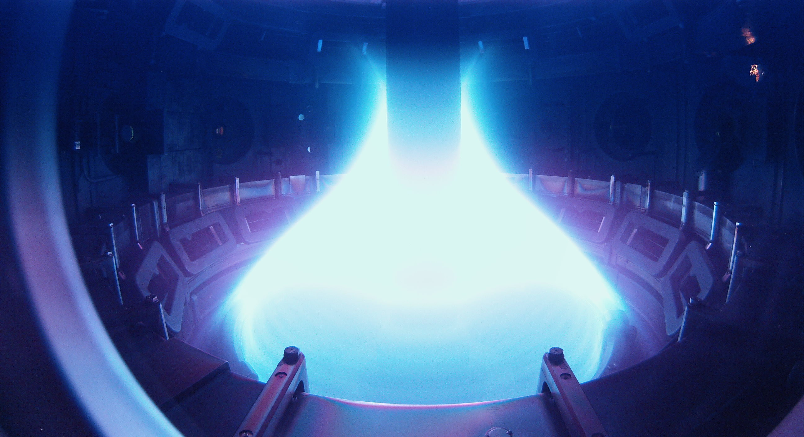
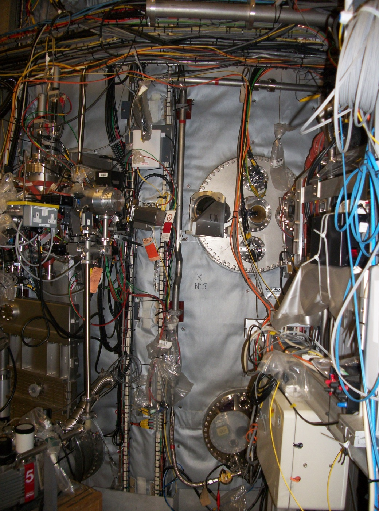
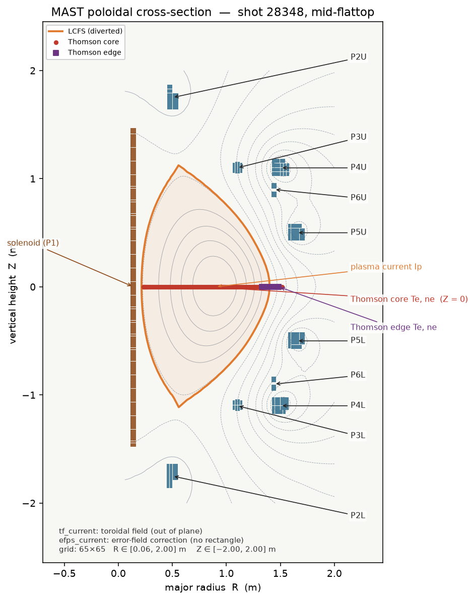
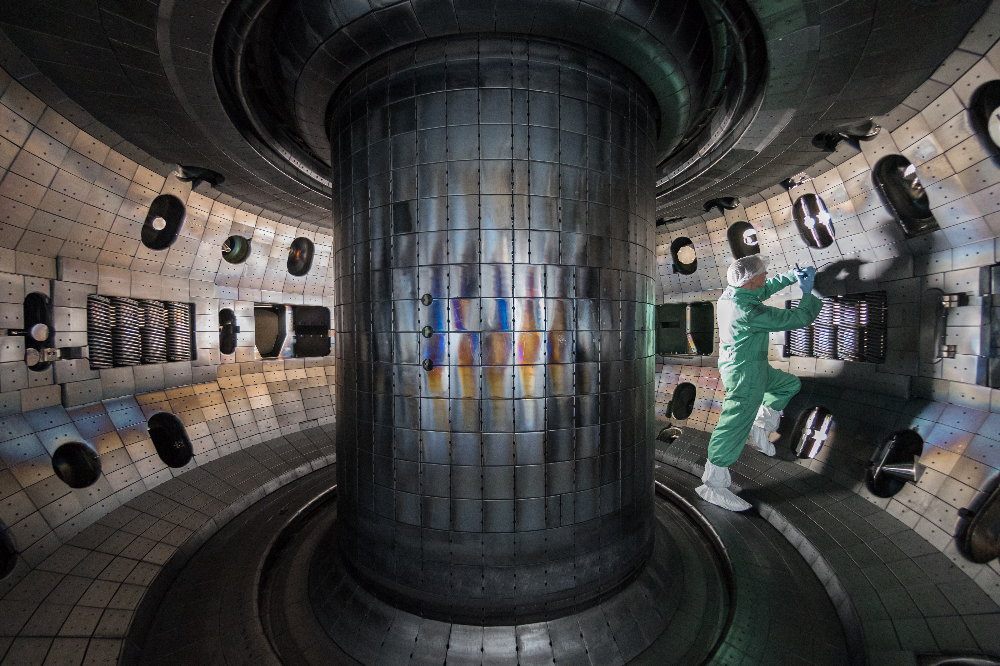
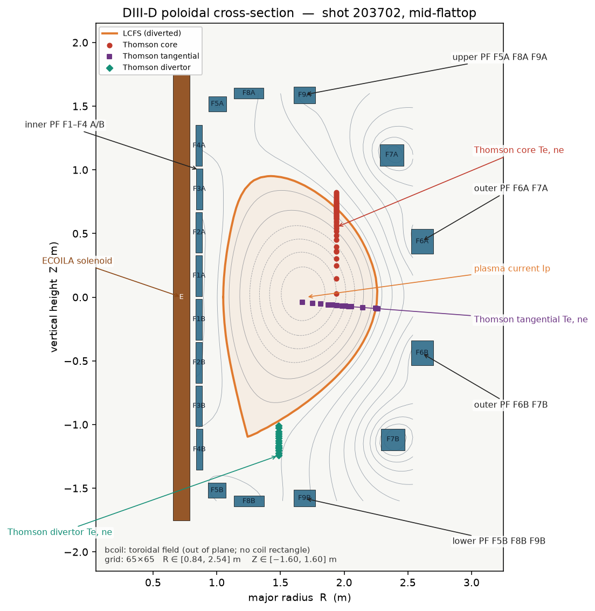

## Parquet data format

In the files, one shot is one **row** of a **Parquet** table. Parquet is a spreadsheet on disk where a cell can hold a whole list (or a list of lists) instead of one number. Column names are flat (`efit_times`, `thomson_core_Te`, …). Grouped by those prefixes, **both** machines use the same four families. Lengths in the tree are letters on purpose: the numbers are not the same on DIII-D and MAST, and they are not even the same from shot to shot.

```
shot/
├── source                         # which machine wrote this row
├── efit/                          # official reconstruction pictures
│   ├── times              (T,)    # when a picture was kept, ms
│   ├── grid_R, grid_Z     (65,)   # the (R,Z) graph paper (65 on both)
│   └── psirz       (T, 65, 65)    # flux movie — labelled rows only
├── magnetics/                     # currents in the coils, and in the soup
│   ├── time           (T_mag,)    # the coils' own clock, ms
│   ├── plasma_current     (…)     # how much current the soup carries
│   └── <one series per coil>      # names differ by machine
├── thomson/                       # laser that tastes the soup
│   ├── chord_name, R, Z   (N,)    # one viewing line per chord, not N lasers
│   ├── core/
│   │   ├── times      (T_core,)
│   │   └── Te, ne  (T_core, N_core)
│   └── edge/
│       ├── times      (T_edge,)
│       └── Te, ne  (T_edge, N_edge)
└── coil/                          # where the metal loops sit (shot-constant)
    ├── name, input_column  (C,)
    └── R, Z, width, height (C,)
```

**What is Thomson?** A laser flashlight. The beam bounces off the free electrons in the soup. How *wide* the bounce is says how hot those electrons are — that is $T_e$ (electron temperature). How *bright* the bounce is says how many electrons are there — that is $n_e$ (electron density). It is the same *kind* of gadget on both machines, not one laser shared by both. Each watching line is a **chord**. Core and edge are two parquet blocks, each with its own when-list. How many beams, and which way they point, is **per machine**.

How many coils $C$, how many chords $N$, the names of the coil-current columns, and extra label columns on the EFIT clock are **per machine**. They live in the DIII-D and MAST data sections below. Missing floating-point samples are `NaN`, never a Parquet null.

## MAST Data

## MAST Introduction

MAST (Mega Ampère Spherical Tokamak, Culham) is a tight-aspect-ratio machine: $R_0\simeq 0.9\,\mathrm{m}$, $a\simeq 0.6\,\mathrm{m}$, $B_\varphi\simeq 0.55\,\mathrm{T}$, $I_p\lesssim 1.3\,\mathrm{MA}$. There is **no** `mast_train`. Challenge 2 is zero-shot from DIII-D. Photographs below are the vessel and a diverted plasma; the cross-section is official FAIR geometry on demo shot 28348.



*MAST plasma in the vessel. Photograph by Eye Steel Film, [Wikimedia Commons](https://commons.wikimedia.org/wiki/File:MAST_Tokamak_(32476489303).jpg), CC BY 2.0.*



*MAST device, side view. [Wikimedia Commons](https://commons.wikimedia.org/wiki/File:MAST_side_view_(4888655683).jpg).*



*MAST $(R,Z)$ plane. Brown bar: 656-turn solenoid `magnetics_sol_current`. Blue tiles: P2–P6 upper/lower conductor elements (812 rows total). Red points: core Thomson on the midplane ($Z=0$). Purple squares: edge Thomson, still $Z=0$, at larger $R$. `tf_current` and `efps_current` have no poloidal rectangle. Flux sign is opposite to DIII-D: the axis is a **maximum** of $\psi$.*

## MAST Coordinates and clocks

- **`efit_times`** $(T,)$, ms. $T\in[5,98]$ on public test. Diverted-only, not contiguous.
- **`efit_grid_R`**, **`efit_grid_Z`** $(65,)$, m. $R\in[0.06,2.00]$, $Z\in[-2.00,2.00]$. Upstream EFIT stored $\psi$ on a 129-column $R$ grid with 64 empty interleaved columns; those empties are dropped. The axis convention is opposite to DIII-D: $\psi_{\mathrm{axis}}>\psi_{\mathrm{boundary}}$ on every frame. Median peak-to-peak is $\sim 0.21\,\mathrm{Wb/rad}$ against DIII-D’s $\sim 0.61$. The scorer flips a global sign; the amplitude factor is yours.
- **`magnetics_time`** $(T_{\mathrm{mag}},)$. Two populations: $1092$ shots at uniform $5\,\mathrm{kHz}$, $T_{\mathrm{mag}}=30000$; $114$ early-campaign shots at $T_{\mathrm{mag}}=15482$, the **union** of a $5\,\mathrm{kHz}$ poloidal grid and a $1\,\mathrm{kHz}$ toroidal-field grid. On those 114 shots each column is `NaN` on the samples that belong to the other grid. Interpolate per column; do not assume a dense shared rate.
- MAST $I_p$ shares `magnetics_time` (no separate ADC).

The vacuum Green function and Grad–Shafranov operator are the shared recipe in the [Grad–Shafranov equation section](tokamak-theory.md#the-gradshafranov-equation). Geometry granularity is not: MAST ships **$C=812$** conductor elements from FAIR `pf_active`. A coil’s turn count is the number of rows that share its `coil_input_column`. Currents are already kA·turn for the P-coils, so each element carries $I/n_{\mathrm{share}}$ in the Green sum. `sol_current` is the exception (plain kA): the 656 solenoid rows *are* the turns, and ampere-turns are $I\cdot n_{\mathrm{share}}$.

## MAST Solenoid

- **`magnetics_sol_current`** $(T_{\mathrm{mag}},)$, kA. Central solenoid (P1), $R\in[0.119,0.157]\,\mathrm{m}$, $Z\in[-1.471,1.459]\,\mathrm{m}$, 656 elements. Same physical role as `ECOILA`: $V_\ell=-d\Phi_{\mathrm{OH}}/dt$.

## MAST Poloidal coils

`magnetics_p{2–6}{l,u}_current` $(T_{\mathrm{mag}},)$, kA·turn. Per-coil in-window peaks run from $\sim 3$ (`p3`, `p6`) to $\sim 185$ (`p2`); extremes $\sim\pm 600$.

| Column | Elements | $R$ (m) | $Z$ (m) | Role |
|---|---:|---|---|---|
| `p2u` / `p2l` | 20 / 20 | $0.46$–$0.54$ | $\pm(1.66$–$1.85)$ | inner divertor / strike-point |
| `p3u` / `p3l` | 8 / 8 | $1.07$–$1.14$ | $\pm(1.07$–$1.13)$ | shaping |
| `p4u` / `p4l` | 23 / 23 | $1.43$–$1.57$ | $\pm(1.04$–$1.17)$ | equilibrium / shaping |
| `p5u` / `p5l` | 23 / 23 | $1.59$–$1.72$ | $\pm(0.44$–$0.56)$ | outer midplane shaping |
| `p6u` / `p6l` | 4 / 4 | $1.43$–$1.45$ | $\pm(0.86$–$0.93)$ | vertical stability |

## MAST Toroidal field and error-field correction

- **`magnetics_tf_current`** $(T_{\mathrm{mag}},)$, kA. Toroidal-field coil current. No `coil_*` row. $N_{\mathrm{TF}}=24$ (12 limbs $\times$ 2). Vacuum $F_b=\mu_0 N_{\mathrm{TF}}I_{\mathrm{TF}}/(2\pi)$ with $I_{\mathrm{TF}}$ in A, and $B_\varphi=F_b/R$ ($\sim 0.48\,\mathrm{T}$ at $R_0=0.85\,\mathrm{m}$ for $85\,\mathrm{kA}$). Same structure as DIII-D `bcoil`, different engineering scale ($\sim 0.55\,\mathrm{T}$ vs $\sim 2\,\mathrm{T}$).
- **`magnetics_efps_current`** $(T_{\mathrm{mag}},)$, kA. Error-field correction. Not a poloidal-plane rectangle; unused in $\Psi_{\mathrm{vac}}$.

## MAST Plasma current

- **`magnetics_plasma_current`** $(T_{\mathrm{mag}},)$, kA. Same Ampère integral as on DIII-D. Interpolate with `magnetics_time`.

## MAST Coil geometry

$C=812$; all angles $0$ — IMAS rectangles, no skew.

Same column names as DIII-D. Join with `coil_input_column`. P2 $=20$ elements, P3 $=8$, P4 $=23$, P5 $=23$, P6 $=4$, solenoid $=656$.

## MAST Thomson scattering

Same incoherent-TS physics as DIII-D. The laser is a **horizontal midplane** beam: **`thomson_chord_Z` $=0$** by construction. FAIR level-2 exposes only `thomson_scattering.channel[:].position.r`.

- **`thomson_core_times`**, **`thomson_core_Te`**, **`thomson_core_ne`**, **`thomson_core_R`**. Core channels along $R\in[0.23,1.52]\,\mathrm{m}$ at $Z=0$ (130 channels on the demo shot).
- **`thomson_edge_times`**, **`thomson_edge_Te`**, **`thomson_edge_ne`**, **`thomson_edge_spatial`**. Edge block is $R$ (typically $1.3$–$1.5\,\mathrm{m}$), 16 channels on the demo shot.
- **`thomson_chord_name`**, **`thomson_chord_R`**, **`thomson_chord_Z`**.

## MAST Withheld on test

There is no MAST train config. `efit_psirz`, scalars, LCFS, and `magnetics_dsep` are absent from `mast_public_test`. The three labelled starter-kit rows are on [MAST parquet](#mast-parquet-data-format). MAST `magnetics_dsep` is **not** DIII-D `DSEP`: it is `esm/dr_sep_out`, upper/lower divertor balance $\delta R_{\mathrm{sep}}$. Its sign is not a diverted/limited flag.

## MAST Parquet Data Format

The [general Parquet layout](#parquet-data-format) is the same four families on both machines. This section details what is MAST-only about the files.

There is **no** `mast_train`. Challenge 2 is zero-shot. The released Hugging Face config is one split:

| Config | Split | Shots | Contents |
|---|---|---:|---|
| `mast_public_test` | `public_test` | 1,206 | Inputs only. Every EFIT-derived column is omitted, not null-filled. |

That is the public-test fleet you predict on. Magnetics clocks on those 1,206 rows: 1,092 shots at uniform $5\,\mathrm{kHz}$ ($T_{\mathrm{mag}}=30000$); 114 early-campaign shots at $T_{\mathrm{mag}}=15482$ (union of a $5\,\mathrm{kHz}$ poloidal grid and a $1\,\mathrm{kHz}$ toroidal-field grid). Details on [coordinates and clocks](#mast-coordinates-and-clocks). Coil-current column names, $C=812$, and Thomson layout are detailed in the other MAST subsections.

**Three held-out labelled shots** sit in the starter kit, not in `mast_public_test`:

| File | Shot |
|---|---|
| `parquet_data/mast_shot_28348.parquet` | 28348 |
| `parquet_data/mast_shot_28350.parquet` | 28350 |
| `parquet_data/mast_shot_28351.parquet` | 28351 |

These three rows carry `efit_psirz` and the MAST-only aux EFIT scalars (`efit_beta_p`, `efit_elongation`, `efit_psi_axis`, `efit_psi_boundary`, `efit_geom_axis_r/z`) that the public-test config does not ship. Together they have **115 flattop frames** with a closed surface. They are a smell-test / format check, not a train split and not a substitute for the 1,206-shot public fold.

## DIII-D Data

## DIII-D Introduction

DIII-D is a conventional-aspect-ratio tokamak at General Atomics (San Diego): typical major radius $R_0\simeq 1.67\,\mathrm{m}$, minor radius $a\simeq 0.67\,\mathrm{m}$, vacuum $B_\varphi\lesssim 2.2\,\mathrm{T}$, plasma current $I_p\lesssim 2\,\mathrm{MA}$. The photograph is the vacuum vessel during a 2017 maintenance opening.



*DIII-D vacuum vessel, 2017. Photograph by Rswilcox, [Wikimedia Commons](https://commons.wikimedia.org/wiki/File:2017_TOCAMAC_Fusion_Chamber_N0689.jpg), CC BY-SA 4.0.*

The poloidal cross-section is drawn from the official coil rectangles and Thomson chords on demo shot 203702, with EFIT $\psi$ contours and the diverted LCFS. Pointers mark every input family in the parquet.



*DIII-D $(R,Z)$ plane. Brown bar: ohmic solenoid `ECOILA`. Blue rectangles: shaping coils `F1A`–`F9B` (A upper, B lower). Orange contour: LCFS. Red points: core Thomson (vertical laser at $R\simeq 1.94\,\mathrm{m}$). Purple squares: tangential Thomson (near-constant $Z$). Green diamonds: divertor Thomson. `bcoil` has no poloidal rectangle — it is the out-of-plane toroidal field.*

## DIII-D Coordinates and clocks

- **`efit_times`** $(T,)$, ms. The prediction clock. $T\in[3,444]$ on public test (train median $T=241$). All actuators and Thomson are interpolated to these instants. The series is not contiguous: limited frames were removed.
- **`efit_grid_R`**, **`efit_grid_Z`** $(65,)$, m. Physical axes of the flux map. DIII-D box $R\in[0.84,2.54]$, $Z\in[-1.60,1.60]$. The discrete $\Delta^*$ and every Green function are evaluated on this mesh.
- **`magnetics_time`** $(T_{\mathrm{mag}},)$, ms. Shared coil-current clock. Two populations: $\sim 20\,\mathrm{kHz}$ ($T_{\mathrm{mag}}=480256$, $dt\simeq 0.050\,\mathrm{ms}$) on $\sim 70\%$ of shots, and $2\,\mathrm{kHz}$ ($T_{\mathrm{mag}}\in\{49152,50176\}$, $dt=0.5\,\mathrm{ms}$) on the rest. Do not hard-code a length. The record typically spans $-9.4$ to $+20.1\,\mathrm{s}$; only about $20\%$ of samples fall inside the EFIT window.
- **`magnetics_plasma_current_times`** $(T_{I_p},)$, ms. DIII-D $I_p$ sits on its own ADC. Interpolate $I_p$ with this clock, not with `magnetics_time`.

The vacuum Green function and Grad–Shafranov operator are the shared recipe in the [Grad–Shafranov equation section](tokamak-theory.md#the-gradshafranov-equation). DIII-D ships **$C=19$** lumped rectangles. `bcoil` has no rectangle and is omitted from $\Psi_{\mathrm{vac}}$.

## DIII-D Solenoid

- **`magnetics_ECOILA`** $(T_{\mathrm{mag}},)$, kA (not kA·turn). Current in the E-coil, the central solenoid at $R\simeq 0.723\,\mathrm{m}$, $Z=0$, height spanning the inner column. Faraday’s law: a changing solenoid flux $\Phi_{\mathrm{OH}}=\int B_Z\,dA$ induces the loop voltage $V_\ell=-d\Phi_{\mathrm{OH}}/dt$ that drives $I_p$ ohmically. EFIT’s machine file models the same group as 48 single-turn elements over $R\in[0.6875,0.7625]\,\mathrm{m}$, $Z\in[-1.7255,1.7255]\,\mathrm{m}$; the shipped row is one lumped rectangle of that envelope. `ECOILB` is a co-located group that is **not** shipped. Do not apply an ampere-turn multiplier.

## DIII-D Poloidal coils

Eighteen F-coils, `magnetics_F{1–9}{A,B}` $(T_{\mathrm{mag}},)$, kA·turn (turns already folded in: 58 or 55). A = upper, B = lower. In-window peaks are typically within $\pm 200$; extremes reach $\sim\pm 580$. Centres from the shipped geometry:

| Column | $R$ (m) | $Z$ (m) | Role |
|---|---:|---:|---|
| `F1A` / `F1B` | 0.861 | $+0.168$ / $-0.174$ | inner PF, near midplane |
| `F2A` / `F2B` | 0.861 | $+0.508$ / $-0.513$ | inner PF |
| `F3A` / `F3B` | 0.863 / 0.861 | $+0.849$ / $-0.854$ | inner PF |
| `F4A` / `F4B` | 0.861 / 0.863 | $+1.190$ / $-1.196$ | inner PF, toward divertor |
| `F5A` / `F5B` | 1.004 / 1.002 | $\pm 1.517$ | inner-upper / inner-lower corner; parallelogram, $\mathrm{AF}=\pm 45^\circ$ |
| `F6A` / `F6B` | 2.612 | $\pm 0.438$ | outer midplane; parallelogram, $\mathrm{AF}=\pm 92.4^\circ$ |
| `F7A` / `F7B` | 2.373 / 2.383 | $\pm 1.117$ | outer off-midplane; parallelogram, $\mathrm{AF}=\pm 108.06^\circ$ |
| `F8A` / `F8B` | 1.252 | $\pm 1.60$ | top / bottom |
| `F9A` / `F9B` | 1.689 | $+1.587$ / $-1.578$ | top / bottom, near $R_0$ |

`coil_angle1` / `coil_angle2` are EFIT’s `AF` / `AF2` shear angles in degrees. Both zero means an axis-aligned rectangle $(R\pm w/2,\,Z\pm h/2)$; EFIT treats $90^\circ$ as $0$. Non-zero angles shear the rectangle into a parallelogram. The vacuum $\psi$ of the set is linear in the currents: $\Psi_{\mathrm{vac}}=\sum_k (NI)_k\,G_k(R,Z)$.

## DIII-D Toroidal field

- **`magnetics_bcoil`** $(T_{\mathrm{mag}},)$, kA. Current in the toroidal-field (B) coils. These wrap the torus poloidally and have **no** `coil_*` rectangle. In vacuum,

$$
B_\varphi^{\mathrm{vac}}(R)=\frac{\mu_0 I_{\mathrm{TF}}}{2\pi R}=\frac{F_{\mathrm{vac}}}{R},
$$

so `bcoil` sets the vacuum $F$ (and therefore the vacuum $q$-scale). Inside the plasma $F=F(\psi)$ is a flux function fixed by Grad–Shafranov, not by this number alone.

## DIII-D Plasma current

- **`magnetics_plasma_current`** $(T_{I_p},)$, kA. Total toroidal current

$$
I_p=\int_\Omega j_\varphi\,dR\,dZ=\frac{1}{\mu_0}\oint_{\mathrm{LCFS}} B_p\,d\ell,
\qquad
B_p=\frac{\lvert\nabla\psi\rvert}{R}.
$$

This is the one current that is dimensionally the same on both machines. It is **not** mixed into $\Psi_{\mathrm{vac}}$; it is the global Ampère constraint on the plasma’s own $j_\varphi$. Interpolate with `magnetics_plasma_current_times`, not `magnetics_time`.

## DIII-D Coil geometry

Shot-constant; $C=19$ lumped rectangles: 18 F-coils + `ECOILA`.

- **`coil_name`**, **`coil_input_column`** $(C,)$ — join key from a rectangle to its current column.
- **`coil_R`**, **`coil_Z`**, **`coil_width`**, **`coil_height`** $(C,)$, m — centre and extents.
- **`coil_angle1`**, **`coil_angle2`** $(C,)$, degrees — parallelogram skew; $0$ means a rectangle.

## DIII-D Thomson scattering

A laser photon of wavelength $\lambda_i$ scatters off a free electron (classical Thomson cross-section $\sigma_T=\tfrac{8\pi}{3}r_e^2$, $r_e=e^2/(4\pi\varepsilon_0 m_e c^2)$). In the incoherent Maxwellian limit the scattered spectrum is Gaussian with width

$$
\frac{\Delta\lambda}{\lambda_i}
\simeq
\frac{2}{c}\sin\!\Bigl(\frac{\theta}{2}\Bigr)\sqrt{\frac{2k_B T_e}{m_e}}.
$$

Absolute intensity gives $n_e$; the width (and the detailed form factor) gives $T_e$. Electron pressure is $p_e=n_e k_B T_e$. The Grad–Shafranov pressure is the total $p(\psi)\simeq n_e T_e+n_i T_i+\cdots$; ions are not in this dataset, so Thomson constrains $p'$ only up to that unknown ion piece.

- **`thomson_core_times`** $(T_{\mathrm{th}}^{\mathrm{core}},)$, ms; **`thomson_core_Te`**, **`thomson_core_ne`** $(T_{\mathrm{th}}^{\mathrm{core}},N_{\mathrm{ch}})$. $T_e$ in eV, $n_e$ in m$^{-3}$. Core system is a **vertical** laser: **`thomson_core_R`** is essentially constant $\approx 1.94\,\mathrm{m}$; the informative coordinate is $Z$, carried on **`thomson_chord_Z`** for `TS_core_*`.
- **`thomson_edge_times`**, **`thomson_edge_Te`**, **`thomson_edge_ne`**. The parquet “edge” block is the **tangential** system: **`thomson_edge_spatial`** is $Z$, nearly constant $\in[-0.09,-0.04]\,\mathrm{m}$; the informative coordinate is $R$.
- **`thomson_chord_name`**, **`thomson_chord_R`**, **`thomson_chord_Z`** $(N,)$, $N\in[59,138]$. IMAS-style names `TS_core_*`, `TS_tangential_*`, `TS_divertor_*`. Positions vary by shot (22 layouts in train) because the divertor system was reconfigured. Do not cache one shot’s chords.

## DIII-D Withheld on test

Present in `diii_d_train` only: `efit_psirz` $(T,65,65)$; `efit_q95`, `efit_beta_n`, `efit_li`, `efit_r_axis`, `efit_z_axis`; `efit_lcfs_*`; `magnetics_dsep` (EFIT a-file `DSEP`, separatrix–limiter clearance; $>0$ on every shipped frame). Those are labels, not inputs. The three starter-kit demo rows are on [DIII-D Parquet Data Format](#diii-d-parquet-data-format).

## DIII-D Parquet Data Format

The [general Parquet layout](#parquet-data-format) is the same four families on both machines. This section details what is DIII-D-only about the files. Column names, clocks, and geometry are detailed in the other DIII-D subsections.

| Config | Split | Shots | Contents |
|---|---|---:|---|
| `diii_d_train` | `train` | 7,041 | Full. `efit_psirz` and the EFIT scalars are present. |
| `diii_d_public_test` | `public_test` | 874 | Inputs only. Every EFIT-derived column is omitted, not null-filled. |

Starter-kit examples of the train schema (not a holdout fold):

| File | Shot |
|---|---|
| `parquet_data/d3d_shot_203702.parquet` | 203702 |
| `parquet_data/d3d_shot_203703.parquet` | 203703 |
| `parquet_data/d3d_shot_203704.parquet` | 203704 |
