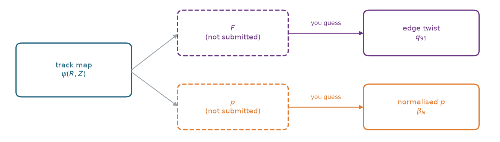
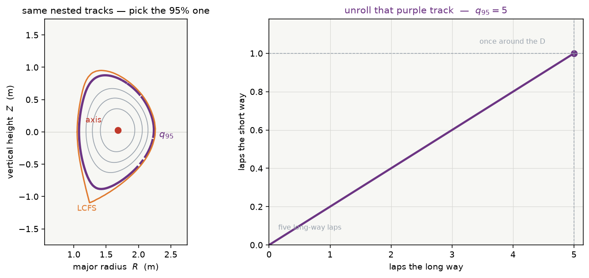
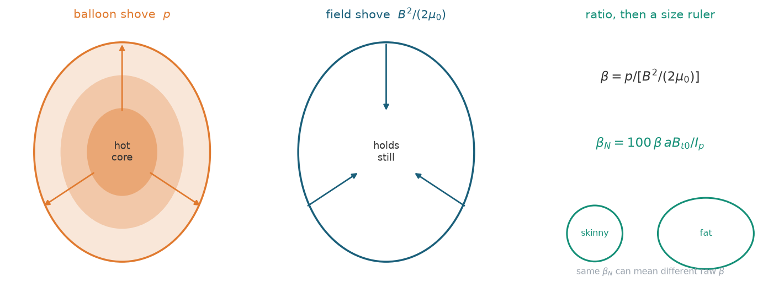

## Scoring

You send **three arrays per shot**. The scorer holds hidden EFIT truth and does all the comparisons.

### Notation

| Symbol | What | Shape |
|---|---|---|
| $i$ | one shot (one row of the scored `.npz`) | |
| $t$ | one frame on that shot’s `efit_times` | $t=0,\ldots,T_i-1$ |
| $\psi_{i,t}$ | one flux map | $(65,65)$ |
| $\psi_i$ | one shot (`shot_XXXX_psirz`) | $(T_i,65,65)$ |
| $\Psi$ | the scored file: every $\psi_{i,t}$ on that machine | one `.npz` |
| $q_{i,t}$, $\beta_{i,t}$ | one frame’s $q_{95}$ and $\beta_N$ | scalars |
| $\mathbf{q}$, $\boldsymbol{\beta}$ | those scalars concatenated over $\Psi$ | vectors |
| $f_j(\psi_{i,t})$ | one Consistency number from one map | scalar |
| $\mathbf{f}_j$ | $f_j(\psi_{i,t})$ concatenated over $\Psi$ | vector |

Pred and EFIT copies get subscripts $\mathrm{pred}$ and $\mathrm{EFIT}$. A bold symbol is always the concatenation over the scored file, never one shot.

### What you send (pred)

| Output Key | Array Shape | Meaning | Physical Role |
|---|---|---|---|
| `shot_XXXX_psirz` | $(T_i, 65, 65)$ | $\psi_i$: predicted $\psi_{i,t}(R,Z)$ on the EFIT grid | Directly reconstructed 2D poloidal flux map. |
| `shot_XXXX_q95` | $(T_i,)$ | $q_{i,t}$: edge safety factor ($q_{95}$) | Needs $F(\psi)$ (field line pitch / twist). |
| `shot_XXXX_betaN` | $(T_i,)$ | $\beta_{i,t}$: normalized pressure ($\beta_N$) | Needs $p(\psi)$ (ratio of kinetic to magnetic pressure). |

**Why $q_{95}$ and $\beta_N$ must be supplied separately:**
1. You submit the track map $\psi(R, Z)$. From $\psi$, the evaluation pipeline determines the poloidal field $(B_R, B_Z)$ and the shape of the nested magnetic surfaces.
2. However, $\psi(R,Z)$ alone does **not** uniquely determine the toroidal field profile $F(\psi)$ or the kinetic pressure profile $p(\psi)$. Because the computer cannot extract $F$ and $p$ from your map alone, you must explicitly submit two summary numbers that capture those missing degrees of freedom:

### $R^2$ methodology

Same $R^2$ everywhere (negatives clipped at 0). $a$ and $b$ are vectors of the same length:

$$R^2(a,b)=1-\frac{\lVert a-b\rVert_2^2}{\lVert b-\bar b\rVert_2^2}$$

NaN in a pair: **EFIT NaN** drops that sample; **pred NaN, EFIT finite** replaces pred by the mean of the EFIT vector (same residual as guessing the average). Same rule as Consistency.

### $\psi$ — pred maps to EFIT maps

If the maps are sign-flipped, the scorer flips **all of** $\Psi_{\mathrm{pred}}$ once (every $i$, every $t$; the orientation that matches $\Psi_{\mathrm{EFIT}}$ better).

$R^2_\psi$ treats $\Psi_{\mathrm{pred}}$ and $\Psi_{\mathrm{EFIT}}$ as one long vector of pixels (every cell of every $\psi_{i,t}$):

$$R^2_\psi = R^2(\Psi_{\mathrm{pred}},\,\Psi_{\mathrm{EFIT}})$$

### $q_{95}$ — pred curve to EFIT curve

As magnetic field lines wrap around the torus, they trace out a spiral. The safety factor $q$ counts how many times a field line wraps the *long way* around the doughnut before completing *one* loop the short way.

$q_{95}$ is this twist number measured on the magnetic track enclosing 95% of the normalized poloidal flux from the magnetic axis out to the last closed flux surface (LCFS):

$$q(\psi) = \frac{F(\psi)}{2\pi}\oint_{\psi=\text{const}}\frac{d\ell}{R\,\lvert\nabla\psi\rvert}$$

The loop integral $W=\oint\mathrm{d}\ell/(R\,\lvert\nabla\psi\rvert)$ is a geometric scalar read off that contour. Large $W$ reflects a long path or a weak poloidal field. $F$ is $R B_\varphi$ on the same track. While the loop geometry comes from $\psi$, $F(\psi)$ must be supplied by the model.

$$R^2_{q_{95}} = R^2(\mathbf{q}_{\mathrm{pred}},\,\mathbf{q}_{\mathrm{EFIT}})$$

### $\beta_N$ — pred curve to EFIT curve

Plasma pushes outward with kinetic pressure $p$; the magnetic field pushes inward with magnetic pressure $B^2 / (2\mu_0)$. Their ratio is $\beta$ ("beta").

Normalized beta ($\beta_N$) rescales toroidal beta $\beta_t$ by plasma minor radius $a$, vacuum toroidal field $B_{t0}$, and total plasma current $I_p$ (in MA) so machines of different dimensions and operational regimes can be compared on a unified scale:

$$\beta_t = \frac{2\mu_0\langle p\rangle_V}{B_{t0}^2}, \qquad \beta_N = 100\,\beta_t\,\frac{a\,B_{t0}}{I_p[\mathrm{MA}]}$$

Because $\beta_N$ depends on the internal pressure profile $p(\psi)$, it cannot be derived from $\psi$ alone and is evaluated as an explicit deliverable:

$$R^2_{\beta_N} = R^2(\boldsymbol{\beta}_{\mathrm{pred}},\,\boldsymbol{\beta}_{\mathrm{EFIT}})$$

### $R^2_{\{q_{95},\beta_N\}}$ — average $R^2$

$$R^2_{\{q_{95},\beta_N\}} = \tfrac12\bigl(R^2_{q_{95}} + R^2_{\beta_N}\bigr)$$

### LCFS

Per frame, the scorer traces a last-closed contour on $\psi_{i,t}^{\mathrm{pred}}$ and the same way on $\psi_{i,t}^{\mathrm{EFIT}}$, then compares those two outlines (512 arc-length points). Hausdorff gap $d_H$. $R_{\mathrm{geo}}=(R_{\max}+R_{\min})/2$ of the **EFIT** outline. Then $D_{i,t}=\min\bigl(1,\,d_H/R_{\mathrm{geo}}\bigr)$ (0 = match). Pred miss or open: $D_{i,t}=1$. EFIT miss or open: that frame is dropped from the mean. $D_{\mathrm{LCFS}}$ is the mean of the remaining $D_{i,t}$ over $\Psi$, then clipped to $[0,1]$. The term in $S$ is $1-D_{\mathrm{LCFS}}$.

### Consistency

#### Goal of Consistency

The scorer runs an extractor on each $\psi_{i,t}^{\mathrm{pred}}$ and each $\psi_{i,t}^{\mathrm{EFIT}}$ to obtain seven numbers $f_j(\psi_{i,t})$. Stacked over $\Psi$ those are the vectors $\mathbf{f}_j^{\mathrm{pred}}$ and $\mathbf{f}_j^{\mathrm{EFIT}}$. A perfect $\Psi$ scores 1 by construction.

Consistency is “does your last-closed D have the right height, pinch, volume, centre, and current-weighted $B_p$?” In other words, edge geometry plus $\ell_i$.

Consistency is not a smoother of the flux residual. $R^2_\psi$ is a pixel sum. One cell (50 mm on DIII-D) at the X-point barely moves it. The same cell **does** move the LCFS tip, so $\kappa$ and both triangularities jump by a grid row. Those discrete tip jumps carry most of the $\kappa$ residual; $\kappa$ and $\ell_i$ are the two Consistency scalars that still lose after $R^2_\psi$ is already $\sim 0.999$. Volume and axis are usually easier once the contour is closed in the right place.

#### The seven $f_j(\psi_{i,t})$

Let $C=\{(R_k,Z_k)\}$ be the LCFS of that one map. $R_{\max}=\max R_k$, $R_{\min}=\min R_k$, same for $Z$. $a=(R_{\max}-R_{\min})/2$, $R_{\mathrm{geo}}=(R_{\max}+R_{\min})/2$. $B_p=\lvert\nabla\psi_{i,t}\rvert/R$. $\Omega$ is the interior of $C$.

| $j$ | $f_j$ | Goal | From | Formula |
|---|---|---|---|---|
| 1 | $R_{\mathrm{axis}}$ | centre | O-point | $R$ of that sub-pixel max |
| 2 | $Z_{\mathrm{axis}}$ | centre | O-point | $Z$ of that max |
| 3 | $\kappa$ | height | box of $C$ | $(Z_{\max}-Z_{\min})/(R_{\max}-R_{\min})$ |
| 4 | $\delta_{\mathrm{top}}$ | pinch | top tip of $C$ | $(R_{\mathrm{geo}}-R\vert_{Z_{\max}})/a$ |
| 5 | $\delta_{\mathrm{bot}}$ | pinch | bottom tip of $C$ | $(R_{\mathrm{geo}}-R\vert_{Z_{\min}})/a$ |
| 6 | $V$ | volume | Pappus on $C$ | $2\pi\bigl\lvert\tfrac16\sum_k(R_k+R_{k+1})(R_k Z_{k+1}-R_{k+1}Z_k)\bigr\rvert$ |
| 7 | $\ell_i$ | current-weighted $B_p$ | field inside $C$ | $\langle B_p^2\rangle_\Omega\big/\bigl(\tfrac1{\ell_p}\oint_C B_p\,\mathrm{d}\ell\bigr)^2$ |

$\ell_i$ is current peaked vs spread. Numerator is volume-weighted $B_p^2$ inside the plasma. Denominator is (Ampère $\mu_0 I_p$ from the loop of $B_p$ around $C$, divided by the poloidal perimeter)$^2$. Constants cancel in the $R^2$. It is the only one that uses the **inside** of the map, not just the outline.

Six of seven are invariant under $\psi_{i,t}\to-\psi_{i,t}$. Axis is the exception; the scorer uses the same sign it chose for all of $\Psi$.

#### Calculation of $f_j(\psi_{i,t})$

These four steps run **per frame**, independently on $\psi_{i,t}^{\mathrm{pred}}$ and on $\psi_{i,t}^{\mathrm{EFIT}}$. Each frame yields seven scalars.

1. Choose one sign $s$ for all of $\Psi$ so the axis is a **maximum** of $\phi=s\psi_{i,t}$.
2. Find the **O-point**: strongest interior local max of $\phi$ (not on the rim), then a 1-D parabola in $R$ and in $Z$ (mm-level).
3. Find the **LCFS**: last closed contour that still encloses that axis and stays in the envelope. Bisect the flux level (22 steps), resample to 512 arc-length points. Same polygon as the $D_{i,t}$ outline.
4. Read seven numbers off that axis + polygon + $\lvert\nabla\psi_{i,t}\rvert$.

#### How NaN is treated in $R^2_j$

Failed or implausible extractions become NaN. Ranges that count as failure: $\kappa\in[0.8,4]$, triangularity $\in[-1,1.5]$, $V\in[0,100]\,\mathrm{m}^{3}$, $\ell_i\in[0.1,5]$. A NaN does not poison $R^2_j$. Per scalar $j$, per frame $(i,t)$:

- **EFIT is NaN** — that frame is dropped from $\mathbf{f}_j$. The rest of $\Psi$ still scores.
- **pred is NaN, EFIT is finite** — pred is replaced by the mean of $\mathbf{f}_j^{\mathrm{EFIT}}$. The residual is $(\mathrm{gt}-\mathrm{mean})^2$, the same as guessing the average.
- **every frame fails for $j$** — that scalar is omitted from the seven-way mean, not scored as 0.

A missed LCFS on one $(i,t)$ typically NaNs $\kappa$, both pinches, $V$, and $\ell_i$ on that frame only (axis can still be finite). Other frames are untouched.

#### $R^2_j$ over the concatenated vector

One $R^2$ per $j$, on the vectors $\mathbf{f}_j^{\mathrm{pred}}$ and $\mathbf{f}_j^{\mathrm{EFIT}}$ (every remaining $(i,t)$ in $\Psi$), not a mean of per-shot $R^2$:

$$R^2_j = R^2(\mathbf{f}_j^{\mathrm{pred}},\,\mathbf{f}_j^{\mathrm{EFIT}})$$

#### Final consistency score

$$\mathrm{Consistency}=\operatorname{mean}_{j\ \mathrm{scored}}\max(0,R^2_j)$$

Then $0.20\times\mathrm{Consistency}$ in $S$. A scalar with no valid frames in $\Psi$ is dropped from that mean, not scored as 0. If every $j$ is dropped, Consistency is 0.

### Total score $S$

$$
S = 0.55\,R^2_\psi + 0.15\,R^2_{\{q_{95},\beta_N\}} + 0.10\,(1-D_{\mathrm{LCFS}}) + 0.20\,\mathrm{Consistency}
$$

Each $R^2$ in this mix is clipped with $\max(0,\cdot)$. $D_{\mathrm{LCFS}}$ is clipped to $[0,1]$.

So 85 percent of $S$ is “how good is your $\Psi$” (maps + outlines + geometry read from the maps). The other 15 percent is the two model scalars you must name because a map does not contain $F$ or $p$.

### Restriction to one shot or one frame

The definitions above stay the same. The concatenation shrinks.

| Term | Scored file $\Psi$ | One shot $i$ | One frame $t$ |
|---|---|---|---|
| Sign $s$ | one flip of every map in $\Psi$ | that same $s$ | that same $s$ |
| $R^2_\psi$ | all pixels in $\Psi$ | all pixels of $\psi_i$ | all pixels of $\psi_{i,t}$ |
| $R^2_{q_{95}}$, $R^2_{\beta_N}$ | $\mathbf{q}$, $\boldsymbol{\beta}$ | the $(T_i,)$ piece | not an $R^2$ (one number). Residual $q_{i,t}^{\mathrm{pred}}-q_{i,t}^{\mathrm{EFIT}}$, same for $\beta_N$ |
| $R^2_{\{q_{95},\beta_N\}}$ | $\tfrac12$ of those two | $\tfrac12$ of the two shot $R^2$ | not defined |
| $D_{i,t}$ | — | — | $d_H/R_{\mathrm{geo}}$ as above |
| $D_{\mathrm{LCFS}}$ | mean of $D_{i,t}$ over $\Psi$ | mean of $D_{i,t}$ on shot $i$ | $D_{i,t}$ |
| $R^2_j$ | $\mathbf{f}_j$ over $\Psi$ | $\mathbf{f}_j$ on shot $i$ | not an $R^2$. The seven $f_j(\psi_{i,t})$ |
| Consistency | mean of scored $R^2_j$ on $\Psi$ | mean of scored $R^2_j$ on shot $i$ | not defined |
| $S$ | the mix on $\Psi$ | the mix on that shot’s terms | not defined |

A local $S$ on one shot is the same four-term mix, using that shot’s column. It is not the leaderboard $S$.
