## Tokamak Theory and Equilibrium Physics

### Shape of a tokamak

This competition uses two machines, DIII-D and MAST. Both are **tokamaks**.

A tokamak is a doughnut that looks the same at every angle around the ring (**axisymmetric**). The metal vessel is a hollow ring; the hole in the middle is real, with a thick central column through it. The fuel is a hot ionized gas — a **plasma** — that forms a glowing loop *inside* the doughnut and is not meant to touch the walls.

The reason it can stay off the walls is magnetic. Charged particles will not cross field lines easily, so the machine wraps two kinds of field around the plasma at once. One set of coils goes the short way around the doughnut and makes a field the long way (the **toroidal** field — the blue arrow in the figure). A current driven through the plasma itself, plus other coils, makes a field the short way (the **poloidal** field — the green arrows). Together they twist into a gentle helix (purple): a helical orbit around the doughnut, not a little circle in the poloidal cut. The plasma is trapped on those twisted rails.

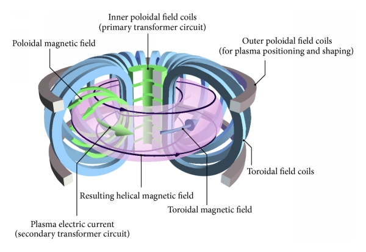

*Tokamak chamber and magnetic profile. Toroidal field in blue, poloidal field in green, helical total field in purple. R. A. Pitts, R. J. Buttery, and S. D. Pinches, Wikimedia Commons, [CC BY 4.0](https://commons.wikimedia.org/wiki/File:Schematic-of-a-tokamak-chamber-and-magnetic-profile.jpg).*

Cut the doughnut vertically, as if slicing a bagel, and you see a **D-shaped** (or almost circular) cross-section: that is the view the rest of this data section uses. The plasma sits in that D. Coils sit around it — a solenoid in the hole of the doughnut, shaping coils above, below, and outside.

The two competition machines differ in how fat the doughnut is. **DIII-D** is a conventional tokamak: a fairly large hole relative to the plasma, so the D sits well out from the centre column. **MAST** is a spherical tokamak: a much smaller hole, so the plasma is almost a cored apple. Same axisymmetric ring, different aspect ratio.

## Basic electromagnetic quantities

These units are used on every later figure. A few starting stocks cannot be rewritten as something else: an electron’s charge, a duration, a length, and a mass (green boxes). Everything else in this section is a recipe that combines those. A volt is the example that can be written four ways; they are the same unit.

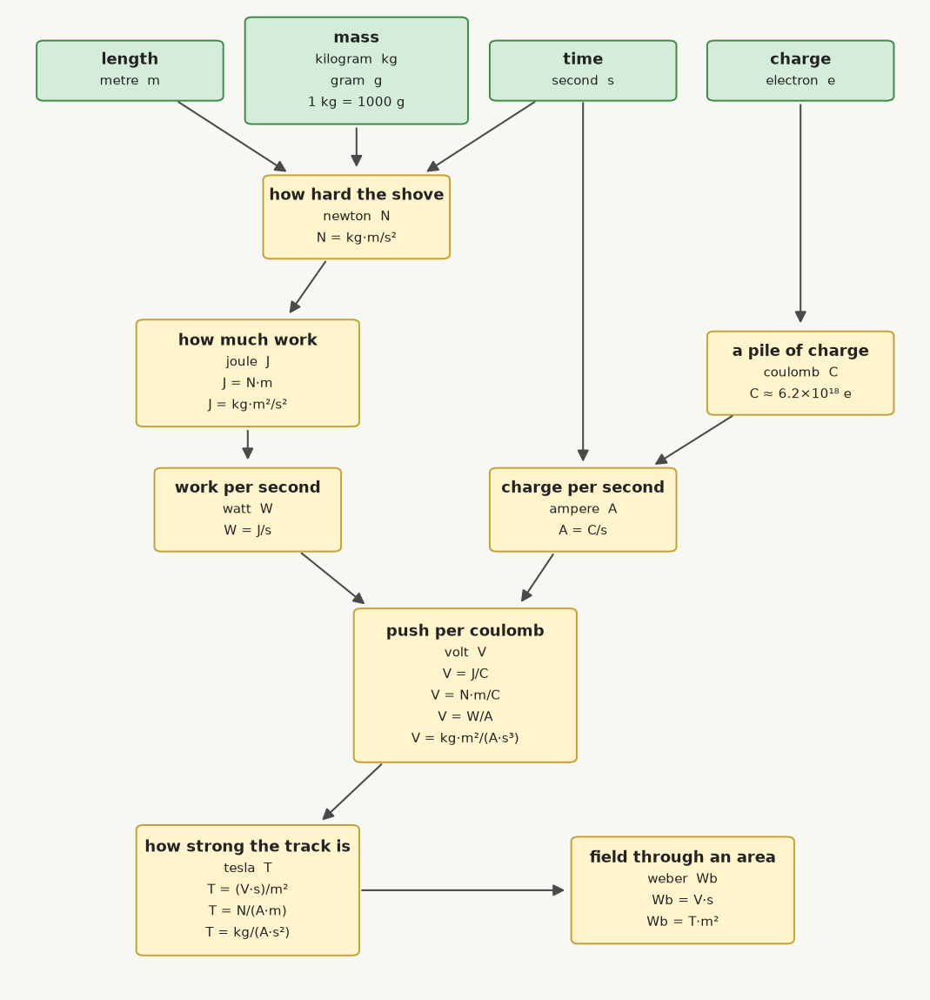

The International System of Units (SI, from French *Système international*) lists the ampere as a base unit. Here the more basic pile is the coulomb — a count of electrons — and the ampere is that pile per second. The kilogram is a thousand grams; mass is the irreducible idea.

A **coulomb** (C) is a pile of charge: about 6.2×10¹⁸ electrons. One electron carries e = 1.6×10⁻¹⁹ C, so that many electrons make one coulomb.

An **ampere** (A) is how hard a current is running: one coulomb past a point each second (A = C/s). In a wire the moving bits are electrons. In the plasma the same count can be ions one way and electrons the other; the ampere still means *net* charge per second through a surface, not a count of particles.

A **volt** (V) is energy per unit charge. Four writings, none of which need tesla: V = J/C (joules per coulomb), V = N·m/C (one newton-metre of work on one coulomb), V = W/A (watts per ampere), and in the starting stocks V = kg·m²/(A·s³). One volt is the push that gives one coulomb one joule.

A **magnetic field** is the invisible push a magnet — or an electric current — exerts on other currents and on charged particles. At every point in space it has a *direction* (which way a compass needle would point) and a *strength*. Strength is measured in **tesla** (T), which is the derived unit T = (V·s)/m². Earth’s field is about 50 µT, a fridge magnet a few millitesla, DIII-D’s main field a couple of tesla.

If you take that strength and multiply by an area the field goes through, you get a **flux** — tesla times square metres, which is the same as volt-seconds (V·s, also called a weber).

| Unit | Name | Measures |
|---|---|---|
| m | metre | length: how far (irreducible) |
| s | second | time: how long (irreducible) |
| kg | kilogram | mass (irreducible). Gram g is the same idea: 1 kg = 1000 g |
| e | electron | elementary charge (irreducible) |
| C | coulomb | charge: a pile of about 6.2×10¹⁸ electrons |
| A | ampere | electric current: one coulomb per second |
| N | newton | force: how hard the shove is |
| J | joule | energy: how much work |
| W | watt | power: energy per time |
| V | volt | electric potential: energy per charge |
| T | tesla | magnetic field: how strong the track is |
| Wb | weber | magnetic flux: field times area |

Each row below is one writing of the same unit. If a later formula does not cancel to one of these, a letter was dropped.

**Metre**

$$\mathrm{m}$$

**Second**

$$\mathrm{s}$$

**Mass**

$$\mathrm{kg}\qquad\text{kilogram}$$

$$1\,\mathrm{kg}=1000\,\mathrm{g}$$

**Electron**

$$e\qquad\text{elementary charge}$$

**Coulomb**

$$1\,\mathrm{C}\approx 6.2\times 10^{18}\,e$$

$$\mathrm{C}=\mathrm{A\cdot s}$$

**Ampere**

$$\mathrm{A}=\mathrm{C/s}$$

$$1\,\mathrm{A}\approx 6.2\times 10^{18}\,e/\mathrm{s}$$

**Newton**

$$\mathrm{N}=\mathrm{kg\cdot m/s^2}$$

**Joule**

$$\mathrm{J}=\mathrm{N\cdot m}$$

$$\mathrm{J}=\mathrm{kg\cdot m^2/s^2}$$

$$\mathrm{J}=\mathrm{W\cdot s}$$

$$\mathrm{J}=\mathrm{C\cdot V}$$

**Watt**

$$\mathrm{W}=\mathrm{J/s}$$

$$\mathrm{W}=\mathrm{V\cdot A}$$

**Volt**

$$\mathrm{V}=\mathrm{J/C}$$

$$\mathrm{V}=\mathrm{N\cdot m/C}$$

$$\mathrm{V}=\mathrm{W/A}$$

$$\mathrm{V}=\mathrm{kg\cdot m^2/(A\cdot s^3)}$$

**Tesla**

$$\mathrm{T}=(\mathrm{V\cdot s})/\mathrm{m^2}$$

$$\mathrm{T}=\mathrm{N/(A\cdot m)}$$

$$\mathrm{T}=\mathrm{Wb}/\mathrm{m^2}$$

$$\mathrm{T}=\mathrm{kg/(A\cdot s^2)}$$

**Weber**

$$\mathrm{Wb}=\mathrm{V\cdot s}$$

$$\mathrm{Wb}=\mathrm{T\cdot m^2}$$

## Tokamak shape and poloidal plane

A tokamak is a doughnut-shaped magnetic bottle. A vertical cut through the doughnut is the **poloidal plane**. Points in that plane are labelled by two lengths and one angle around the doughnut:

| Symbol | Type | Description |
|---|---|---|
| $R$ | coordinate (m) | Major radius: distance from the machine’s vertical axis. |
| $Z$ | coordinate (m) | Height above the midplane. |
| $\varphi$ | angle (rad) | Toroidal angle: the long way around the doughnut. Equilibrium is taken to be independent of $\varphi$ (axisymmetric). |

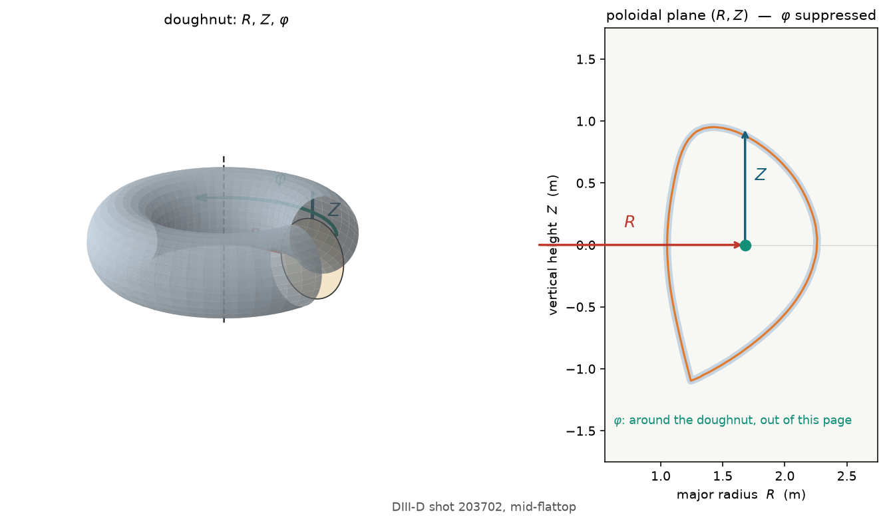

*$R$ from the vertical axis, $Z$ up, $\varphi$ the long way around. Left: a cutaway doughnut. Right: one snapshot from DIII-D pulse 203702, taken in the quiet middle of the pulse; $\varphi$ points out of the page. The orange line is the outer edge of the **plasma** (the glowing soup) on that snapshot — not a wall, just where the nested magnetic tracks stop closing on themselves. The same $(R,Z)$ frame is used in every figure below. The grown-up name for that edge comes with the flux map.*

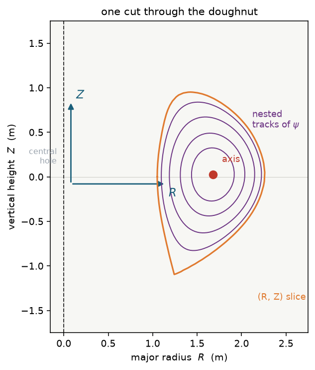

*The dashed line is the central machine axis. $R$ is horizontal distance from that axis; $Z$ is height. Purple: nested tracks of $\psi$. Orange: the last closed flux surface (LCFS). The red dot is the magnetic axis (O-point). $\varphi$ points out of the page — the long way around the doughnut.*

Around the doughnut sit **coils**: loops of wire. Push a current through a loop and it becomes a magnet for as long as the current runs — an **electromagnet**. Tokamak coils you can turn up, down, or off.

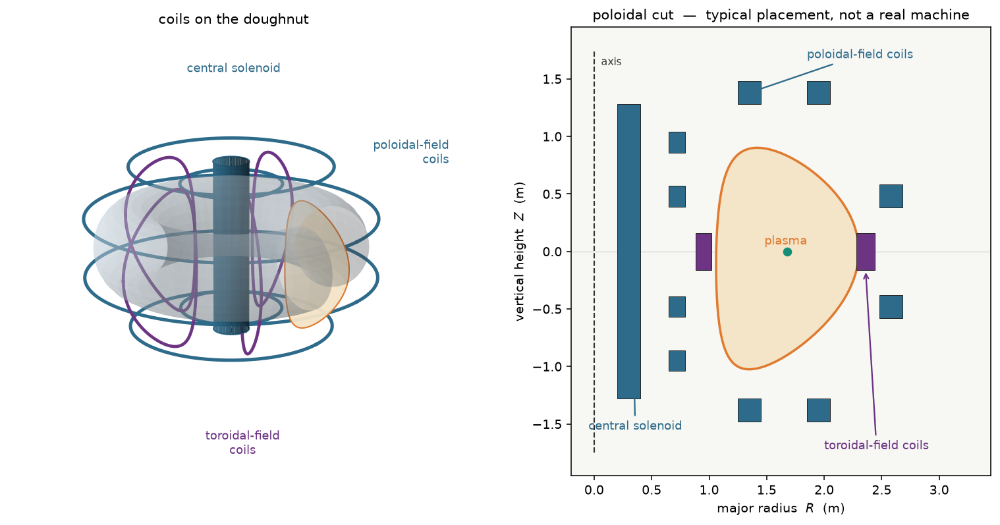

*Cartoon only — not DIII-D and not MAST. Blue: the **central solenoid** and the **poloidal-field (PF) coils** — rings around the vertical axis. Purple: the **toroidal-field (TF) coils** — they wrap the short way around the doughnut, so in the poloidal cut you only see two limbs of one coil, not a ring.*

- **Central solenoid** — a tall stack of loops in the hole of the doughnut. In these files it is **one circuit**: every turn carries the same current. Changing that current drives the plasma current $I_p$ the long way around.
- **Poloidal-field coils** — loops above, below, and outside (often called shaping coils). They slide the magnetic tracks in, out, up, or down, and they can make the plasma taller or shorter, so it does not bump the wall.
- **Toroidal-field coils** — they wrap the *short* way around the doughnut. The field they make *points* the long way around (the toroidal field). They do not make the plasma taller or shorter. They are not rings about the vertical axis, so they do not look like the PF circles.

**The twist $I_p$ makes.** TF coils already laid tracks the long way. $I_p$ is itself a magnet the *short* way, so each track is a **helical orbit around the doughnut** — not a little circle in the poloidal cut. Follow one track: each lap the long way, it also creeps a little around the D. Small $I_p$, a lazy helix. Large $I_p$, a tight helix. (A little ohmic heat comes along for the ride.)

The track does **not** cross itself. Magnetic tracks cannot cut through each other. If the twist is a neat ratio (two long-way laps per one short-way lap, and so on), the track meets its own tail and repeats the same loop. If the twist is not a neat ratio, it never quite comes back: it winds forever and slowly paints the whole doughnut surface.

**Which is the norm?** Non-repeating. The amount of twist changes from the core to the edge, so almost every track is a never-closing helix. Repeating tracks sit on thin special surfaces (neat-ratio twist) that you *must* cross on the way out — a few sheets in a stack of painted doughnuts. Those sheets matter for some instabilities, but they are not a machine-wide setting. You do not choose “repeating tokamak” versus “non-repeating tokamak.” You choose $I_p$, $B_\varphi$, and the shape, which set how much twist there is. DIII-D and MAST both work this way. They differ in *how much* twist is typical (MAST, being fatter, usually has a gentler edge twist), not in whether tracks repeat.

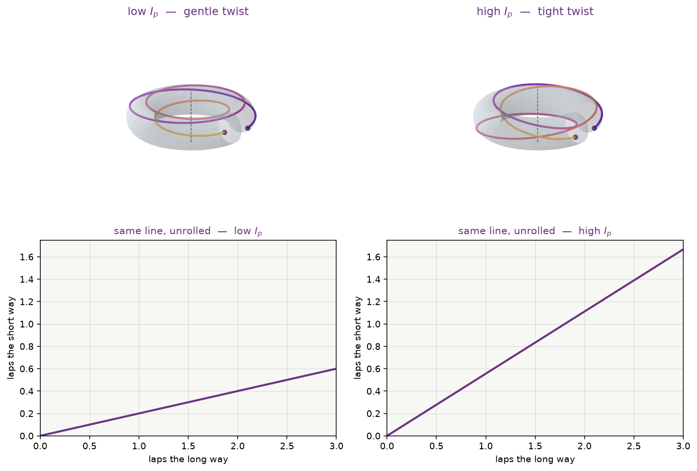

*One magnetic track around the doughnut, followed for three laps the long way — not circles in the poloidal cut. Left: small $I_p$, lazy helix. Right: large $I_p$, tight helix. Bottom: the doughnut unrolled (long way across, short way up). The track is a straight slash; $I_p$ sets how steep the slash is. A straight slash on the unroll never crosses itself.*

How many coils, what they are called, and the exact $(R,Z)$ of each rectangle are **per machine**. DIII-D and MAST do not share a coil list.

## What is a shot?

The operators do not leave the doughnut running all day. They turn it on for a few seconds, take a lot of pictures, then turn it off. That whole pulse is one **shot**. It has a number (e.g. 203702 on DIII-D, 12345 on MAST, and so on). A shot is not one picture. It is a **sequence of snapshots**: flux maps of the doughnut’s magnetic “weather,” plus whatever else the gadgets wrote down while the pulse was on. Think of one video: many frames, one filename.

Those snapshots do not all fire at the same instants. So one shot is several movies of different lengths, all covering the same few seconds. How that row is stored is the [Parquet data format](parquet-data.md#parquet-data-format).

### What is a clock?

A **clock** is a list of “when” stickers, in milliseconds. Each gadget writes its own list because it beeps at its own speed. That private list is its **native clock**. They do not share a metronome.

- **`efit_times`** — when the official reconstruction (a program called **EFIT**) kept a flux picture. Some frames were thrown away. This is the clock you predict on.
- **`magnetics_time`** — when the coil-current taps wrote a number. Much faster than EFIT. Which clock the soup’s own current uses is per machine.
- **`thomson_*_times`** — when each laser system fired.

To line a coil or a laser up with an EFIT picture, **interpolate** onto `efit_times`: “what would this gadget have said at EFIT’s when-sticker?”

## Plasma

**Plasma.** The plasma is a puff of **deuterium** (heavy hydrogen: one proton + one neutron) that is injected into the empty metal doughnut and then heated until the atoms break into charged bits — electrons and $\mathrm{D}^{+}$ ions. That is the soup on both DIII-D and MAST. It does not come out of the magnets. The magnets draw invisible train tracks in the air. Those tracks go around the doughnut the long way and creep a little the short way: a helical orbit, not a little circle in the poloidal cut. A bit can zoom *along* a track; it cannot hop off sideways. Extra magnets can slide the whole set of tracks so the glowing ring does not bump the wall.

**Not Brownian motion.** Temperature is **not** one particle jiggling in place, changing its mind every instant like a dust speck in water. That picture is wrong here. Along the track the ride is almost **frictionless**. One bit is handed a speed and a sign — this way around the doughnut, or the other way — and then it **keeps that ticket** for a long, smooth trip. The randomness is **across** particles (who got which ticket), not **within** one particle’s path.

**One ticket, one way.** Speed along the track is just speed, like a bowling ball on a smooth lane. Positive: this way around the hole. Negative: the other way. That sign is the bit’s sense of circling (its angular-momentum sign, for a first look). The bit does not wander; it keeps going until a rare bump (a collision) deals a new ticket. Hotter means a typical ticket is a faster ball, so *that* bit laps faster. It does not mean the bit starts jittering.

**The soup as a whole need not rotate.** Deal tickets to a crowd. About as many go one way as the other. Each bit is circling. The glowing ring, thought of as a wind, is **not**. Two-way traffic on a circular highway is not a merry-go-round. People say “the plasma circles” and mix up three things: the *tracks* circle (that is $\mathbf{B}$); *each bit* circles (two-way); the soup as a *wind* circles only if the tickets are unbalanced (often from heating beams). That net wind can be nearly zero.

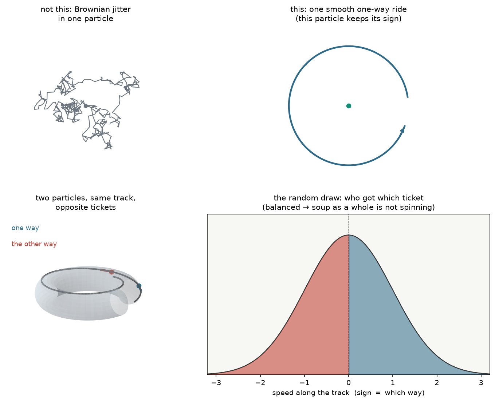

*Top left: the wrong picture — one particle scribbling at random. Top right: the right picture for one particle — a smooth one-way ride. Bottom left: two bits on the same helical track, opposite tickets. Bottom right: the random draw. Sign is which way; how spread out the curve is is temperature. A balanced distribution means the soup as a whole is not spinning.*

**A distribution of speeds, not one number.** Electrons have a whole **distribution** of speeds along the track, and ions have their own. The curve people draw is not a freehand fit. Collisions drive the crowd toward the **Maxwellian** (Maxwell–Boltzmann) distribution — the unique most-likely pile of tickets at a given density and energy. Along the track that is just a **Gaussian** (normal) in $v$:

$$
f(v)=\sqrt{\frac{m}{2\pi T}}\,\exp\!\left(-\frac{m v^{2}}{2T}\right).
$$

The **width** of a Gaussian is its standard deviation $\sigma$, where $\sigma^{2}$ is the variance. Here $\sigma=\sqrt{T/m}$ and $\langle v^{2}\rangle=\sigma^{2}=T/m$. Temperature is that width, written as an energy $T=m\sigma^{2}$. It is **not** the average of $|v|$. That average is $\langle|v|\rangle=\sqrt{2T/(\pi m)}=\sigma\sqrt{2/\pi}$, set by $T$, not equal to $T$. The signed mean $\langle v\rangle$ is the net wind (zero if the Gaussian is centred on the origin). Same $T$, electrons have large $\sigma$ and $\mathrm{D}^{+}$ a small $\sigma$, because $m$ is in the denominator. The soup on DIII-D and MAST is close to this bell curve.

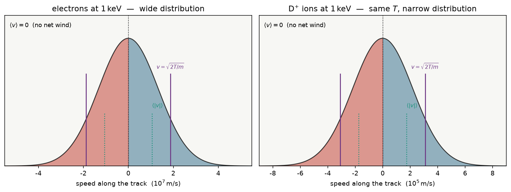

*Maxwellian (Gaussian) at $1\,\mathrm{keV}$. Blue: this way. Red: the other way. Width $\sigma=\sqrt{T/m}$. Dashed line: $\langle v\rangle=0$. Purple: $v=\sqrt{2T/m}$. Green: $\langle|v|\rangle$. Note the $x$-axis: electrons in $10^{7}\,\mathrm{m/s}$, ions in $10^{5}\,\mathrm{m/s}$.*

**What a keV is.** Fusion people write that width as an **energy**. A kilo-electron-volt is that unit: $1\,\mathrm{keV}=1.6\times 10^{-16}\,\mathrm{J}$, about $12$ million kelvin. “The plasma is $1\,\mathrm{keV}$” means the distribution is that wide in energy — not that someone applied a kilovolt around the doughnut, and not that $\langle|v|\rangle$ *is* $1\,\mathrm{keV}$. A bit with energy $T$ has speed $v=\sqrt{2T/m}$. Same $T$, heavier bit, slower ticket. Double $T$, ticket speeds only rise as $\sqrt{2}$. Light is $c=3.00\times 10^{8}\,\mathrm{m/s}$.

**Electron tickets.** Same $T$ on both machines; MAST’s doughnut is smaller, so the same ticket laps it more often. At $1\,\mathrm{keV}$: $v_e\simeq 1.88\times 10^{7}\,\mathrm{m/s}$ ($0.063\,c$). One electron, one way, around $2\pi R_0$: about **$1.8\,\mathrm{MHz}$** on DIII-D ($R_0\simeq 1.67\,\mathrm{m}$) and **$3.3\,\mathrm{MHz}$** on MAST ($R_0\simeq 0.9\,\mathrm{m}$). As many electrons hold the opposite ticket. At $3\,\mathrm{keV}$, $\times\sqrt{3}$: $v_e\simeq 3.25\times 10^{7}\,\mathrm{m/s}$ ($0.11\,c$), about $3.1\,\mathrm{MHz}$ and $5.7\,\mathrm{MHz}$. Still far below light: rest energy $511\,\mathrm{keV}$.

**Ion tickets.** The main ion on both machines is **deuterium**, $\mathrm{D}^{+}$, not a bare proton. About $3670$ times heavier than an electron, so about $\sqrt{3670}\simeq 61$ times slower at the same $T$. At $1\,\mathrm{keV}$: $v_{\mathrm{D}}\simeq 3.10\times 10^{5}\,\mathrm{m/s}$ ($0.0010\,c$), about **$30\,\mathrm{kHz}$** on DIII-D and **$55\,\mathrm{kHz}$** on MAST, both signs. At $3\,\mathrm{keV}$: $v_{\mathrm{D}}\simeq 5.36\times 10^{5}\,\mathrm{m/s}$, about $51\,\mathrm{kHz}$ and $95\,\mathrm{kHz}$. Wall carbon and other impurities are heavier, and slower.

**Heating.** Turn $T$ up and both distributions get wider (faster tickets in the tails). Two-way traffic speeds up. The ring as a whole does not start to spin. A hotter soup is not a faster merry-go-round.

**What makes a bit follow the track.** Each bit has an electric charge. A magnetic field does not pull a charge the way gravity pulls a ball. It only shoves *sideways* when the charge tries to cut across the field — never along the field, and it never speeds the bit up or slows it down. Sideways-only, over and over, turns “I’m leaving” into a tiny circle around the track. Along the track there is no shove, so the bit just keeps going. Tiny circle plus zoom-along is a corkscrew (a helix). The corkscrew is skinny — a few millimetres for a hot ion in DIII-D, much thinner for an electron — so from across the room the bit looks glued to the rail. The grown-up name for the sideways shove is the Lorentz force, $\mathbf{F}=q\,\mathbf{v}\times\mathbf{B}$.

| Symbol | Type | Description |
|---|---|---|
| $q$ | charge (C) | How much electric “stickiness” the bit has. A proton is $+e$, an electron is $-e$, with $e=1.6\times 10^{-19}$ coulomb. One coulomb is the charge of about $6.2\times 10^{18}$ electrons — what a one-ampere flow carries past a point in one second. |
| $\mathbf{v}$ | velocity (m/s) | How fast the bit is going, and which way. Speed along the track is the ticket above. |
| $\mathbf{B}$ | magnetic field (T) | The track at that spot: which way it points, and how strong it is. Tesla (T). Earth’s field is about $50\,\mu\mathrm{T}$; DIII-D’s main field is a couple of tesla. |
| $\mathbf{F}$ | force (N) | The shove itself. Newton (N): about the weight of a small apple. The $\times$ means “sideways only”: $F=qvB$ when $\mathbf{v}$ is square-on to $\mathbf{B}$, and $F=0$ when $\mathbf{v}$ runs along $\mathbf{B}$. Check: $\mathrm{C}\cdot(\mathrm{m/s})\cdot\mathrm{T}=\mathrm{N}$. |

The shove then has nowhere to hide: $\mathrm{C}\cdot(\mathrm{m/s})\cdot\mathrm{T}=(\mathrm{A\cdot s})\cdot(\mathrm{m/s})\cdot\mathrm{N/(A\cdot m)}=\mathrm{N}$.

## Poloidal flux and LCFS

The plasma is held by a magnetic field. The field’s topology in the $(R,Z)$ plane is recorded by one scalar:

| Symbol | Type | Description |
|---|---|---|
| $\psi(R,Z)$ | scalar field (V·s/rad) | Poloidal flux. Contours of constant $\psi$ *are* the magnetic surfaces. |

**Per radian** does mean per unit of sweep of $\varphi$: pick a point $(R,Z)$, spread a one-radian pie slice from the machine axis out to that point, and count how much field goes through that slice. That number is the poloidal flux $\psi$ at the point, in $\mathrm{V\cdot s/rad}$. A full trip around the doughnut is $2\pi$ radians, so the flux through the whole disk is $2\pi\psi$ webers. It is still “flux through an area”; the $/\,\mathrm{rad}$ just refuses to count the same doughnut $2\pi$ times.

Flux is a *count of field through a surface*, not a magnet that particles fall into. A plasma particle is not attracted to a value of $\psi$ and does not sit still there. It feels the local field $\mathbf{B}$ (the arrows): it gyrates around a field line and streams *along* that line. The lines lie on surfaces of constant $\psi$, so the particle is *guided* around a contour, not pulled toward the core the way a mass is pulled down a gravity well.

The core of the $\psi$ map on DIII-D is very negative and rises toward positive as you walk out. That sign is a **bookkeeping convention**, not “more magnetic” or “more attractive.” DIII-D’s reconstruction makes the magnetic axis a *minimum* of $\psi$; MAST makes it a *maximum*. Flip the official sign of the plasma current and the colours swap. A more negative number is not a deeper trap. Particles do not prefer negative $\psi$.

The last closed flux surface (LCFS) is **not** the place $\psi$ crosses zero. It is the last contour that still closes on itself around the axis. Zero on the colour bar is just where the number happens to pass through $0\,\mathrm{V\cdot s/rad}$; on the DIII-D frame below that happens to sit near the LCFS, but that is not the definition and it is not true on MAST.

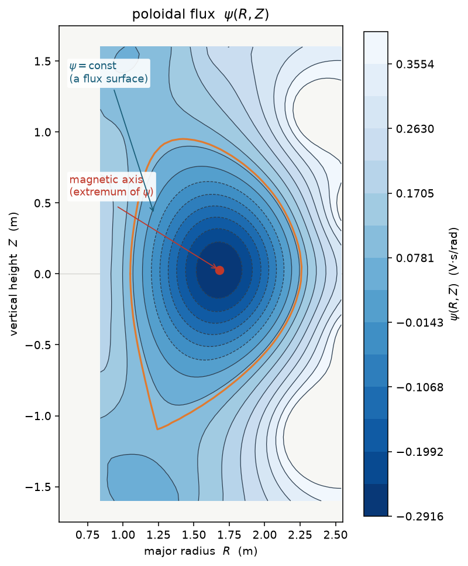

*$\psi$ on the same DIII-D frame. Nested contours are flux surfaces. The red point is the magnetic axis (a minimum of $\psi$ on DIII-D). Orange: last closed flux surface.*

## Magnetic axis and nulls

The **magnetic axis** is the O-point: the interior extremum of $\psi$ (a minimum on DIII-D, a maximum on MAST). The plasma’s outer boundary is the last closed flux surface (LCFS): the outermost contour of $\psi$ that still closes on itself and encloses that axis.

That boundary can be set in two ways. If the plasma leans on a material limiter, the LCFS is the wall — a **limited** configuration. The other way uses nulls of the poloidal field. Those are points where the gradient of $\psi$ vanishes:

| Symbol | Type | Description |
|---|---|---|
| $\nabla$ | differential operator | Spatial gradient in the $(R,Z)$ plane. |
| $\nabla\psi=0$ | condition | A magnetic null: no poloidal field. An **X-point** is a saddle of this kind. |

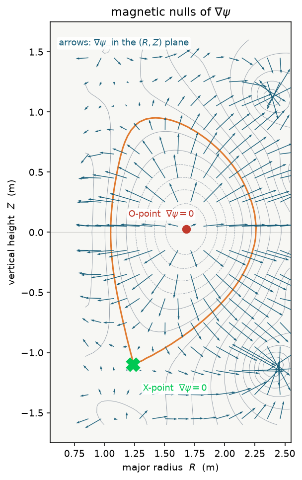

*Arrows are $\nabla\psi$ in the $(R,Z)$ plane. They vanish at the red O-point (axis) and at the green X-point — both are $\nabla\psi=0$. The lower saddle sits on this shot’s last closed surface.*

Through the X-point runs one special contour of $\psi$. That contour is the **separatrix**: it *separates* the nested closed tracks inside (the confined soup) from the open tracks outside (which strike the divertor plates). When the plasma’s edge *is* this separatrix, rather than a material wall, the configuration is **diverted**. Heat and particles leave along those open lines instead of touching the wall. Every shipped timeslice is diverted.

Limited frames **did exist**. The organizers **cut them** from `efit_times` (and from every column on that clock) on both machines. A guess as to why: on a limited plasma the edge is the **wall**, and the wall is not in $\psi(R,Z)$. A last-closed contour taken from the flux map alone then overshoots — most DIII-D limited frames missed volume by more than $0.5\,\mathrm{m}^{3}$. The score asks for $D_{\mathrm{LCFS}}$ and for Consistency scalars read off that same boundary. Scoring a boundary you cannot infer from $\psi$ is not a useful test, so those frames were dropped rather than down-weighted. The recut kept $88\%$ of DIII-D EFIT frames (`magnetics_dsep>0`) and $66\%$ of MAST frames (EFIT++ found an X-point). Magnetics and Thomson clocks were **not** cut; `efit_times` is simply no longer contiguous. Shots left with no diverted frames at all left the corpus.

## MHD force balance

In static magnetohydrodynamic (MHD) equilibrium, the outward plasma pressure gradient $\nabla p$ is balanced by the inward Lorentz force $\mathbf{j}\times\mathbf{B}$:

| Symbol | Type | Description |
|---|---|---|
| $\mathbf{B}$ | vector field (T) | Magnetic field. |
| $\mathbf{j}$ | vector field (A·m$^{-2}$) | Current density. |
| $p$ | scalar field (Pa) | Kinetic pressure. |
| $\times$ | operator | Vector cross product. |

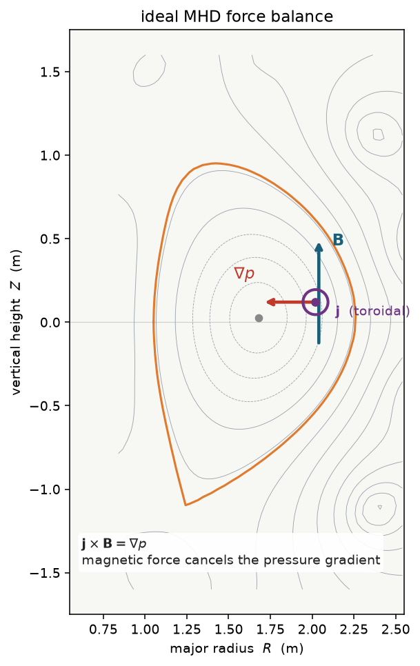

*At an outboard point: $\mathbf{j}$ is toroidal (out of the page), $\mathbf{B}$ runs along the surface, and $\nabla p$ points inward (pressure is highest on axis). The cross product $\mathbf{j}\times\mathbf{B}$ is the magnetic force that cancels $\nabla p$.*

$$
\mathbf{j}\times\mathbf{B}=\nabla p.
$$

### Pressure and Toroidal Field as Flux Functions

This single balance equation forces two fundamental quantities to become **flux functions** (invariant along any single closed magnetic surface $\psi = \text{const}$):

1. **Pressure $p(\psi)$:** Because the cross product $\mathbf{j} \times \mathbf{B}$ is orthogonal to $\mathbf{B}$, taking the inner product with $\mathbf{B}$ yields:
   $$\mathbf{B} \cdot \nabla p = 0$$
   Along any magnetic field line, the directional derivative of pressure vanishes. Because field lines densely cover each flux surface, $p$ is strictly constant on each contour: $p = p(\psi)$.

2. **Toroidal Field Function $F(\psi)$:** The toroidal magnetic field $B_\varphi$ decays geometrically as $1/R$ with major radius. Multiplying out this dilution yields the quantity $F = R B_\varphi$. In axisymmetric equilibrium, Ampère's law and axisymmetry require that $F$ is also invariant on each flux surface: $F = F(\psi)$.

### Assembling the Magnetic Field $\mathbf{B}$

Given the 2D poloidal flux map $\psi(R, Z)$ and the profile function $F(\psi)$, the full 3D magnetic field decomposes into poloidal (in-plane) and toroidal (out-of-plane) components:

$$
\mathbf{B} = \underbrace{\frac{1}{R}\nabla\psi \times \mathbf{e}_\varphi}_{\text{Poloidal Field (short-way loops)}} + \underbrace{\frac{F(\psi)}{R}\mathbf{e}_\varphi}_{\text{Toroidal Field (long-way circle)}}
$$

In cylindrical components:
$$B_R = -\frac{1}{R}\frac{\partial\psi}{\partial Z}, \qquad B_Z = \frac{1}{R}\frac{\partial\psi}{\partial R}, \qquad B_\varphi = \frac{F(\psi)}{R}$$

**Physical orientation of the field components:**
* **$B_R$ is the radial field** (pointing horizontally in the $(R,Z)$ cut). Because $\mathbf{B}_{\mathrm{pol}} \propto \nabla\psi \times \mathbf{e}_\varphi$, a vertical gradient $\partial\psi/\partial Z$ generates horizontal field $B_R$.
* **$B_Z$ is the vertical field** (pointing up/down). A radial gradient $\partial\psi/\partial R$ generates vertical field $B_Z$.
* **$B_\varphi$ is the toroidal field** pointing in the $\pm\mathbf{e}_\varphi$ direction around the torus.

| Symbol | Type | Description |
|---|---|---|
| $\psi(R,Z)$ | 2D Scalar Field ($\mathrm{V\cdot s/rad}$) | Poloidal flux map (the nested tracks). |
| $p(\psi)$ | Flux function ($\mathrm{Pa}$) | Plasma pressure (constant on each track). |
| $F(\psi)$ | Flux function ($\mathrm{T\cdot m}$) | Toroidal field function: $F = R B_\varphi$. |
| $B_R, B_Z$ | Scalar fields ($\mathrm{T}$) | Poloidal field (tangent to tracks in the $R, Z$ slice). |
| $B_\varphi$ | Scalar field ($\mathrm{T}$) | Toroidal field (the long-way circular field). |

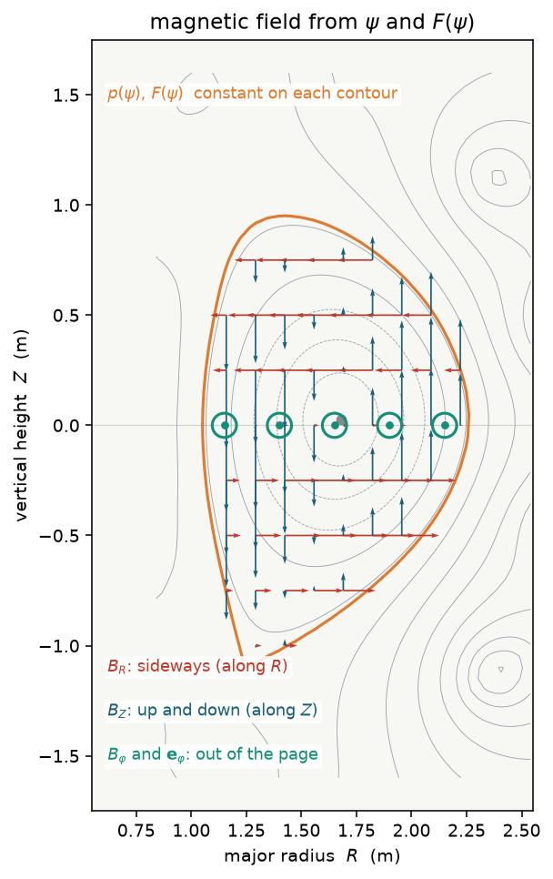

*Red arrows are $B_R$ (sideways). Blue arrows are $B_Z$ (up and down). Together they run along the contours of $\psi$. The teal symbol $\odot$ marks the long-way field $B_\varphi$ pointing out of the page.*

## Derivation of the Grad–Shafranov Equation

The magnetic cage $\mathbf{B}$ cannot take an arbitrary shape: the field must be generated by physical currents (Ampère’s law, $\nabla\times\mathbf{B}=\mu_0\mathbf{j}$), and those currents must balance the outward plasma pressure (MHD equilibrium, $\mathbf{j}\times\mathbf{B}=\nabla p$). The **Grad–Shafranov equation** expresses these combined physical requirements on the 2D poloidal plane $(R,Z)$.

We establish the equation in five steps:

## Step 1 — The track map

The track map $\psi(R,Z)$ draws the nested loops. That fixes the two short-way pieces: they have to run *along* those loops.

It does **not** fix the long-way piece. $B_\varphi$ is that long-way field, in tesla ($\mathrm{T}$). $R$ is metres. **$F$ is not a force** and not stickiness. It is the product

$$
F=R B_\varphi\qquad\text{units: tesla-metres, }\mathrm{T\cdot m}.
$$

$F$ is the **toroidal field function**. We care about it because the cage is only half-specified without the long-way strength — Grad–Shafranov’s source later needs how $F$ changes from layer to layer.

$\psi$ is a **field** $\psi(R,Z)$: a number (units $\mathrm{V\cdot s/rad}$) at every point of the slice. It is not a length and not a second radius. A track is a *level set* of that field — every point where $\psi$ has the same value. One such loop already has two radii (inboard and outboard), so $R$ cannot name the loop. To name the loop, we use the value of $\psi$ on that level set — one real number for the whole loop.

Here is the unique continuous label, stated as a bijection. Write $\psi_{\mathrm{ax}}$ for the value at the red dot — the **magnetic axis** (the O-point, the interior extremum of $\psi$) — and $\psi_b$ for the value on the last closed track. On DIII-D, $\psi_{\mathrm{ax}}<\psi_b$ (a minimum on axis); on MAST the inequality flips. For every real number $t$ strictly between $\psi_{\mathrm{ax}}$ and $\psi_b$, the set of points inside the last closed track where $\psi(R,Z)=t$ is exactly one simple closed curve.

Why *exactly one*. Recall: $\nabla$ (spoken “del” or “nabla”) is the **gradient**. At each point it is an arrow that answers two questions about the field: which way is the steepest climb, and how steep is that climb. So $\nabla\psi$ is the steepest-change arrow of $\psi$. If $\nabla\psi=0$, the arrow has zero length: the field is locally flat — a peak, a pit, or a saddle — and there is no “uphill” to follow.

Inside the last closed track, $\nabla\psi=0$ at only one point: the axis. (The X-point sits *on* that last track, not inside.) So those steepest-change arrows never stop and never reverse until you reach the edge: along any of those paths, $\psi$ is strictly monotonic. Pick a $t$ in between. Start at the axis and follow $\nabla\psi$ (or $-\nabla\psi$ if the axis is a maximum, so you still walk *downhill* toward the edge) out to the last closed track. You pass through the value $t$ exactly once — if you missed it or hit it twice, $\psi$ would have had to turn around, which requires another point where $\nabla\psi=0$. Do that in every direction and the hit-points form one closed curve around the axis. A second curve at the same $t$ would need a second flat spot to start a second nest. There isn’t one.

That $t$ *is* the name of the loop. The axis is the degenerate point at $t=\psi_{\mathrm{ax}}$. There is no unnamed loop left, and no two loops share a $t$.

A ray from the axis that reaches the last closed track without first hitting the X-point crosses each of those loops exactly once, and in the same order of $t$ in every direction. So every such ray enumerates the *same* family of names.

It does **not** paint those names at the same *distance* along every ray. The outboard side is fatter; the inboard side is squeezed; up and down are a different stretch again. The physical distance from the axis to the loop named $t$ depends on the direction. Same numbers; not the same numbers versus metres along the ray. The label is the value of $\psi$, not arc length.

It is also **not** monotonic in $R$ across the whole slice. The axis is not at the smallest $R$. Walk the midplane from the inner edge through the red dot to the outer edge and $\psi$ goes to $\psi_{\mathrm{ax}}$ and back.

$B_\varphi$ thins as $1/R$ on the wider side. Multiplying by $R$ cancels that, so $F$ is the same at every point of the level set. Writing $F(\psi)$ means $F$ at a point depends only on the *value* of the field $\psi$ there — shorthand for $F\bigl(\psi(R,Z)\bigr)$, a composition, not a claim that $\psi$ is a number line.

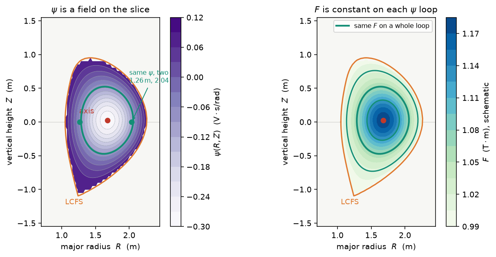

*Left: the field $\psi(R,Z)$. The teal loop is one level set — two $R$, one $\psi$. Right: $F$ painted on the same slice; it does not change as you walk around a loop. Schematic $F$, not a fit.*

## Step 2 — Curl: extras one way around the torus

Cut the doughnut. Pick a postage-stamp on that cut — a tiny patch at some $(R,Z)$. Bits stream through that stamp the **long way**: toward you, or away from you, along their helical tracks.

Recall the tickets: each bit already has a sign. **Number** (how many bits live near the stamp) is density $n$. **Concentration** is the same $n$ per cubic metre. **Flow** is those bits actually crossing the stamp.

If the same number go toward you as go away, the *net* flow of charge is zero. The road can be packed. **Current is only the extras** — toward minus away. For one species,

$$
j = n\,q\,v_{\mathrm{d}}
$$

with $v_{\mathrm{d}}$ the small *imbalance* of tickets, not the thermal speed. A typical electron is already flying at tens of thousands of kilometres per second; the extra one-way drift that makes a mega-ampere is much slower. High current is not “everyone sprints,” and not “everyone parked at the axis.” It is a slight lean on huge two-way traffic — and/or more bits taking part in that lean.

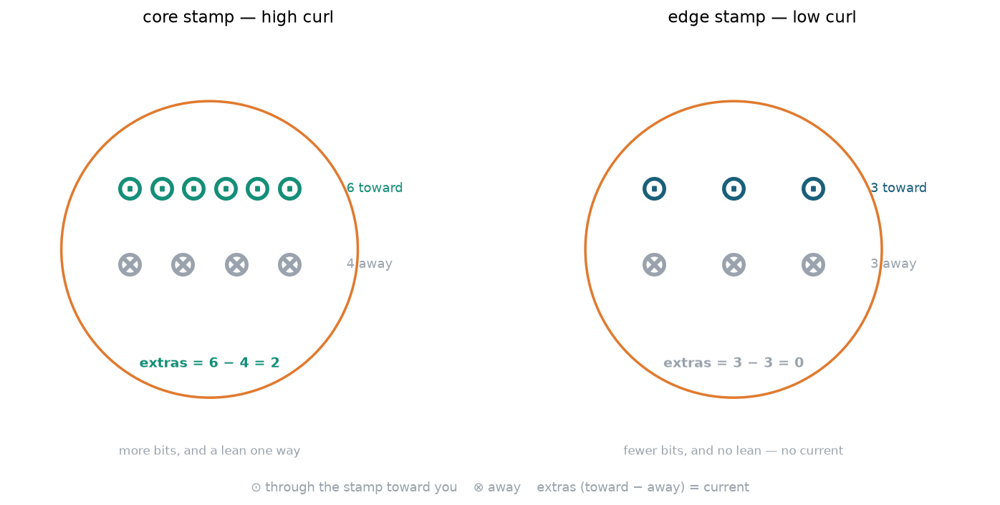

*Each stamp is a patch on the $(R,Z)$ cut. Count toward, count away; **extras = toward − away**. That difference is current through the stamp.*

Those extras, added up around the whole doughnut, are a **fat wire** the long way. A wire is a magnet. That magnet writes the short-way field — the D-shaped rails in the cut. **That is why we care.** No extras, no wire, no D, soup hits the wall.

**Curl** is the map of extras on the slice. High curl at a stamp means more extras one way through that stamp — the long way around the doughnut, not around the axis in the cut. Red around the magnetic axis means more extras *there* than farther out toward the last closed track. The extras are net *charge* (electrons usually carry most of it; ions going the other way count too).

What that buys the *machine* — recall $I_p$, the total long-way current (all the stamps added up):

* **Twist the rails.** TF coils already laid tracks the long way. $I_p$ is a magnet the *short* way, so each track becomes a helix. Low $I_p$: a lazy helix. High $I_p$: a tight helix.
* **Squeeze the balloon.** Force balance is $\mathbf{j}\times\mathbf{B}=\nabla p$. More extras crossed with the field is a harder inward shove. High $I_p$ can hold a hotter, fatter plasma off the wall.
* **A little heat.** Current through a slightly resistive soup makes ohmic heat. Not the main heater here, but it is a real knob.

*Recall from the [tokamak geometry section](#tokamak-shape-and-poloidal-plane): three laps the long way. Left: small $I_p$, lazy helix. Right: large $I_p$, tight helix.*

A red blob is a *skinny current channel* (extras stuffed down the middle), not a smaller balloon. Shaping coils mostly set how fat the orange outline is. Skinny current core $\neq$ skinny plasma.

---

### How the math sees the extras

You cannot count tickets on the public data. You see $\mathbf{B}$. Ampère’s law (next steps, with units) is the dictionary: $\mathbf{B}$ around the *edge* of the stamp equals extras through the *middle*.

Walk around the edge of the stamp on the cut. Add up how much the short-way arrows $(B_R, B_Z)$ point along your walk.

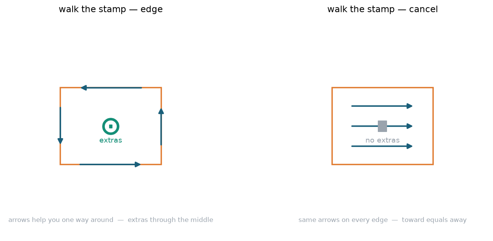

*Left: the arrows help you one way around — extras through the middle. Right: every edge matches — toward equals away. The walk is how we *read* extras from $\mathbf{B}$. The particles still go the long way, through the stamp.*

That walk, divided by the stamp’s area, is written

$$
(\nabla\times\mathbf{B})_\varphi = \frac{\partial B_R}{\partial Z} - \frac{\partial B_Z}{\partial R}.
$$

Two comparisons, one remainder:

* $\partial B_R/\partial Z$ — did the sideways arrows change as you step up?
* $\partial B_Z/\partial R$ — did the up-down arrows change as you step out?

The minus puts both sides of the walk into one number. The subscript $\varphi$ is the extras’ direction: through the stamp, out of the page. Next step, $\mu_0$ turns this remainder into amperes: $(\nabla\times\mathbf{B})_\varphi=\mu_0 j_\varphi$.

---

### The map on a real shot

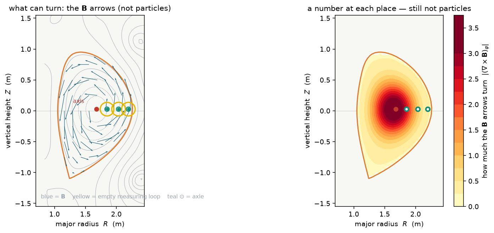

*Left: short-way arrows $(B_R, B_Z)$ along the tracks. Right: $|(\nabla\times\mathbf{B})_\varphi|$ — extras through each stamp (up to $\mu_0$). Deep red near the axis: most extras punch through here. Pale near the last closed track: almost no lean. Bits still ride the pale tracks; the *engine* that made the rails sits inward.*

That redness is not packed tracks. How tightly the $\psi$ loops sit is $|\nabla\psi|$. How many bits per cubic metre is $n$. Curl is the third map: $j_\varphi$ in disguise.

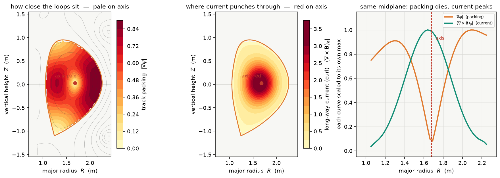

*Left: $|\nabla\psi|$ — how tightly the loops sit (a ring, pale on the axis). Middle: $|(\nabla\times\mathbf{B})_\varphi|$ — extras (a blob, red on the axis). Right: the same two numbers along the midplane, each scaled to its own max. At the axis, packing dies and extras peak. They are not the same map.*

---

1. A stamp on the cut: extras = toward − away. That is current. Curl maps those extras.
2. Extras around the doughnut are a fat wire. The wire writes the D and twists the rails into helices.
3. The formula walks the edge of the stamp: $(B_R, B_Z)$ on the edge is extras through the middle. Step 4 plugs $B_R$ and $B_Z$ into that walk.

## Step 3 — The constant $\mu_0$

In standard metric units (SI units), Ampère’s law is written:

$$
\nabla\times\mathbf{B}=\mu_0\mathbf{j}.
$$

Let's look at the units on both sides, just like making sure you don't accidentally say "3 apples equals 3 seconds":
* **Left side:** It is the curl of a magnetic field (measured in teslas, $\mathrm{T}$), divided by distance (metres, $\mathrm{m}$). Its units are tesla per metre, $\mathrm{T/m}$.
* **Right side (without any constant):** The electric current density $\mathbf{j}$ measures how many amperes of electricity flow through a square metre patch, $\mathrm{A/m^2}$.

$\mathrm{T/m}$ and $\mathrm{A/m^2}$ are totally different units! You cannot set them equal without a conversion factor—a "universal translator" that turns *"how much electric current is rushing through"* into *"how much the magnetic field swirls."* That conversion factor is $\mu_0$ (called the magnetic permeability of free space):

$$
\mu_0=4\pi\times 10^{-7}\ \mathrm{N\cdot A^{-2}}.
$$

Look at those units: newtons per ampere squared ($\mathrm{N\cdot A^{-2}}$). You can also write it as tesla-metres per ampere ($\mathrm{T\cdot m/A}$). When you multiply $\mu_0$ by $\mathbf{j}$, the amperes cancel out cleanly and leave $\mathrm{T/m}$, perfectly matching the curl on the left side!

The number $4\pi\times 10^{-7}$ is an exact bookkeeping number built into the metric system. It is **not** a special property of our hot plasma cloud. It is simply the conversion number built into empty space itself. The plasma can heat up or cool down, changing its pressure $p$ and swirl $F$; but empty space never changes its conversion rate $\mu_0$.

## Step 4 — Plug the $\mathbf{B}(\psi,F)$ recipe into that $\varphi$ curl

Recall: $R$ is distance from the doughnut hole, $Z$ is height, $\varphi$ is the long-way angle.
Recall: $\psi(R,Z)$ is the track map (which onion layer you are on).
Recall: $F(\psi)=R B_\varphi$ is one number per track — the long-way field strength.

If you have $\psi$ and $F(\psi)$, the three pieces of $\mathbf{B}$ are

$$
B_R=-\frac{1}{R}\frac{\partial\psi}{\partial Z},\qquad
B_Z=\frac{1}{R}\frac{\partial\psi}{\partial R},\qquad
B_\varphi=\frac{F}{R}.
$$

Those look backwards if you have not seen the turn. $B_R$ *points* sideways (along $R$), yet the formula uses a $Z$-derivative. $B_Z$ *points* up and down, yet the formula uses an $R$-derivative. Neither field is “a function of only one coordinate” — both are fields of $(R,Z)$ because $\psi$ is. What is swapped is **which derivative of $\psi$ builds which arrow.** Here is why.

The short-way field must run *along* a track, not across it. A particle follows $\mathbf{B}$; if $\mathbf{B}$ pointed across contours of $\psi$, it would hop from one onion layer to the next. So $B_R$ and $B_Z$ have to be tangent to $\psi=\mathrm{const}$.

The gradient $\nabla\psi$ does the opposite: it points *across* the tracks, the steepest-change direction.

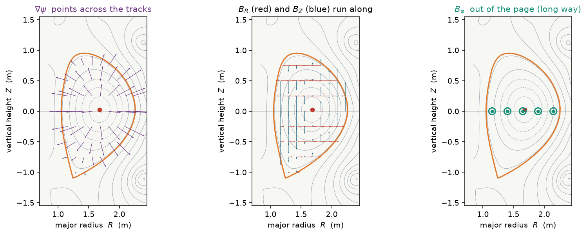

*Left: $\nabla\psi$ (purple) sticks out of each layer — that hop is forbidden for $\mathbf{B}$. Middle: $B_R$ (red, sideways) and $B_Z$ (blue, up-down) run along the layers. Right: $B_\varphi$ (teal $\odot$) is the remaining long-way piece, out of the page. It is not a turn of $\nabla\psi$.*

$$
\nabla\psi
=\frac{\partial\psi}{\partial R}\,\mathbf{e}_R
+\frac{\partial\psi}{\partial Z}\,\mathbf{e}_Z.
$$

To turn that across-arrow into an along-arrow, cross it with the out-of-the-page unit $\mathbf{e}_\varphi$ (right-hand rule: a $90^\circ$ turn in the $(R,Z)$ plane). The 2-D cross product swaps components and flips one sign:

$$
\mathbf{e}_R\times\mathbf{e}_\varphi=\mathbf{e}_Z,
\qquad
\mathbf{e}_Z\times\mathbf{e}_\varphi=-\mathbf{e}_R,
$$

so

$$
\nabla\psi\times\mathbf{e}_\varphi
=-\frac{\partial\psi}{\partial Z}\,\mathbf{e}_R
+\frac{\partial\psi}{\partial R}\,\mathbf{e}_Z.
$$

Divide by $R$ because $\psi$ is flux *per radian* (a longer circle at larger $R$ must not count the same doughnut twice). The turned gradient is exactly the short-way pair:

$$
\frac{1}{R}\nabla\psi\times\mathbf{e}_\varphi
=-\frac{1}{R}\frac{\partial\psi}{\partial Z}\,\mathbf{e}_R
+\frac{1}{R}\frac{\partial\psi}{\partial R}\,\mathbf{e}_Z
=B_R\,\mathbf{e}_R+B_Z\,\mathbf{e}_Z.
$$

Read the pieces:

* The sideways field $B_R$ is built from $\partial\psi/\partial Z$ — how $\psi$ changes as you step **up**. The $90^\circ$ turn sent “change-in-$Z$” into the $R$ direction.
* The up-down field $B_Z$ is built from $\partial\psi/\partial R$ — how $\psi$ changes as you step **out**. The same turn sent “change-in-$R$” into the $Z$ direction.
* The minus on $B_R$ is that right-hand-rule sign, not a claim that $B_R$ points down.

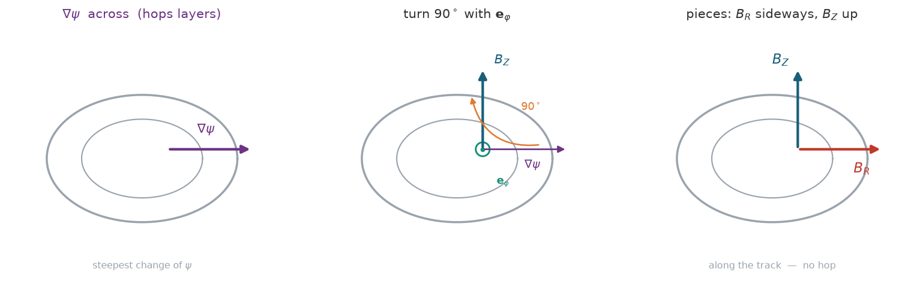

*At one point on a track: $\nabla\psi$ points across (left). Cross with $\mathbf{e}_\varphi$ (teal $\odot$, out of the page) to turn $90^\circ$ (middle). The pieces are $B_R$ sideways and $B_Z$ up (right). Together they stay on the track.*

$B_\varphi=F/R$ is the remaining long-way piece. It was never a turn of $\nabla\psi$.

Now we play detective: plug those short-way formulas into the curl from Step 2.

Recall: $(\nabla\times\mathbf{B})_\varphi=\partial B_R/\partial Z-\partial B_Z/\partial R$.

Take the derivatives (rate of change) of both:
* For $B_R$, take a step in the $Z$ direction:
  $$
  \frac{\partial B_R}{\partial Z}
  =-\frac{1}{R}\frac{\partial^2\psi}{\partial Z^2}.
  $$
* For $B_Z$, take a step outward in the $R$ direction. Here, both $1/R$ and $\partial\psi/\partial R$ depend on $R$, so by the calculus product rule:
  $$
  \frac{\partial B_Z}{\partial R}
  =\frac{\partial}{\partial R}\left(\frac{1}{R}\frac{\partial\psi}{\partial R}\right)
  =-\frac{1}{R^2}\frac{\partial\psi}{\partial R}+\frac{1}{R}\frac{\partial^2\psi}{\partial R^2}.
  $$

Now, subtract them to find the curl:

$$
(\nabla\times\mathbf{B})_\varphi
=\frac{\partial B_R}{\partial Z}-\frac{\partial B_Z}{\partial R}
=-\frac{1}{R}\left(
\frac{\partial^2\psi}{\partial R^2}
+\frac{\partial^2\psi}{\partial Z^2}
-\frac{1}{R}\frac{\partial\psi}{\partial R}
\right).
$$

Look at that big combination inside the parentheses. Physicists got tired of writing all those terms over and over, so they gave it a special nickname: $\Delta^*\psi$ (spoken as **"Delta-star of psi"**):

$$
\Delta^*\psi
=\frac{\partial^2\psi}{\partial R^2}
+\frac{\partial^2\psi}{\partial Z^2}
-\frac{1}{R}\frac{\partial\psi}{\partial R}
=R\frac{\partial}{\partial R}\left(\frac{1}{R}\frac{\partial\psi}{\partial R}\right)
+\frac{\partial^2\psi}{\partial Z^2}.
$$

*(These two forms are identical: if you use the product rule on $R\,\partial_R(R^{-1}\partial_R\psi)$, the extra $-(1/R)\partial_R\psi$ term pops right back out!)*

### What $\Delta^*$ is, and what it is not

On a completely flat 2D board with coordinates $(x,y)$, the standard curvature operator (the flat **Laplacian**, written $\nabla^2$) is:

$$
\nabla^2 f=\frac{\partial^2 f}{\partial x^2}+\frac{\partial^2 f}{\partial y^2}.
$$

Think of the flat Laplacian like a rubber sheet or a trampoline: it measures *"how much the height at this spot differs from the average height of its immediate neighbors"*—in other words, how curved the surface is. 

$\Delta^*$ is that exact same curvature idea, but tailored specifically for magnetic tracks wrapped around a **curved doughnut**, **not** a flat board! The extra $-\frac{1}{R}\frac{\partial\psi}{\partial R}$ appears because loops farther out (at larger $R$) are physically longer circles than loops closer to the doughnut hole, and because our field formulas already contain $1/R$. If you threw that extra term away, you would be pretending the doughnut is just a flat box!

Putting this together:

$$
(\nabla\times\mathbf{B})_\varphi=-\frac{1}{R}\Delta^*\psi.
$$

Recall from Step 3: Ampère’s law is $\nabla\times\mathbf{B}=\mu_0\mathbf{j}$, so the long-way piece is $(\nabla\times\mathbf{B})_\varphi=\mu_0 j_\varphi$. Setting them equal:

$$
-\frac{1}{R}\Delta^*\psi = \mu_0 j_\varphi
\quad\Longrightarrow\quad
\Delta^*\psi=-\mu_0 R\,j_\varphi.
$$

Look at how pretty this is:
* The **left side** ($\Delta^*\psi$) measures: *"How curved are our magnetic onion-skin tracks?"*
* The **right side** ($-\mu_0 R j_\varphi$) measures: *"How much electric current is marching the long way around the ring?"*, converted by $\mu_0$ and multiplied by $R$.

## Step 5 — Force balance writes $j_\varphi$ from $p$ and $F$

Recall: $p=p(\psi)$ is the pressure on each track, and $F=F(\psi)$ is the long-way swirl $R B_\varphi$.
Recall from Step 4: the short-way field is $B_R=-(1/R)\partial\psi/\partial Z$, $B_Z=(1/R)\partial\psi/\partial R$.

Now, how does our plasma stay still without bursting? It plays a game of tug-of-war!

The plasma is hot and wants to push outward like air in an over-pumped balloon (that outward shove is the pressure gradient, $\nabla p$). To trap it, the magnetic field exerts an inward magnetic squeeze (the Lorentz force, $\mathbf{j}\times\mathbf{B}$). In balance, these two forces cancel out:

$$
\mathbf{j}\times\mathbf{B}=\nabla p.
$$

Remember that pressure is identical all the way around any single magnetic track: $p = p(\psi)$. So the pressure gradient only pushes directly *across* the tracks:

$$
\nabla p=p'(\psi)\,\nabla\psi,
$$

where $p' = dp/d\psi$ simply means *"how much the pressure drops as you hop from one magnetic track to the next outer track."*

Since the pressure shove points directly across the tracks, the magnetic push $\mathbf{j}\times\mathbf{B}$ must point across the tracks too! We can split the current into two paths:
1. A current running the long way around the doughnut loop: $j_\varphi$.
2. A current running the short way around the doughnut loop: $\mathbf{j}_{\mathrm{pol}}$.

Each current crosses with the *opposite* magnetic field component to shove across the tracks:
* The long-way current $j_\varphi$ crosses with the short-way magnetic field $(B_R, B_Z)$. This shove is proportional to $j_\varphi/R$, because the short-way strength is $\sqrt{B_R^2+B_Z^2}=\lvert\nabla\psi\rvert/R$.
* The short-way current $\mathbf{j}_{\mathrm{pol}}$ crosses with the long-way magnetic field $B_\varphi = F/R$. Using Ampère’s law on the long-way field shows that $\mathbf{j}_{\mathrm{pol}}$ depends on $F'(\psi) = dF/d\psi$, making this second push equal to $FF'/(\mu_0 R^2)$.

Since both shoves point across the tracks in the direction of $\nabla\psi$, their sum must balance the pressure shove $p'\,\nabla\psi$:

$$
p'
=\frac{j_\varphi}{R}-\frac{FF'}{\mu_0 R^2}.
$$

Now, rearrange this equation to solve for the mystery current $j_\varphi$:

$$
j_\varphi
=R\,p'(\psi)+\frac{FF'(\psi)}{\mu_0 R}.
$$

Notice how intuitive this is! The long-way electric current is made of two clear parts:
1. $R\,p'(\psi)$: The current needed to push back against the plasma's outward pressure.
2. $\frac{FF'(\psi)}{\mu_0 R}$: The current needed to hold together the twisting, spinning magnetic field lines.

| Symbol | Type | Description |
|---|---|---|
| $j_\varphi$ | scalar field ($\mathrm{A\cdot m^{-2}}$) | Toroidal component of current density $\mathbf{j}$. |

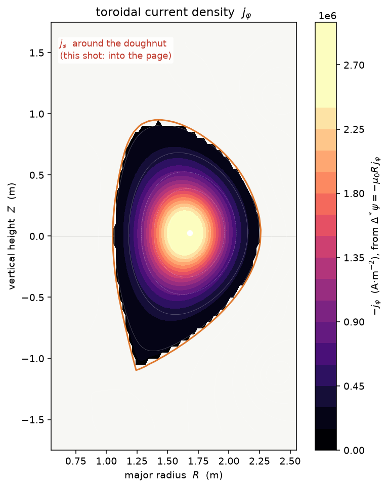

*$j_\varphi$ inside the LCFS from Ampère, $\Delta^*\psi=-\mu_0 R\,j_\varphi$. On this DIII-D frame $\psi$ is a minimum, so $j_\varphi$ is into the page; the colour scale is $-j_\varphi$ so the core reads as current. The same $j_\varphi$ is the right-hand side of Grad–Shafranov.*

## The Grad–Shafranov equation

Recall from Step 4: $\Delta^*\psi=-\mu_0 R\,j_\varphi$.
Recall from Step 5: $j_\varphi=R\,p'(\psi)+FF'(\psi)/(\mu_0 R)$.

Now comes the grand finale! We take our formula for $j_\varphi$ from Step 5 and drop it straight into our curvature equation from Step 4:

$$
\Delta^*\psi
=-\mu_0 R\left(R\,p'+\frac{FF'}{\mu_0 R}\right)
=-\mu_0 R^2\,p'(\psi)-FF'(\psi).
$$

And there it is! **The Grad–Shafranov equation.**

Two brilliant physicists named Harold Grad and Vitaly Shafranov figured this out back in the 1950s and 1960s. Supercomputers run programs like **EFIT** to solve this equation numerically thousands of times during an experiment. When scientists run an experiment, they never type in the whole equation—they submit a map of $\psi$ that is *supposed* to be a true solution to this equation.

### Summary of the Cast of Characters

| Symbol | Type | Description |
|---|---|---|
| $\nabla\times$ | operator | **Curl:** measures how much a vector field swirls around a tiny loop, divided by the loop's area. |
| $\mu_0$ | constant | $4\pi\times 10^{-7}\ \mathrm{N\cdot A^{-2}}$. Empty space's conversion factor that turns electric current density $\mathbf{j}$ into magnetic swirl $\mathrm{T/m}$. |
| $j_\varphi$ | scalar field ($\mathrm{A\cdot m^{-2}}$) | Long-way electric current density flowing around the doughnut ring. |
| $\Delta^*$ | operator | **Doughnut Laplacian** of $\psi$: $\displaystyle\partial_R^2\psi+\partial_Z^2\psi-(1/R)\partial_R\psi$. Measures track curvature on a doughnut. |
| $p'(\psi)$ | flux function | $dp/d\psi$. How fast plasma pressure changes as you step from one track to the next. |
| $FF'(\psi)$ | flux function | $F\,dF/d\psi$. How fast the long-way magnetic swirl changes from one track to the next. |

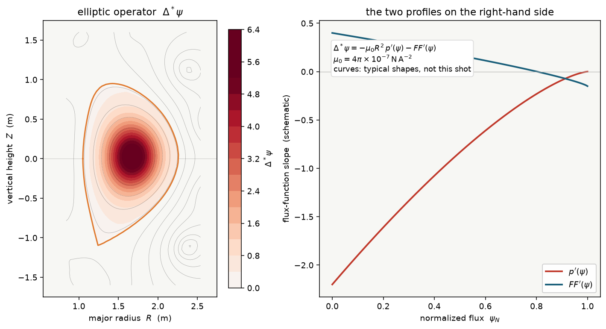

*Left: $\Delta^*\psi$ computed from this shot’s $\psi$ (inside the last closed track). Right: schematic $p'$ and $FF'$ — typical shapes, not a fit to this shot. The next picture is those two curves as themselves.*

The two missing profiles are **slopes of two other curves**, one number on every track:

* $p'(\psi)=dp/d\psi$ — how fast the soup’s push drops as you hop to the next outer track.
* $FF'(\psi)=F\,dF/d\psi$ — how fast the long-way $F=RB_\varphi$ changes on that same hop.

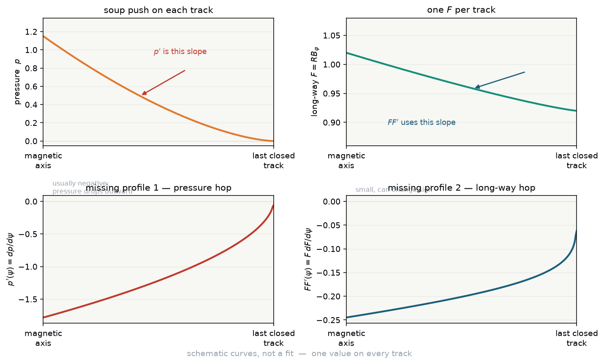

*Top: the things whose slopes matter — pressure $p$ (high on axis, spent at the edge) and $F$ (almost flat). Bottom: those slopes. Schematic, not a fit. $p'$ is usually negative because pressure falls outward. $FF'$ is smaller and can change sign.*

Grad–Shafranov is a **forward** recipe. You pick a smooth pair of curves $p'(\psi)$ and $FF'(\psi)$, and the equation tells you the track map $\psi$. A $\psi$ that no smooth pair could have made is not a solution. A $\psi$ that *did* come from a smooth pair is legal. The rest of this section details how two extra numbers constrain that pair — not how they replace it.

### Formula for a family of $F$ consistent with a fixed $q_{95}$

Recall the helix from the [tokamak geometry section](#tokamak-shape-and-poloidal-plane): follow one track around the doughnut and count how many laps the *long* way it takes to finish one lap the *short* way. That count is $q$. **$q_{95}$ is $q$ on the track that sits 95 percent of the way from the magnetic axis out to the last closed track.**

On that same track, $F$ has one value. Call it $F_{95}$ — not a new kind of $F$, just $R B_\varphi$ at a point on that track. Walk once around the track; at each step add $1/(R\,\lvert\nabla\psi\rvert)$. That sum is a scalar $W$ made from the map $\psi$. Then $F_{95}=2\pi q_{95}/W$.

$\tau=0$ on axis, $\tau=1$ on the last closed track (DIII-D: $\tau=(t-t_{\mathrm{ax}})/(t_b-t_{\mathrm{ax}})$; MAST: ends swap). $\tau_{95}=0.95$. $\Delta\psi=t_b-t_{\mathrm{ax}}$ (flip sign on MAST so $\Delta\psi>0$ outward). Physicists write a polynomial for $FF'$, vanishing at the edge, and pin $F$ at $\tau_{95}$ with $q_{95}$:

$$
G(\tau;c)=(1-\tau)\Bigl(1+\sum_{k=1}^{n_f}c_k\tau^k\Bigr),
\qquad
F(\tau;q_{95};\ \bar{\gamma},c)
=\sqrt{\max\left(0,\ \left(\frac{2\pi q_{95}}{W}\right)^2
-2\Delta\psi\,\bar{\gamma}\int_{\tau}^{\tau_{95}}G(\sigma;c)\,d\sigma\right)}.
$$

Take $F>0$ (same sign as $B_\varphi$). $n_f=2$ is the usual EFIT-sized model family.

**Knobs and domains**

* $q_{95}\in[2,16]$
* $;$ $\bar{\gamma}\in[-10,10]\ \mathrm{(T\cdot m)^2/(V\cdot s/rad)}$ — scale of $FF'$
* $;$ $c_k\in[-3,3]$, $k=1,\ldots,n_f$, $n_f\in\{1,2,3\}$ — shape of $FF'$

If the TF coils also give $F_b=R_0 B_t$ at $\tau=1$, drop $\bar{\gamma}$ and solve it from $F(1)=F_b$:

$$
\bar{\gamma}=\frac{(2\pi q_{95}/W)^2-F_b^2}{2\Delta\psi\bigl(I_c(\tau_{95})-I_c(1)\bigr)},
\qquad
I_c(x)=x-\frac{x^2}{2}+\sum_{k=1}^{n_f}c_k\left(\frac{x^{k+1}}{k+1}-\frac{x^{k+2}}{k+2}\right).
$$

$I_c$ is the antiderivative of $G(\,\cdot\,;c)$. The definite integral in $F$ is $I_c(\tau_{95})-I_c(\tau)$.

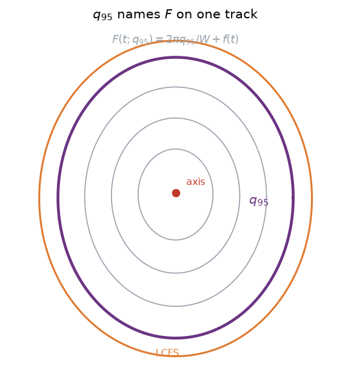

*The purple track is where $f$ must be zero. Other tracks still free.*

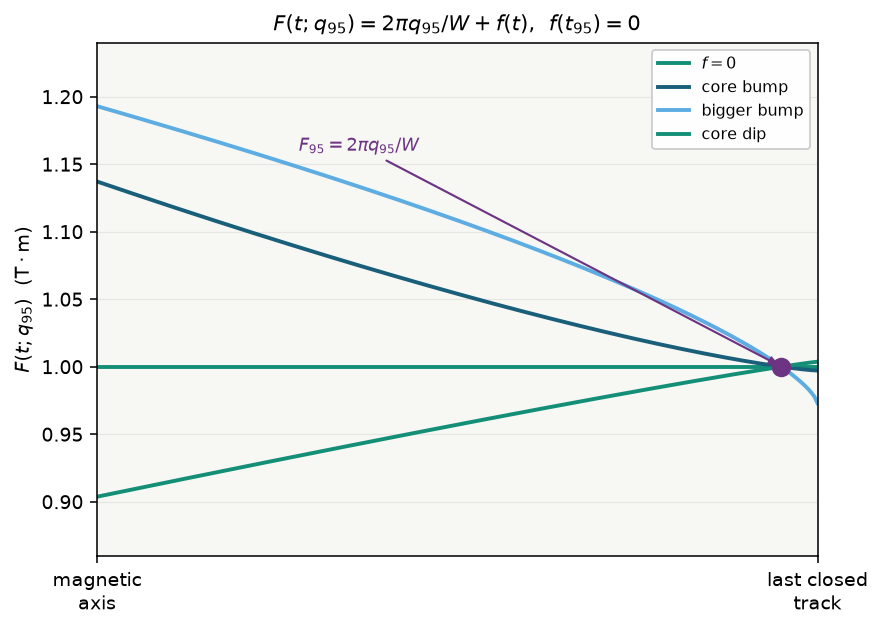

*Members of $F(t;q_{95})$. All pass through $F_{95}=2\pi q_{95}/W$.*

---

### Formula for a family of $p$ consistent with a fixed $\beta_N$

$\beta_N$ constrains how tall $p$ is **on average**, not $p$ on each track. The pieces in the formula:

* $\langle p\rangle$ — the soup’s push $p$, averaged through the whole balloon.
* $\beta_t$ — that average compared to the push of the long-way field.
* $B_t$ — the typical TF-coil field, in tesla, usually taken at a typical $R$. Same $B_\varphi$ family, not a new arrow.
* $I_p$ — total long-way current from the [tokamak geometry section](#tokamak-shape-and-poloidal-plane), written in mega-amperes so the number is a few, not millions.
* $a$ — how fat the plasma is (minor radius). $\beta_N$ resizes $\beta_t$ by fatness, $B_t$, and $I_p$ so a small machine and a big one can be compared.

$$
\beta_t=\frac{2\mu_0\langle p\rangle}{B_t^2},\qquad
\beta_N=100\,\beta_t\,\frac{a\,B_t}{I_p\text{ in MA}}.
$$

Turn that around and put $\beta_N$ on an EFIT $p'$ polynomial (edge $p=0$, edge $p'=0$):

$$
\langle p\rangle(\beta_N)
=\frac{\beta_N}{100}\cdot\frac{B_t}{2\mu_0}\cdot\frac{I_p\text{ in MA}}{a},
\qquad
P'(\tau;d)=(1-\tau)\Bigl(1+\sum_{k=1}^{n_p}d_k\tau^k\Bigr),
\qquad
s(\tau;d)=\int_{\tau}^{1}P'(\sigma;d)\,d\sigma,
$$

$$
p(\tau;\beta_N;\ d)
=\langle p\rangle(\beta_N)\,\frac{s(\tau;d)}{\langle s\rangle_V}.
$$

$s(\tau;d)=I_d(1)-I_d(\tau)$ with the same antiderivative $I_d$ as $I_c$ above, using the $d_k$. Volume element on the slice: $dV=2\pi R\,dR\,dZ$, sum only inside the last closed track. $\langle s\rangle_V=\sum s(\tau_{ij})\,2\pi R_i\Delta R\Delta Z\big/\sum 2\pi R_i\Delta R\Delta Z$. The scale of $p'$ cancels; $\beta_N$ sets the height. $n_p=2$ is the usual model family.

**Knobs and domains**

* $\beta_N\in[0.2,4]$
* $;$ $d_k\in[-3,3]$, $k=1,\ldots,n_p$, $n_p\in\{1,2,3\}$ — shape of $p'$

**What the later Python takes.** Knobs alone do not determine $F$ or $p$. Also pass, from the current $\psi$ iterate (or a first guess): $W$, $\Delta\psi=|t_b-t_{\mathrm{ax}}|$, and for $p$ the grid so $\langle s\rangle_V$ can be summed. Frame numbers, not knobs: $B_t$, $I_p$ in MA, $a$, and optional $F_b=R_0 B_t$. Then $F(\tau)$ and $p(\tau)$ are closed. The Grad–Shafranov solve that updates $\psi$ (and therefore $W$, $\Delta\psi$, $\langle s\rangle_V$, $\tau_{ij}$) is a separate function.

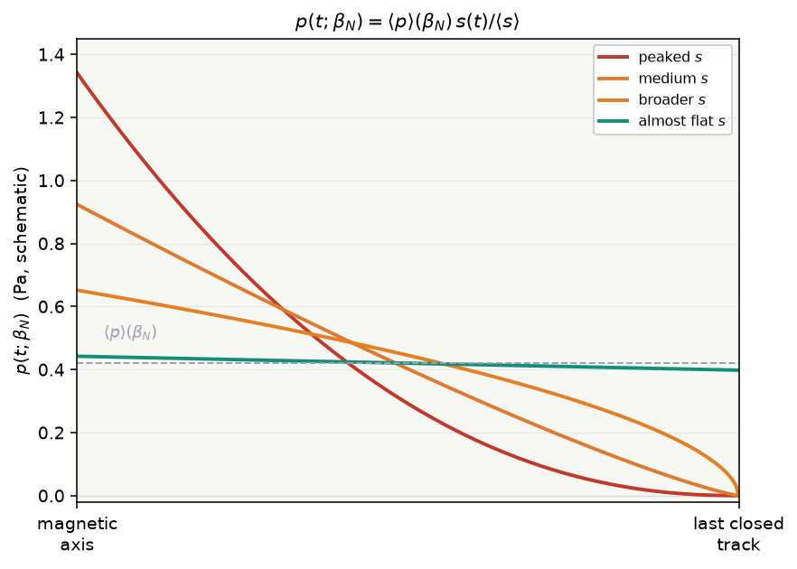

*Members of $p(t;\beta_N)$. All have the same $\langle p\rangle(\beta_N)$.*

---

### We also need a boundary

$p(\tau)$ and $F(\tau)$ are the source inside the plasma. They do not place the tracks in $(R,Z)$. The files do that with **coil currents**, which you do not search.

Call $\Omega$ the official $(R,Z)$ grid (65 by 65 on both machines). One circular filament at $(R_c,Z_c)$ carrying $I$ **amperes** makes

$$
k^{2}=\frac{4RR_{c}}{(R+R_{c})^{2}+(Z-Z_{c})^{2}},
\qquad
G(R,Z;R_{c},Z_{c})=\frac{\mu_{0}\sqrt{RR_{c}}}{2\pi k}\Bigl[(2-k^{2})K(k^{2})-2E(k^{2})\Bigr].
$$

$K$ and $E$ are the complete elliptic integrals (SciPy: ellipk and ellipe of $k^{2}$). A rectangular coil is the average of a $3\times 3$ of those filaments inside its shipped box. Then, once per frame,

$$
\psi_{\mathrm{vac}}(R,Z)
=\sum_{n=1}^{N_{\mathrm{coils}}}I_n\,G(R,Z;R_n,Z_n)
$$

on **every** grid point. $(R_n,Z_n)$ come from the coil geometry table. $I_n$ come from the magnetics columns, converted to amperes (kA or kA·turn as specified in that machine's data section). Do not include the TF column: it has no poloidal rectangle.

Split the unknown map as

$$
\psi=\psi_{\mathrm{vac}}+\psi_{\mathrm{pl}}.
$$

$\psi_{\mathrm{vac}}$ is finished. No family of walls. No probe for $\mathcal{B}$. The plasma piece is

$$
\psi_{\mathrm{pl}}(R,Z)
=\iint_{\Omega} G(R,Z;R',Z')\,j_\varphi(R',Z')\,dR'\,dZ',
$$

with the same $G$. $j_\varphi=0$ outside the last closed track. Inside,

$$
j_\varphi=R\,p'(\psi)+\frac{FF'(\psi)}{\mu_0 R}.
$$

The total edge values $\psi|_{\partial\Omega}$ are then outputs of this sum, not extra knobs.

---

### Solving for the flux map

**Inputs, this frame (none of these is a wall to search).**

* Knobs already chosen: $q_{95}$, $\beta_N$, model $c$, $\bar{\gamma}$ (or $F_b$), $d$.
* Frame numbers: $I_{\mathrm{coils}}$, coil boxes, $B_t$, $I_p$ in MA, $a$, grid $(R_i,Z_j)$.
* $\psi_{\mathrm{vac}}$ from the previous section (compute once).

**Slopes from the fitted curves.** $\Delta\psi=|t_b-t_{\mathrm{ax}}|$. $\tau$ increases from axis to last closed. Then

$$
p'(\psi)=\frac{1}{\Delta\psi}\frac{dp}{d\tau},
\qquad
FF'(\psi)=\frac{F}{\Delta\psi}\frac{dF}{d\tau}.
$$

($F(\tau)$ and $p(\tau)$ are the family functions of the earlier sections. $W$ and $\langle s\rangle_V$ used to build them come from the current $\psi$ iterate.)

**Last closed track, this iterate.** From the current $\psi$: the last simple closed contour around the magnetic axis that does not run off the grid. If $\psi$ has an X-point, that contour is the one through the X-point. Iterate 0 has no such contour yet: use a trial disk in the middle of $\Omega$ (radius $\sim a$, centre at typical $R_0$) and replace it after the first pass.

**One iterate.**

1. From the current $\psi$, read $t_{\mathrm{ax}}$, $t_b$, last closed track, $\tau_{ij}$, $W$, $\Delta\psi$, $\langle s\rangle_V$.
2. Rebuild $F(\tau)$, $p(\tau)$ from the knobs and those scalars. Form $p'$ and $FF'$.
3. Set $j_\varphi=R p'+FF'/(\mu_0 R)$ inside the last closed track, $j_\varphi=0$ outside.
4. $\psi_{\mathrm{pl}}(R,Z)=\iint G\,j_\varphi\,dR'\,dZ'$ on the whole grid (same $G$ as $\psi_{\mathrm{vac}}$).
5. $\psi\leftarrow\psi_{\mathrm{vac}}+\psi_{\mathrm{pl}}$.

**Stop** when $\max|\psi-\psi_{\mathrm{old}}|$ and the change in $(W,\Delta\psi,\langle s\rangle_V)$ are small. Then $q_{95}$ and $\beta_N$ still mean what the family formulas said, because $W$ and $\langle s\rangle_V$ were rebuilt to match this $\psi$.

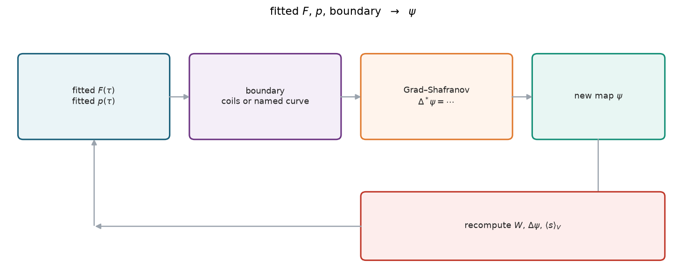

*$F$ and $p$ from knobs. $\psi_{\mathrm{vac}}$ locked. $j_\varphi$ inside the last closed track. $\psi_{\mathrm{pl}}$ from $G$. Sum. Rebuild scalars. Repeat.*

Model knobs $(c,\bar{\gamma},d)$ pick which $F$ and $p$. Same $q_{95}$, $\beta_N$, and $\psi_{\mathrm{vac}}$, different model, different map:

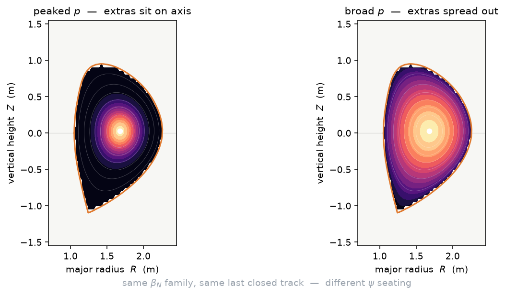

*Two model $d$ choices. Same $\beta_N$. Different extras, different $\psi$ seating.*

**Output of the forward solver:** The settled grid $\psi(R,Z)$, along with the model knobs $q_{95}$ and $\beta_N$, form the three prediction arrays submitted for scoring. See the [Scoring](scoring.md#scoring) section for the complete evaluation pipeline ($R^2_\psi$, $R^2_{\{q_{95},\beta_N\}}$, $D_{\mathrm{LCFS}}$, and Consistency across the seven geometric and physical scalars).
