# Benchmark report — CRC_FEQ_olive_O1_dualctx

**CATSKILLS RESEARCH COMPANY**

**Model version:** `0.1.0+CRC_FEQ_olive+65cfe77`  
**Checkpoint:** `CRC_FEQ_olive_O1_dualctx.pt`  
**SHA-256:** `451af695446ae0045d955566c311717b5570f6e6ff22b6d1376629bc6e5cbabd`  
**Created (UTC):** 2026-08-20 (train receipt); report assembled 2026-11-03  
**Lab git (train):** `65cfe77`  
**Code URL:** https://github.com/catskillsresearch/fusion-equilibrium-challenge/commit/65cfe77  
**Phase-3 release asset:** https://github.com/catskillsresearch/catskills_fec/releases/download/phase3-rebuild-6dc3637/CRC_FEQ_olive_O1_dualctx.pt  
**Not to confuse with:** `CRC_FEQ_olive_geom` / O1G (later color; six-member ensemble parents). This report is **Olive O1 dualctx only**.

## Problem description

### What we are solving

**Fusion Equilibrium Challenge (Challenge 1 — DIII-D):** learn a mapping from
*non-magnetic* tokamak diagnostics to the plasma’s magnetic geometry.

In plain English: a tokamak is a donut-shaped bottle that holds hot plasma with
magnetic fields. The shape of the plasma is a 2D map of **poloidal magnetic flux**
$\psi(R,Z)$. Historically, **EFIT** (Equilibrium Fitting — the standard reconstruction
code on DIII-D and many other tokamaks) rebuilds that map using magnetic
sensors on the vessel wall. Future reactors will lose those sensors to radiation.
We rebuild $\psi$ (and two related numbers) from **coil currents**, **Thomson
scattering** ($T_e$, $n_e$), and **plasma current** alone — with **no** Mirnov /
pickup / Rogowski wall magnetics.

Ground truth is EFIT’s labelled $\psi$ on held-out DIII-D shots. The official scorer
does **not** plug our $\hat\psi$ into the Grad–Shafranov PDE at scoring time; it
compares maps, boundaries, and geometry derived from the maps (details below).
Grad–Shafranov is still the physics that EFIT solutions approximately satisfy, and
the motivation for our physics-informed models.

### Inputs (what we use)

All inputs are functions of time during a **shot** (one plasma pulse). Magnetics and
Thomson are sampled at higher rate than EFIT; pipelines interpolate them onto EFIT
timestamps $t_k$.

| Symbol / name | Math (rough) | Plain English description |
|---------------|--------------|---------------------------|
| Coil currents | $I_c(t)$ for each coil $c$ | How hard each electromagnet is driven. DIII-D: 18 F-coils (F1A…F9B), ohmic solenoid **ECOILA**, toroidal-field **bcoil** — shaping and heating “knobs.” |
| Plasma current | $I_p(t)$ | Total current flowing through the plasma (kA). Strong driver of equilibrium. |
| Thomson $T_e$ | $T_e(t,\mathbf{x}_i)$ | Electron **temperature** from laser scattering at several spatial channels $\mathbf{x}_i$. A **profile over time**, not one number. |
| Thomson $n_e$ | $n_e(t,\mathbf{x}_i)$ | Electron **density** on the same chords. Together $n_e T_e$ proxies kinetic pressure. |
| Core vs edge TS | two diagnostic views | Core vertical system vs edge/tangential system — different channel layouts. |

**Not used as challenge inputs (withheld):** wall magnetic probes that classic EFIT relies on.

### Outputs (what we submit / what we plot as Pred)

| Output | Math | Plain English description |
|--------|------|---------------------------|
| Flux map | $\hat\psi(R_j, Z_i;\, t_k)$ on a fixed **65×65** $(R,Z)$ grid per EFIT time | The full “topographic map” of magnetic surfaces. Nested closed contours = nested flux surfaces; outer closed contour ≈ plasma edge. |
| Edge safety factor | $\hat q_{95}(t_k)$ | **Edge safety** is how resistant the plasma edge is to certain MHD instabilities (higher $q$ → field lines wind more helically, typically more stable against kink-like modes). $q_{95}$ measures that winding number — times around the long way per short-way loop — on the ~95% flux surface (a standard near-edge surface; not the exact separatrix where $q\to\infty$). The range is about **$[2, 23]$** on DIII-D shots here (most values ~3–9); **higher is “safer”** against kink-like modes. **We submit this as a scalar series.** |
| Normalized beta | $\hat\beta_N(t_k)$ | Plasma pressure relative to magnetic pressure, normalized (Troyon-style $\beta_N$). The range is about **$[-1.5, 4]$** on DIII-D shots here (most values ~0.2–2.6). **Higher means more pressure / performance** for given current and field, but too high approaches MHD stability limits — so “good” for fusion output is the high end, until the plasma hits those limits. **We submit this as a scalar series.** |

Everything else the leaderboard scores is **derived by the scorer from our $\hat\psi$** —
we do not submit these numbers ourselves:

| Derived quantity | Plain English description |
|------------------|---------------------------|
| LCFS outline | **Last closed flux surface** — the plasma’s outer boundary curve in the $(R,Z)$ plane. |
| Magnetic axis | The center of the nested flux surfaces — roughly where the plasma is “hottest / most central” in the cross-section ($R_{\mathrm{axis}}$, $Z_{\mathrm{axis}}$). |
| Elongation $\kappa$ | How tall vs wide the plasma cross-section is (stretched up–down vs round). |
| Triangularity | How D-shaped / pointed the cross-section is (inboard/outboard “corners”), not a simple circle or ellipse. |
| Volume | How much space the plasma occupies inside the LCFS. |
| Internal inductance $\ell_i$ | How peaked the toroidal current is toward the axis vs spread out — a shape-of-the-current profile number. |

### Scoring criteria (official composite $S$)

On each evaluation fold the scorer builds a single number in $[0,1]$ (higher is better):

$$
S = 0.55\cdot\max(0,R^2_\psi)
  + 0.15\cdot\max(0,R^2_{\{q_{95},\beta_N\}})
  + 0.10\cdot\bigl(1 - \min(1,D_{\mathrm{LCFS}})\bigr)
  + 0.20\cdot\mathrm{Consistency}.
$$

| Term | Weight | What it measures |
|------|-------:|------------------|
| $R^2_\psi$ | 0.55 | Coefficient of determination between $\hat\psi$ and EFIT $\psi$ over all grid points × times × shots. $1$ = identical maps; $\le 0$ clipped to $0$ in $S$. |
| $R^2_{\{q_{95},\beta_N\}}$ | 0.15 | Same idea for the two **submitted** scalars (pooled). |
| $1-D_{\mathrm{LCFS}}$ | 0.10 | Extract the **last closed flux surface** (plasma boundary polygon) from $\hat\psi$ and from true $\psi$; $D_{\mathrm{LCFS}}$ is a normalized symmetric **Hausdorff** distance between those curves. Closer outlines → higher score. |
| Consistency | 0.20 | From $\hat\psi$ (and from true $\psi$) compute geometric scalars: $R_{\mathrm{axis}}$, $Z_{\mathrm{axis}}$, elongation $\kappa$, triangularities, volume, $\ell_i$. Score how well those **derived** numbers match — so a blurry-but-pretty $\psi$ that implies the wrong shape is punished. |

**Physics equation (background, not the Codabench loss):** ideal axisymmetric equilibrium
obeys the **Grad–Shafranov** equation for poloidal flux $\psi(R,Z)$,

$$
\Delta^*\psi
  = R\frac{\partial}{\partial R}\!\left(\frac{1}{R}\frac{\partial\psi}{\partial R}\right)
  + \frac{\partial^2\psi}{\partial Z^2}
  = -\mu_0 R^2 p'(\psi) - FF'(\psi),
$$

where $p(\psi)$ is plasma pressure and $F(\psi)$ relates to the toroidal field.
EFIT finds $\psi$ consistent with that PDE plus measurements. Our official $S$ above
compares maps and geometry **directly**; a PINN-style trainer may still minimize a
discretized Grad–Shafranov residual during learning so $\hat\psi$ stays physically
plausible — that residual is **not** itself a term in $S$.

# Olive model description — checkpoint `CRC_FEQ_olive_O1_dualctx`

**Model ID:** `CRC_FEQ_olive` *(public name; the word “olive” is only a color, not a method)*  
**Checkpoint tag:** `O1_dualctx`  
**Color:** Olive `#808000` — next luminance step after Steel Blue  
**Status (campaign):** CLOSED 2026-08-20 as an early-SoftDerive color — SoftDerive never turned on; O1.1 never enabled; both parents died in data-only warmup. Successor color was Red.  
**Status (this checkpoint):** **RETAINED.** `CRC_FEQ_olive_O1_dualctx.pt` is the from-scratch `CoeffDualContext` parent trained under Olive job **O1** (lab commit `65cfe77`). Official holdout at kill: \(S=0.986209\). Later `psi_tailfit` plain fine-tunes of this parent became the strongest single flux members in the house (COLOR_LEDGER §30.10); Phase 3 ships two of those children (`CRC_FEQ_brown_TF_LS_O1_{101,W1}`) and releases this parent as the warm-start asset.  
**What this report is:** standalone Brown/Charcoal-style package report for **this specific weight**, integrating the Olive model description with the measured O1 receipt, post-campaign afterlife, and a 3-shot holdout figure pack under `figures/`. It is not a Codabench attempt directory.  
**Predecessor:** [`MODEL_DESCRIPTION_CRC_FEQ_steel.md`](../../catskills/MODEL_DESCRIPTION_CRC_FEQ_steel.md) — closed.  
**Code:** [`pinn_charcoal.py`](../../catskills/pinn_charcoal.py) (`CoeffDualContext`, SoftDerive), [`soft_derive.py`](../../catskills/soft_derive.py). GradNorm was new in this color.  
**Sibling (do not mix docs):** olive_geom / O1G lives under `CRC_FEQ_olive_geom_*` — different MODEL_ID, different campaign.

This document is the model. It is written for a reader who does not already know fusion physics or neural networks. Every technical term is defined the first time it is used. The execution plan (which job to launch, and when) lives in `OLIVE_PLAN.md` and is not repeated here.

---

## How to read this

The competition asks a computer to reconstruct the shape of a fusion plasma from sensor readings. Brown already does that as **two** networks whose predictions are averaged, and that mix is what we submit today. Steel tried to improve the mix by leaving those networks frozen and adding a small physics residual. That family is closed. Olive trains **new parents**: the same map family as B8 and F9, new weights, and a loss that can still pull \(\kappa\) and \(\ell_i\) after pixel \(\psi\) has saturated.

The sections go in this order on purpose:

0. **The ledger** — every prior color, every process-step ID, goal, and measured result. Read this before proposing a job. It is the system prompt for what we already know.
1. The physical object we are reconstructing.
2. The three numbers the program must emit.
3. The formula the judges use to grade those numbers.
4. Why Steel is closed and why the leftover is fit quality.
5. The sensor readings and the 60-number picture.
6. Neural-network vocabulary, from zero.
7. Olive’s two parents, drawn.
8. The **loss**, including GradNorm and the promoted \(\ell_i\) stack.
9. The **optimizers**.
10. Every hyperparameter in one place.
11. When we mix (the three legal pairs, and the retired single-must-beat-0.99320 gate).
12. What we have already measured (Brown / Steel).
13. How to run it.

---

## 0. What prior colors already measured

This section is a **standing memory**, not a highlight reel. A later session that has not read Black through Steel should be able to start here and know which levers are dead, which ceilings are illegal, and which two bets Olive is allowed to take.

**How to read the table.** *Color* is the luminance revision. *ID* is the process-step tag on that color’s board or plan (not a Codabench name). *Goal* is the one-variable question the step was written to answer. *Result* is the official 80-shot holdout unless marked public, oracle/GT, or existence-only. Verdicts:

| word | meaning |
|---|---|
| **SHIP** | Packaged and scored on Codabench. |
| **KEEP** | Beats the then-held local bar. May or may not have shipped. |
| **PAPER** | Real but under the submit bar. Do not package. |
| **PASS** | The written gate cleared. Often a ceiling, not a submit. |
| **MISS** | Trained or applied; did not beat the keep bar. |
| **KILL** | Hit a written floor (usually \(R^2_\psi\)) and stopped. |
| **CEILING** | Uses holdout GT or an illegal warp. Not a submit. |
| **LOCK** | Negative result that closes a family. |
| **NO** | Existence fail; the arm was never legal. |
| **MOVED** | Rewritten as a later color’s job. |

Local \(S\) is the official scorer. Public \(S\) is Codabench Challenge 1 (DIII-D). Calibration has moved: maroon thought public ≈ local − 0.0013; purple ship was ≈ local − 0.0004; Brown B8+F9 is **public = local − 0.00135**. Do not mix those offsets.

### 0.1 One line per color

| Color | Thesis | What it left |
|---|---|---|
| Black | Ridge / MLP on PCA-60 | The family exists. Capacity is tiny. |
| Navy | Implicit neural \(\psi(R,Z)\), no PCA | \(S\approx 0.60\). INR as a parent is dead. |
| Teal | Train Consistency on the PCA manifold | Surrogate \(\kappa\) can go to \(R^2=-0.60\). Mean of three teals still a toy. |
| Charcoal | Differentiable SoftDerive + geom emphasis | SoftDerive works. Geom-on MLP ships public 0.9556. Capacity, not the basis, is the fit limit. Vacuum-as-\(Y\) is dead. |
| Maroon | Full corpus + residual trunk + ensemble | Trunk > MLP. Clip 10. Concatenated context loses three times. R6: GT through \(k=60\) is Cons 0.9972. Public 0.9832 / #6. |
| Purple | Dualctx (context gets its own encoder) | C1/C2b/C7b. \(\lambda_w=1.35\) saturates. 200 epochs anti-align. GRU-only trunk dies. Public 0.9904 / #7. |
| Forest | Shot GRU + F9 + post-process \(\kappa\) | F9 single 0.99191. Oracles F15/F32/F57/F66 are ceilings. Predict \(s_Z,dR,dZ\) from \(X\) or the F9 trunk is dead. |
| Brown | Z-grid dualctx parent × F9 | B8+F9 local 0.99320 → public **0.99185 / #5**. Cousin 3-mixes dilute. B1/B3/B12/B15 kill. |
| Steel | Frozen-B8 residual (GS / probes / eddy) | Every arm ~0.991 or worse. K: \(\Delta\kappa\) OOF \(R^2=-0.019\). Family closed. |

Held ship is Brown B8+F9. Olive does not reopen any row marked LOCK / KILL / CEILING / NO.

### 0.2 The ledger

| Color | ID | Goal | Result |
|---|---|---|---|
| Black | baseline | Ridge / small MLP on PCA-60 | The competition family. \(S\) far below 0.95. Not the live ship. |
| Navy | INR | Drop PCA; emit \(\psi(R,Z)\) from a coordinate MLP | **LOCK.** \(S\approx 0.60\), Cons ~0. Do not rebuild the decoder as an INR. |
| Teal | manifold Cons | Push Consistency in coefficient space | Surrogate can destroy \(\kappa\) (\(R^2_\kappa=-0.60\)). A biased Cons loss is worse than none. |
| Teal | ensemble3 | Mean of three Wave-3 teal scale checkpoints | Packaging ID, not a luminance step. Toy vs later ships. |
| Charcoal | 0a | Is \(k=60\) the Cons ceiling? GT through our basis | **PASS / LOCK.** Cons **0.9971**. FieldRefiner cancelled. Raising \(k\) buys nothing. (Maroon R6 repeats this cleaner.) |
| Charcoal | 0b | Shrinkage vs noise: does smoothing still pay? | Ensemble and smoothing are substitutes. Smoothing pays only while incoherent residual remains. |
| Charcoal | 0c | Test-time temporal smooth of \(\psi\) | Negative on a strong ensemble (−0.00035 S later on maroon R3). Helps slow scalars, hurts \(\ell_i\). |
| Charcoal | 0d | Kappa error attribution | Field error, not extraction, dominates \(\kappa\). |
| Charcoal | P1 | Write SoftDerive = batched `derive_frame` | **PASS.** Discrete O-point / \(\psi_b\) detached; values stay in-graph. This is still the Cons loss. |
| Charcoal | P3 | Ablate geom / temporal / H1 | Geom emphasis works. Temporal window and H1 hurt at this scale. |
| Charcoal | P4 | Scale s42, geom-emphasis 10 | **KEEP.** Local \(S\) **0.9530** / Cons 0.8489. Beat the prior ship. |
| Charcoal | P5 | Scale s202 | **SHIP.** Local 0.9567 → public **0.9556**. Best charcoal. s101 crashed. |
| Charcoal | P6a | Soft \(D_{\mathrm{LCFS}}\) | Term works as a surrogate; official \(1-D_{\mathrm{LCFS}}\) later shown not to track (maroon R10b). |
| Charcoal | P6b/c/d | Deficit weights / anneal / \(L_{q\beta}\) as \(R^2\) | Built; ladder waited on P5. Not the maroon trunk. |
| Charcoal | P7 | \(\psi\) diagnostic on trained-on vs holdout | **CAPACITY.** Trained-on \(R^2_\psi\) 0.99537. Not an input bug. |
| Charcoal | P8 | Width/depth ladder at 250 shots | Width 512 helps a little; 1024+ overfits this shot count. Wrong question: we train on 12.7% of the corpus. |
| Charcoal | 25.1 | Subtract \(\psi_{\mathrm{vac}}\) from \(Y\) | **LOCK.** Vacuum-as-\(Y\) dead. (Brown B13 later uses vac as *input* PCA, a different question.) |
| Maroon | M0 | Coeff cache; reconstruct unseen shots | **PASS.** \(R^2_\psi\ge 0.99999\). Full-corpus training fits on 12 GB. |
| Maroon | M1 | Data ladder at equal steps, geom off | **PASS.** 7.7× data: \(S\) 0.92055 → 0.93443. Thesis holds. M2–M5 (capacity-first) superseded. |
| Maroon | P1 | Full corpus, geom-emphasis 10, 250 ep | **KILL** (power cycle ep 50). Partial \(S\) 0.95017: Cons 0.710→0.848, \(\psi\) and LCFS paid. Geom-on MLP is net-destructive on the term #1 wins. |
| Maroon | P2–P5 | Continue charcoal geom ladder | **Cancelled.** P1 fragment was enough. |
| Maroon | R1 | Residual trunk, geom off, vs M1c | **PASS.** \(S\) **0.97506**, \(R^2_\psi\) 0.99880. Trunk was the ceiling. Cons 0.8936 *without* geom loss. |
| Maroon | R2a | Concatenate window-5 context | **MISS.** \(S\) 0.95938. Central-diff of raw \(X\) amplifies jumps. |
| Maroon | R2b | `--feature-clip 10` | **KEEP.** \(S\) **0.97698**. Gain through Cons, not \(\psi\). Clip stays on forever. |
| Maroon | R3 | Seed ensemble of four R2b | **KEEP.** \(S\) **0.98170** / Cons 0.9231. Character ≫ magnitude (~80×). Seed variance ±0.002 \(S\). |
| Maroon | R4 | Context + clip together | **MISS.** \(S\) 0.96979. Concatenated context retired on this line. |
| Maroon | R5 | 17M trunk, no warmup / no clip | **VOID.** Diverged (loss → 7.9e6). Not a capacity verdict. |
| Maroon | R6 | GT \(\psi\) through \(k=60\) | **LOCK.** \(S\) 0.99900 / Cons **0.9972** / \(\kappa\) **0.9887** / \(\ell_i\) **0.9988**. The entire remaining gap is fit quality. Do not raise \(k\). |
| Maroon | R7 | R5 trunk + warmup 5 + grad-clip 1 | **KEEP.** \(S\) **0.97998**. Capacity is real. |
| Maroon | R8 | 1/\(N\) of seed members | Asymptote \(S(N)=0.98395-0.00910/N\). \(N=\infty\) still under #1. Count is spent. |
| Maroon | R9 | 26.5M, matched wall clock vs R7 | **MISS** as a lever. \(S\) 0.98002 (+0.00004). Capacity saturated. |
| Maroon | R10a | `smoothdiff` concatenated context | **MISS** as a single (\(S\) 0.97642) and **KEEP** as a mix member (+0.00035): different \(X\) representation. |
| Maroon | R10b | Soft LCFS on | **MISS** as a single. Official LCFS −0.00013 while the surrogate improved 17%. Proxy ≠ metric. Still adds +0.00019 in a mix. |
| Maroon | kopt | Is PCA-50 the missing ingredient? | 14/60 modes lose to the mean; dropping them changes \(\psi\) MSE 0.001%. PCA-50 closed without training. |
| Maroon | ship6 | Heterogeneous mix R7+R9+R2b+R3b+R10a+R10b | **SHIP.** Local 0.98451 → public **0.9832 / #6**. Calib was wrong by 0.0045. Public ≈ local − 0.0013 *then*. |
| Purple | C1 | Dualctx: context encoder + gate init 0 | **PASS.** \(S\) **0.98178**. Cons +0.0085, \(\psi\) flat. Stem was the defect. |
| Purple | C2a | Bigger context encoder 1024×6 | **MISS.** Below C1. \(\kappa\) −0.0157. Branch wants window, not width. |
| Purple | C2b | Window 5→9 | Best single then: \(S\) **0.98214** / Cons 0.92619. Gate on \(S\) missed (±0.002). Cons is the signal. |
| Purple | combo | Free mix of owned ckpts | C1+C2a+C2b+R7+R9 local 0.98678. Not submitted (under then #5 bar). |
| Purple | C3 | 200 epochs of C2b | **MISS / LOCK schedule.** \(S\) 0.98154 *below* 88-ep C2b. \(\psi\) MSE down, Cons −0.00254. Objective anti-aligns past \(R^2_\psi\) 0.9993. |
| Purple | C4 | 8 dualctx members | Paused after C4a. Seed Cons noise is 0.0015, not 0.0005. |
| Purple | C5a | Whitened \(L_{\mathrm{coeff}}\) clamp 12, \(\lambda_w=0.05\) | **PASS.** \(S\) **0.98406** / Cons 0.93519. First Cons gain that does not spend \(\psi\). |
| Purple | C5b | Val selector only | **LOCK selector.** \(\Delta S\) −0.00008. Dead as a lever; kept because it is cheap. |
| Purple | band | Hand true coeffs by mode band | Cons responds ~1:1 to gradient share. Modes 1–12 hold ~60% of recoverable Cons. |
| Purple | C6a | \(\lambda_w=0.15\), clamp 12 | **MISS as written** (\(R^2_\psi\) −0.00005 vs gate) and **best single then**: \(S\) **0.98542** / Cons 0.94190. Dose curve is real. |
| Purple | C6b | Same strength, clamp 8 | Allocation matters: lost 0.00326 Cons to C6a, won \(\psi\). |
| Purple | C6c | Clamp 20 overshoot | Predicted miss; dropped to pay for C7. |
| Purple | C7a/b/c | \(\lambda_w\) 0.45 / **1.35** / 4.05 | Lever saturates at **1.35**: \(S\) 0.98884 / Cons 0.95773. \(\lambda=4.05\) is a null (+0.00061 Cons). |
| Purple | C8a | Edge-weighted \(L_{\mathrm{data}}\) | Used in the shipped 3-mix. Not a new #1. |
| Purple | C9a | Small geom on C7b | Cons pass / \(R^2_\psi\) miss. In the shipped 3-mix. |
| Purple | ship3 | C7b+C8a+C9a | **SHIP.** Local 0.99096 → public **0.9904 / #7**. Calib ≈ local − 0.0004 *then*. |
| Purple | D1a | GRU 2×256 as the only trunk | **KILL family.** \(S\) 0.96921 / Cons 0.867. R2a-shaped. |
| Purple | D2 | Gated GRU on frozen C7b | LIVE as a trainer, not a member. Every D2 mix lost to C7b+C8a+C9a. Shot recurrence → Forest. |
| Purple | 396M GRU | GRU-only huge trunk | **KILL.** Val \(R^2_\psi=-398\) after warmup. |
| Forest | F4 | Shot GRU on frozen present-frame map | \(S\) 0.98919. Cousin: +0.00007 on the 3-mix. Not a new base. |
| Forest | F6 | Unfreeze F4, lr \(10^{-3}\) | **MISS.** \(S\) 0.98872. |
| Forest | F7 | Unfreeze, lr \(3\times10^{-4}\) | **MISS.** \(S\) 0.98952. |
| Forest | F8 | Unfreeze + C9a geom2 | \(S\) 0.99014 / Cons 0.96254. Parent of F9. |
| Forest | F9 | F8 + one geom-off data epoch (edge flag was a no-op) | **KEEP.** Best single **0.99191** / Cons 0.97037 / \(\kappa\) 0.9454. `best_epoch` 1. Held Forest single. |
| Forest | F10 | F9 + edge band | **MISS.** 0.99171. Dose closed. |
| Forest | F11 | F8 + edge mix 0.8 | **MISS.** Tied F9 exactly. |
| Forest | F12 | F9 + lcfs-emphasis 2 | **MISS.** 0.99171 / Cons 0.9695. Soft LCFS does not move \(\kappa\). |
| Forest | mix+F4 | 3-mix + F4 | 0.99103. Dilutes later F9. |
| Forest | F13 | Inference GS projection of F9 | **KILL.** \(S\) **0.861** / Cons 0.376. Do not project a finished map onto GS. |
| Forest | F14 | Train-time \(L_{\mathrm{GS}}\) 88 ep | **Never launched.** Flag was not on the trainer. Same class as F13. |
| Forest | F15 | Oracle \(s_Z\) vs GT \(\kappa\) | **CEILING.** \(S\) 0.99294 / Cons 0.9750. The knob exists. |
| Forest | F16 | Features → \(s_Z\) | **LOCK.** corr 0.09; \(s=1.000\pm0.002\). \(S\) is F9. |
| Forest | F17 | Features → \(\kappa\) then \(s=\hat\kappa/\kappa_{\mathrm{map}}\) | **KILL.** Spent the map (\(\kappa\) 0.559). |
| Forest | F18 | Map-shape → \(s-1\) | **MISS.** corr 0.18. Stretch-from-anything-we-can-see closed. |
| Forest | F19 | Hotter \(\kappa\) geom on finished F9, 4 ep | **KILL.** \(S\) 0.9823. Do not raise \(\varepsilon\) on a finished map. |
| Forest | F20 | F15 + oracle \(dR\) | **CEILING.** \(S\) 0.99333 / \(R_{\mathrm{axis}}\) 1.000. |
| Forest | F21 | Features/shape → \(dR\) | **LOCK.** corr −0.02. |
| Forest | F22 | F9 embed → \(dR\) | **MISS.** corr 0.12. Worse than F9. |
| Forest | F23 | F8+edge+\(R_{\mathrm{axis}}\times 2\) | **MISS.** \(S\) 0.9890. Walked off. |
| Forest | F24 | 5-frame MA of F9 \(\psi\) | **MISS.** \(S\) 0.99058. |
| Forest | F25 | F9 recipe seed 101, 4 ep | **MISS.** \(S\) 0.9892. Val proxy picks a later epoch that spends the map. |
| Forest | F26 | Seed 101, 1 ep | **MISS.** \(S\) 0.9859. F9 is a seed-42 ticket. |
| Forest | F27 | Compute-light seq+mlp 512×2 | **MISS.** Not F9. |
| Forest | F28 | Freeze F9, train only GRU | **MISS.** \(S\) 0.99138. Cousin of F4. |
| Forest | F29 | C8a parent, F9 recipe 1 ep | **MISS.** \(S\) 0.9847. |
| Forest | F30 | Oracle \(s_R\) for \(\kappa\) | **CEILING.** Width is not a better 1-dof than \(s_Z\). |
| Forest | F31 | F15 + \(s_R\) to restore volume | **MISS.** Next is isotropic scale. |
| Forest | F32 | F15 + isotropic scale for volume | **CEILING.** PASS. GT only. |
| Forest | F33 | Oracle \(dR\) on F32 | **CEILING.** \(\psi\) spent at full \(dR\). |
| Forest | F34 | Scaled \(dR\) on F32 | **CEILING.** Local #1 bar 0.9938 in sight. |
| Forest | F35 | Legal shot-median \(\kappa\) stretch | **MISS.** Flattening kills frame variation. |
| Forest | F36 | Iso-volume on raw F9 | **MISS.** Volume returns; \(S\) does not. \(s_{\mathrm{iso}}\) only works after \(s_Z\). |
| Forest | F37 | Legal MA5 \(\kappa\) stretch | **MISS.** |
| Forest | F38 | dualseq 1 ep from F9 | **KILL.** \(S\) 0.9837. Dropping the shot GRU walks off F9. |
| Forest | F39 | F9 + \(L_{\mathrm{disp}}\) | **MISS.** Held flux, spent \(Z_{\mathrm{axis}}\) (0.886). |
| Forest | F40 | High-mode coeff residual | **MISS.** |
| Forest | F41 | F9 second epoch, lr \(10^{-4}\) | **MISS.** \(S\) 0.9901. Any second step walks off. |
| Forest | F42 | kNN stretch in F9 coeff space | **MISS.** Neighbors do not share \(s\). |
| Forest | F43 | C9a + edge, stay dualctx | **KILL.** \(S\) 0.9761. Do not put the F9 recipe on another dualctx. |
| Forest | F44 | \(q_{95}\)-implied \(\kappa\) stretch | **MISS.** |
| Forest | F45 | F8 + edge-mix 0.4 | **MISS.** \(S\) 0.9859. |
| Forest | F46 | F8 + edge-power 2 | **MISS** and a **bug**: dualshot `_loss` never applied `--edge-weight`. Bit-identical to F45. F9’s gain is a geom-off data epoch, not edge. |
| Forest | F47 | Real dualshot edge, hot lr | **MISS.** \(S\) 0.9873. 6× too hot vs F9’s \(5\times10^{-5}\). |
| Forest | F48 | F8 + 1 ep, geom off, lr \(5\times10^{-5}\) | **MISS.** \(S\) 0.99044. F8 bump, not F9. |
| Forest | F49 | F8 + 1 ep, lr \(3\times10^{-4}\) | **MISS.** Same basin as F47. F8+1-ep cannot reproduce F9. |
| Forest | F50 | F9 + gentle real edge | **MISS.** \(S\) 0.99127. Spends F9 Cons. |
| Forest | F51 | F9 + data-only second ep | **MISS.** Same as F50. Edge vs no-edge is a no-op. Second epoch closed. |
| Forest | F52 | F8 + gentle edge | **MISS.** Same as F48. |
| Forest | F53 | Shrink F9 \(\kappa\) to map mean | **KILL.** \(\kappa\) 0.842. Frame variation is real. |
| Forest | F54 | F9+F4 mean | **MISS.** Dilutes F9 (−0.00083). |
| Forest | F55 | F8 + F9 4-ep schedule | **MISS.** Val picked epoch 4 and walked off. |
| Forest | F56 | Embed → \(s_Z\) | **LOCK.** corr 0.059. Features, shape, coeffs, kNN, embed all fail to carry \(s\). |
| Forest | F57 | Oracle \(dZ\) on raw F9 | **CEILING.** \(S\) 0.99267 / \(Z_{\mathrm{axis}}\) 1.000. \(\kappa\) stays 0.945. |
| Forest | F58 | Embed → \(dZ\) | **MISS** as a full apply (corr 0.36, first real signal). Full \(\hat{dZ}\) is noise. |
| Forest | F59 | \(\alpha=0.35\) embed-\(dZ\) | **PAPER.** \(S\) **0.99199** (+0.00008 vs F9). Not a ship (bar was 0.9924). |
| Forest | F60 | Finer \(\alpha\) | **LOCK.** Plateau 0.25–0.35. F59 stands. |
| Forest | F61 | Ridge \(dZ\) at \(\alpha=0.35\) | **MISS.** corr 0.13 < MLP 0.36. |
| Forest | F62 | Embed+shape+features → \(dZ\) | **MISS.** Extra channels dilute (corr 0.09). |
| Forest | F63 | F15 + oracle \(dZ\) | **CEILING.** \(S\) 0.99343. \(s_Z\) and \(dZ\) stack. |
| Forest | F64 | F32 + oracle \(dZ\) | **CEILING.** \(S\) 0.99390. #1 stack starts here. |
| Forest | F65 | kNN embed → \(dZ\) | **MISS.** corr 0.12. |
| Forest | F66 | F32+\(dZ\)+\(0.35\,dR\) | **CEILING.** \(S\) **0.99436** / Cons 0.9830. Illegal GT warp. Olive’s “match #1” local bar sits *above* this. |
| Forest | F67 | Features → \(dZ\) | **LOCK.** corr 0.06. Coils do not carry \(dZ\). |
| Forest | F68 | F8 + \(Z_{\mathrm{axis}}\times 3\) | **MISS.** Bit-equal to F48. \(Z\) geom dose did not speak. Post-process family closed. |
| Brown | B1 | Dualshot + stack geom from epoch 1, random init | **KILL.** \(R^2_\psi=-228\) ep 1, still −48 at 30. Geom on a random field shatters \(\psi\). |
| Brown | B2 | Te-weighted kinetic \(Z\) apply on F9 | **MISS.** \(S\) 0.983. F9 already has \(Z\) corr 0.984. |
| Brown | B2b | Affine leftover \(dZ\) from Thomson | **MISS.** leftover corr 0.08. Kinetic-\(Z\) post-process closed. |
| Brown | B3 | Unfreeze C9a + stack after warmup | **KILL.** One Adam step, \(R^2_\psi=-1.55\). Do not unfreeze finished F9/C9a. |
| Brown | B4 | New dualctx `th1`, stack after 25 | **MISS.** \(S\) 0.98992. Map-first on channel Thomson did not beat F9. |
| Brown | B5 | Limiter-fill stretch of F9 | **MISS.** \(S\) 0.970. Vessel-fill closed. |
| Brown | B6 | Channel index vs \(Z\) (audit) | Layout is scrambled (\(Z\) std 55 mm). Why `thz` exists. Missed the `TS_edge` name. |
| Brown | B7 | `thz` dualctx, \(\varepsilon=0.5\) | **MISS** as single (0.99104). Do not 3-mix with B8. |
| Brown | B7+F9 | Mean | KEEP then, superseded by B8+F9 (0.99298). |
| Brown | B8 | `thz` dualctx, \(\varepsilon=1.0\), warmup 25 | **MISS** as single (**0.99173**). Owns \(Z_{\mathrm{axis}}\) 0.9855. Do not raise \(\varepsilon\). |
| Brown | B8+F9 | Uniform mean | **SHIP.** Local **0.99320** / Cons 0.9754 / \(\kappa\) 0.9519 → public **0.99185 / #5**. Held ship. |
| Brown | B8+B7+F9 | 3-mix cousins | **MISS.** 0.99306. Shared residual. Diluted. |
| Brown | B10 | Thomson \((R,Z)\) audit | **DONE.** `TS_tangential` is \(R\)-informative. B8 joined `TS_edge` (none). |
| Brown | B11 | `thzr` dualctx | **MISS** single 0.99081; +F9 0.99283 (−0.00037 vs held); +B8 0.99224 (cousins). |
| Brown | B12 | dualshot + `thzr`, geom after 25 | **KILL.** \(S\) 0.0034 / \(R^2_\psi=-3\). Same as B1. |
| Brown | B13 | \(\psi_{\mathrm{vac}}\) as 4 PCA *input* channels | **KEEP** vs B11 (0.99153). +F9 **0.99312** (−0.00008 vs held). Closest miss. Not a ship. |
| Brown | B14 | \((R,Z)\)+envelope CNN refiner | **MISS.** Cons unchanged vs B8. |
| Brown | B15 | Trained free-boundary parent | **KILL.** Ep-8 \(R^2_\psi=0.982\). Holdout \(S\) 0.9794. Map formed, then spent. |
| Brown | A1 | Cons autopsy of B8 / F9 / mix | **PASS.** \(Z\) is B8; \(R\)/\(\ell_i\) are F9; \(\kappa\) shared ~0.945. A gate cannot invent \(\kappa\). |
| Steel | A2 | Learned scalar / 60-d gate on frozen B8+F9 | **PAPER.** Scalar **0.99323** (+0.00003). Oracle \(w\) 0.99335. \(\kappa\) 0.952. Do not package. |
| Steel | S1 | Frozen B8 + low-D \((p',FF')\) + \(L_{\mathrm{GS}}\) from ep 1 | **KILL.** Holdout \(S\) **0.566** / Cons 0 / \(R^2_\psi\) 0.733. |
| Steel | S2 | GS after warmup 8, \(L_{\mathrm{GS}}=0.005\) | **MISS.** \(S\) **0.99172**. Best ep 2. Do not mix. |
| Steel | C0 | Existence: poses, cited \(\tau\), shot join | **DONE.** C1 YES (GPEC poses). C2 YES (Sayer 6.9 / 3.3 ms). C3 **NO**. |
| Steel | C1-vac | Vacuum \(B/\psi\) PCA into residual head | **MISS.** \(S\) 0.99109 / \(\kappa\) 0.9406. |
| Steel | C1-reg | \(L_{\mathrm{mag}}\) vs GT \(\psi\) at probes | **MISS.** \(S\) 0.99120 / \(\kappa\) 0.9399. (First build had `psi.detach()`; fixed; still theater.) |
| Steel | C1-shape | Same on \(\kappa\) / X-point subset | **MISS.** \(S\) 0.99077 / \(\kappa\) 0.9427. C1 closed. |
| Steel | C2-feat | Eddy PCA at \(\tau=6.9\) ms | **MISS.** \(S\) **0.99109** / \(\kappa\) 0.9429. Same class as C1-vac. |
| Steel | C2-rl | Predict eddy modes + RL loss | **MISS.** \(S\) **0.98971**. SoftDerive-on crashed Cons. |
| Steel | C2-tau33 | Eddy PCA at \(\tau=3.3\) ms | **MISS.** \(S\) **0.99106**. \(\tau\) is not the lever. C2 closed. |
| Steel | C3 | Supervised current / `ECOILB` / shot hash | **NO.** No map, MDS private. Do not invent hashes or test `ECOILB`. |
| Steel | C4 | Longer shot context / GRU on frozen map | **LOCK** after K. `steel_ladder c4` exits 2. |
| Steel | K | \(\Delta\kappa\) from coils / \(p_{\mathrm{th}}\) / time / bilinear | **LOCK.** Mix OOF \(R^2=-0.019\). No Job 2. \(X\) already in B8/F9 does not explain \(\kappa\). |
| Steel | SD | Add a second \(\kappa\) proxy | **LOCK.** B8 already has SoftDerive \(\kappa\) after ep 25. The hole is the map. |
| Steel | E1/E2 | New parents (fit quality) | **MOVED** to Olive O1 / O2. Wrong color for a new parent. |
| Olive | P0 | Wire GradNorm on \(h_{\mathrm{fuse}}\), \(\lambda_{\mathrm{geom}}\) ramp, delayed \(w_g\), \(\ell_p\) floor | **NOT STARTED.** Blocks O1. |
| Olive | O1 | New dualctx + GradNorm + \(\ell_i\)-stack | **NOT STARTED.** Trainer not wired. |
| Olive | O1.1 | PCGrad if O1 \(w_g\) collapsed | **CLOSED.** Never enabled. Collapse file is written only after geom is on and \(w_g\) dies. |
| Olive | O2 | New dualshot from F8-class init, geom on after 8 | **PARKED** until O1 holdout. |
| Olive | O3.a/b/c | Mix O1+O2 / O1+F9 / B8+O2 | **PARKED** until holdouts. |
| Olive | P4 | Next-color dimensionless-\(X\) if mixes miss | **NOT AN OLIVE JOB.** |

### 0.3 Known knowns (laws, not hopes)

These are closed questions. Do not reopen them to be thorough.

1. **The basis is not the ceiling.** R6 / Charcoal 0a: GT through \(k=60\) is Cons 0.9972, \(\kappa\) 0.9887, \(\ell_i\) 0.9988. Raising \(k\), INR (Navy), FieldRefiner (0a), and X-point basis (Steel P) are dead.
2. **Pixel \(R^2_\psi\) is spent on the board.** We are 0.99964 public vs #1 0.99979. Consistency is ~74% of the weighted gap.
3. **A biased Cons surrogate is worse than none.** Teal \(\kappa\); Charcoal/maroon geom-on MLP (P1); Soft LCFS (R10b, F12) moves the proxy and not the metric.
4. **Concatenated temporal context loses.** R2a, R4, R10a. Dualctx (C1) is the delivery that works. Gate starts at 0.
5. **Capacity saturated at ~17M residual / dualctx.** R7 vs R9: +56% params, +0.00004 \(S\).
6. **Whitened \(L_{\mathrm{coeff}}\) saturates at \(\lambda_w=1.35\).** C7c is a null. More \(\lambda\) will not buy the rest of Cons.
7. **Longer training can anti-align.** C3: 200 ep bought \(\psi\) MSE and spent \(\kappa\). F9/F11/F12 restore `best_epoch` 1.
8. **Geom on a random field shatters \(\psi\).** B1, B12. Warmup exists for this reason. Olive warmup is 8, not 0.
9. **Unfreezing a finished parent walks off.** B3 (F9/C9a), F19 (hotter \(\varepsilon\) on F9), F41/F50/F51 (any second F9 epoch).
10. **Post-process of F9 cannot see \(s_Z\), \(dR\), or a usable \(dZ\).** F16/F21/F56/F58/F67. Oracles F15/F32/F57/F66 are GT ceilings, not submits. F66 0.99436 is the illegal local #1 stack.
11. **Cousin means dilute.** B8+B7+F9, B13+B8, F9+F4, 3-mix+F9. Heterogeneous residuals (B8 `thz` dualctx × F9 `th1` dualshot) are the mix that shipped.
12. **A gate on B8+F9 cannot invent \(\kappa\).** A2 +0.00003; oracle +0.00015. A1: shared hole is \(\kappa\sim 0.945\).
13. **Frozen-B8 residuals are spent.** S1/S2/C1/C2 all land at \(S\approx 0.991\) or crash. Eddy \(\tau\) 6.9 vs 3.3 is the same number.
14. **\(\Delta\kappa\) is not in the legal coils.** K OOF \(R^2=-0.019\). No bilinear Job 2. No C4.
15. **We do not have test MPI / `ECOILB` / a shot-hash map.** C3 is NO. Do not invent them.
16. **B8’s stack floors \(\ell_i\).** Weights after mean-1: \(\kappa\) 2.561, \(\ell_i\) **0.256**. F9 owns \(\ell_i\) from a *geom-off* epoch. That split is already in the held mix.
17. **GRU as the only trunk dies.** D1a, 396M. Shot GRU as a *gated residual* on a map (F4/F9) is the form that lives.
18. **MAST is unsolved.** Public #1 0.73 vs us 0.055. Olive is a DIII-D parent hunt, not a transfer story.

### 0.4 Known unknowns (Olive is allowed to ask)

These are the only open questions that are not in the graveyard and that do not require a new illegal input.

| # | Question | Why it is still open | How O1/O2 ask it |
|---|---|---|---|
| 1 | If SoftDerive turns on *while a new dualctx map is still plastic*, does \(\kappa\) move without spending \(R^2_\psi\)? | B8 waits until epoch 25; F9 never turns it on. F19/B3 change a *finished* map. | O1: data-only through epoch 8, then a 4-epoch \(\lambda_{\mathrm{geom}}\) ramp. Kill if epoch-8 \(R^2_\psi<0.999\). |
| 2 | Does promoting \(\ell_i\) off the floor write a different \(\lvert\nabla\psi\rvert\) in the core? | B8 never paid \(\ell_i\). F9 got it for free, geom off. R6 says the basis *can* hold \(\ell_i=0.9988\). | O1 stack \(\{\kappa:1.5,Z,V,\ell_i:1.0\}\). No third \(\lVert\nabla\psi\rVert\) loss. \(\ell_p\) floor \(10^{-3}\). |
| 3 | After \(R^2_\psi\) saturates, can GradNorm keep \(\nabla L_{\mathrm{stack}}\) alive? | Fixed \(\varepsilon\) either drowns the stack or, if raised on a finished map, spends \(\psi\) (F19). Navy Kendall-norm failed. | GradNorm \(\alpha=0.5\) on \(h_{\mathrm{fuse}}\), not on \(z\). \(w_g\) Adam from epoch 10. PCGrad only if \(w_g\) collapses (O1.1). |
| 4 | Is a *new* dualshot with geom on better than finished F9? | F9 is one geom-off epoch on F8. B3 unfroze the *zip*. The unspent variable is geom on a dualshot that may still move. | O2, after O1 holdout, F8-class init, not `F9_unfreeze_edge`. |

Expected if (1)–(3) work: \(+0.0000\) to \(+0.0006\) local \(S\). Not a promise of 0.9945. A single is a mix member at \(S\ge 0.99250\) (above either held parent), not only if it beats the mix. See §11.

### 0.5 Unknown unknowns (do not pretend we have a third parent)

If O1 and O2 both miss, the legal fit-quality lever is spent. What we do *not* know, and must not fill with a leftover Steel residual:

- Whether #1’s Cons 0.9800 is a better *write* of \(\hat z\) from the same \(X\), or a legal input we still have not named. K says it is not the 21 coils, \(p_{\mathrm{th}}\), or time.
- Whether a third heterogeneous layout (not `th1`, not `thz`, not `thzr`) exists that is not B11/B13 theater. B10 closed `TS_edge`. Divertor has no Te/ne.
- Why their MAST \(S\) is 0.73. That may be the same unknown as the DIII-D Cons hole, or a different one. A model that scores 0.73 zero-shot on MAST is probably not regressing raw DIII-D coil amps onto EFIT pixels. A later color may *measure* non-dimensional \(X\) (scale by \(I_p, B_{\mathrm{tor}}, a, R_0\)). That is Phase 4 in `OLIVE_PLAN.md`, not an Olive job.
- Whether an organizer shot map or public `ECOILB` will ever appear. Until it does, C3 stays NO.

Do not invent an unknown unknown into a GPU job. The next legal move after two Olive misses is a new color with a new *measured* thesis, not another head on B8.

---

## 1. The physical problem

A **tokamak** is a doughnut-shaped machine that holds a hot ionized gas (a **plasma**) with magnetic fields. The doughnut’s horizontal radius is called \(R\) (meters from the machine’s vertical axis). Height from the midplane is called \(Z\) (meters). A slice through the doughnut is therefore a 2-D \((R, Z)\) plane.

One experimental run of the machine is a **shot** (also called a **discharge**). A shot lasts on the order of a few seconds. During the shot, a reconstruction code called **EFIT** writes down the plasma’s magnetic geometry at a sequence of clock times. Each of those clock times is a **frame**. In this dataset a shot has between 1 and 445 frames; the middle (median) shot has 241 frames.

At each frame, EFIT stores a **poloidal flux map**. Flux is a scalar field: one number at every point in the \((R, Z)\) plane. The conventional symbol is \(\psi\) (the Greek letter psi). The dataset stores \(\psi\) on a fixed **65 × 65 grid** — 4,225 numbers per frame. Those 4,225 numbers are the main thing we must predict.

Why \(\psi\) matters: the contours of \(\psi\) (the curves of constant flux) *are* the magnetic surfaces the plasma sits on. From those contours a physicist can read the plasma’s boundary, its centre, how tall it is versus how wide, and several other shape numbers. The competition’s “Consistency” score (defined in §3) is exactly “how well those derived shape numbers match the official ones.”

We are **not** solving the Grad–Shafranov equation at apply time. Steel already tried a small current plus a Grad–Shafranov residual on frozen B8. It missed. We are doing **supervised learning**: given sensor readings \(X\), emit a \(\psi\) that matches the EFIT \(\psi\) the laboratory already computed. The physics enters through (a) which sensors we are allowed to use and (b) how the official scorer — and our differentiable copy of it — reads geometry out of \(\psi\).

The machine we train on is **DIII-D** (San Diego). Challenge 1 is “predict DIII-D equilibria the model has not seen.” Challenge 2 (MAST, no training data) is packaged with the same code so the zip is complete. Public #1’s MAST \(S\) is **0.73**; ours is **0.055**. Their method generalizes. Ours so far is a DIII-D-specific mix.

---

## 2. What the program must emit

For every frame of every shot, a submission is three arrays:

| name | shape | meaning |
|---|---|---|
| \(\hat\psi\) | 65 × 65 | predicted poloidal flux on the same grid as EFIT |
| \(\hat q_{95}\) | one number | **safety factor** near the edge. \(q\) is how many times a magnetic field line goes the long way around the doughnut per trip the short way. \(q_{95}\) is \(q\) evaluated at 95% of the way from the axis to the boundary. |
| \(\hat\beta_N\) | one number | **normalized beta**. Beta is plasma pressure divided by magnetic pressure. The \(N\) means a conventional normalization by plasma current and field so shots of different size can be compared. |

Each parent also has three extra output heads (\(R\) of the magnetic axis, \(Z\) of the magnetic axis, and internal inductance \(\ell_i\)). The official Challenge 1 scorer does **not** grade those heads. Olive’s training loss (§8) does not use them either: it derives the same quantities from \(\hat\psi\) the way the scorer does.

---

## 3. How the judges score a prediction

### 3.1 Coefficient of determination, \(R^2\)

Given a list of true values \(y_i\) and predicted values \(\hat y_i\),

\[
R^2 \;=\; 1 \;-\; \frac{\sum_i (y_i - \hat y_i)^2}{\sum_i (y_i - \bar y)^2}
\]

where \(\bar y\) is the mean of the true values. \(R^2 = 1\) is a perfect match. \(R^2 = 0\) means the predictor is no better than always guessing the mean. \(R^2\) can be **negative**: worse than guessing the mean.

When the \(y_i\) are all 4,225 pixels of every holdout frame, this number is called \(R^2_\psi\). When they are the \(q_{95}\) and \(\beta_N\) time series, it is called \(R^2_{q\beta}\).

### 3.2 The official composite \(S\)

The competition score is a weighted sum of four terms, each forced into \([0, 1]\):

\[
S \;=\; 0.55\,R^2_\psi \;+\; 0.15\,R^2_{q_{95},\beta_N} \;+\; 0.10\,(1 - D_{\mathrm{LCFS}}) \;+\; 0.20\,\mathrm{Consistency}
\]

- **\(R^2_\psi\)** (weight 0.55). Pixel-wise agreement of the flux map. Our models already sit at \(R^2_\psi \approx 0.9996\). There is almost no score left to collect here.
- **\(R^2_{q_{95},\beta_N}\)** (weight 0.15). Agreement of the two scalar time series.
- **\(D_{\mathrm{LCFS}}\)** (weight 0.10). **LCFS** means *last closed flux surface*: the contour of \(\psi\) that is the plasma’s boundary. \(D_{\mathrm{LCFS}}\) is a **symmetric Hausdorff distance** (the largest gap between the predicted boundary polygon and the true one, in both directions), scaled so that 0 is perfect and 1 is “as bad as the scorer will count.” The term in \(S\) is \(1 - D_{\mathrm{LCFS}}\), so bigger is better.
- **Consistency** (weight 0.20). The mean of seven \(R^2\) values, each computed on a shape number that the scorer *derives from* \(\psi\):
  - **Magnetic-axis \(R\), \(Z\).** The \((R, Z)\) location of the peak of \(\psi\) inside the plasma.
  - **Volume.** Cubic metres the plasma occupies, read from the boundary contour.
  - **Internal inductance \(\ell_i\).** How peaked the current is: high means concentrated near the axis.
  - **Elongation \(\kappa\).** How tall the plasma is versus how wide.
  - **Triangularity \(\delta_{\mathrm{top}}\), \(\delta_{\mathrm{bot}}\).** How pointed the top and bottom of the boundary are.

Public #1 is dmitryzhevn at \(S\) **0.99438** / Consistency **0.9800**. We are **0.99185** / **0.9707**. The top of the board is Consistency order. Pixel \(\psi\) is a ceiling.

---

## 4. Why a new color

### 4.1 Steel is closed

Steel’s thesis was: keep B8 frozen, predict a small current or a magnetics-shaped residual, and pull \(\psi\) toward physics the mix does not already encode. Every arm that trained landed in the same hole.

| id | holdout \(S\) | Cons | \(\kappa\) | lesson |
|---|---:|---:|---:|---|
| S1 | 0.566 | 0 | — | \(L_{\mathrm{GS}}\) from epoch 1 spent B8 |
| S2 | 0.99172 | 0.9691 | — | warmup kept the map; GS at 0.005 did not beat 0.99320 |
| C1-vac / C1-reg / C1-shape | 0.99077–0.99120 | ~0.969 | 0.940–0.943 | vacuum PCA and probe regularizers are theater |
| C2-feat | 0.99109 | 0.9686 | 0.9429 | eddy extras at 6.9 ms = C1-vac |
| C2-rl | 0.98971 | 0.9601 | 0.9318 | RL eddy loss crashed Cons |
| C2-tau33 | 0.99106 | 0.9683 | 0.9420 | 3.3 ms = 6.9 ms. \(\tau\) is not the lever |
| K | — | — | — | mix OOF \(R^2(\Delta\kappa)=-0.019\). Lock. No Job 2. No C4 |

A learned gate on the *finished* mix (Steel A2) is +0.00003. The per-frame oracle gate is 0.99335. Kappa stays ~0.952. The cheap mix lever is spent.

### 4.2 The leftover is fit quality, not the decoder

Maroon R6 scored the \(k=60\) PCA reconstruction of *ground-truth* \(\psi\):

| | \(S\) | Cons | \(\kappa\) | \(\ell_i\) |
|---|---:|---:|---:|---:|
| GT through our basis | 0.99900 | 0.9972 | 0.9887 | 0.9988 |
| Held B8+F9 | 0.99320 | 0.9754 | 0.9519 | 0.9692 |

The same linear eigenmodes that we decode through can hold \(\kappa\) at 0.9887. We sit at 0.9519 because the network does not *write* those coefficients, not because the basis cannot represent elongation. Raising \(k\), switching to an implicit neural representation (Navy, \(S\approx 0.60\)), or a FieldRefiner (Charcoal 0a) is closed by that number.

The illegal Forest F66 warp of F9 (uses holdout ground truth) is local \(S\) **0.99436**. Submit bar is local **0.9945**. Olive does **not** promise that bar. Expected if O1 works: \(+0.0000\) to \(+0.0006\) local \(S\).

### 4.3 What Olive is not

- Not a residual head on frozen B8 (Steel S / C).
- Not an unfreeze of finished F9 (Brown B3) or a hotter \(\varepsilon\) on finished B8 (Forest F19).
- Not Grad–Shafranov at inference (Forest F13, \(S\) 0.861).
- Not a new spatial decoder.

Olive spends the GPU on **who writes \(\hat z\)** and **when SoftDerive is allowed to pull it**.

### 4.4 What the review added (accepted)

A later critique of this document (and of Steel’s negative results) did not change the thesis. It changed four *delivery* details so O1 does not die of a known numerical failure mode, and it retired one mix gate that contradicted our own ship:

1. GradNorm’s shared layer is \(h_{\mathrm{fuse}}\), not \(z\) (§8.4).
2. \(\lambda_{\mathrm{geom}}\) ramps across epochs 9–12; \(w_g\) is frozen until epoch 10 (§8.2, §8.4).
3. \(\ell_p\) in the \(\ell_i\) denominator is floored at \(10^{-3}\); Huber \(3\sigma\) stays (§8.2).
4. A single is a mix member at \(S\ge 0.99250\), not only if it beats the held mix (§11). B8 and F9 never beat 0.99320 as singles.

PCGrad is O1.1, parked until \(w_g\) collapses. Non-dimensional \(X\) / the MAST 0.73 clue is Phase 4: a *next color*, not an Olive job. The job sequence is [`OLIVE_PLAN.md`](OLIVE_PLAN.md).

---

## 5. Sensors and the 60-number picture

### 5.1 Legal inputs

Each frame is 149 raw numbers: 21 coil / shape currents and 128 Thomson-scattering channels (electron temperature and density). Challenge 1 forbids the magnetic probes EFIT used. Machine geometry (coil \((R,Z)\), vessel outline) is an official input.

**Thomson layout** is how those 128 channels are ordered:

- **`th1`** — native channel order. This is F9.
- **`thz`** — the same measurements interpolated onto a **fixed height grid** in \(Z\). This is B8, and it is O1.

The two layouts are different *coordinates* for the same sensors. That is why B8 owns \(Z_{\mathrm{axis}}\) and F9 owns \(R_{\mathrm{axis}}\) / \(\ell_i\).

### 5.2 PCA-60

A 65×65 map is 4,225 numbers. We store it as 60 **principal-component** coefficients plus a frozen mean field \(\mu\) and basis \(C\):

\[
\psi \;=\; z\,C + \mu, \qquad z\in\mathbb{R}^{60}.
\]

The network emits \(\hat z\). Decode is a matrix multiply. The basis is frozen (B8’s). Do not raise \(k\).

---

## 6. Neural-network vocabulary

A **neural network** is a stack of matrix multiplies and simple nonlinearities whose entries (the **weights**) are adjusted so that a **loss** gets small.

A **residual block** is two linear layers with the input added back: the block can learn “do nothing.” **Width** is the length of the vector that travels through the block. **Depth** is how many such blocks are stacked. **Dropout** \(p=0.05\) randomly zeros 5% of coordinates during training.

A **GRU** (gated recurrent unit) reads a sequence one step at a time and keeps a hidden state. **Bidirectional** means a second GRU reads the shot backwards. F9 and O2 have a bidirectional GRU, hidden 256, one layer. B8 and O1 do not.

A **scalar gate** multiplies a context (or sequence) branch by one learned number before adding it to the present-frame embedding. The gate starts at **exactly 0**, so at step 0 the extra branch contributes nothing.

An **epoch** is one pass over every training shot. A **checkpoint** is a `.pt` file of the weights plus the feature \(\mu,\sigma\) and the PCA basis. A **mix** is not a new network: run two finished checkpoints and average \(\hat\psi\), \(\hat q_{95}\), \(\hat\beta_N\) in 64-bit.

---

## 7. Olive’s architecture

Olive is **one parent at a time**. O1 is a new dualctx. O2 is a new dualshot. They mix only after holdout, and only if the single is at least PAPER (§11). The held ship stays B8+F9 until a mix beats 0.99320.

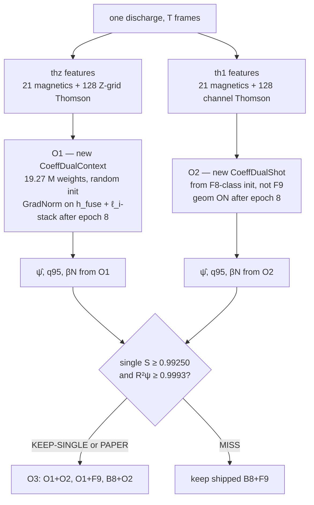

O2 does not start until O1 has a holdout number. Do not start both on one GPU.

### 7.1 Temporal augmentation (both parents)

Let \(x_0, x_1, \ldots, x_{T-1}\) be the raw 149-d frames of one shot. **Window 9** means a half-width of 4 frames. For each time \(t\):

1. **Moving average** \(\bar x_t\): the mean of \(x_{t-4},\ldots,x_{t+4}\), with indices clamped to \([0, T-1]\).
2. **Smooth difference** \(\Delta x_t\): a central difference of the *average*,
   \[
   \Delta x_t \;=\; \frac{\bar x_{t+4} - \bar x_{t-4}}{8}
   \]

The map’s input is the concatenation \([x_t \mid \bar x_t \mid \Delta x_t]\), length 447. Windows never cross a shot boundary.

### 7.2 O1 — new `CoeffDualContext` (B8’s trunk, new weights)

19,268,162 parameters. `--arch dualctx`. `--thomson-zgrid`. Random AdamW init. **Not** a load of `CRC_FEQ_brown_B8_zgrid_e1.pt`.

The two halves of the network never share a first layer. The present frame gets a wide residual tower. The 298 context numbers get a narrower tower. They meet as *embeddings*, not as raw columns, and the context tower is multiplied by the scalar `gate` which starts at 0.

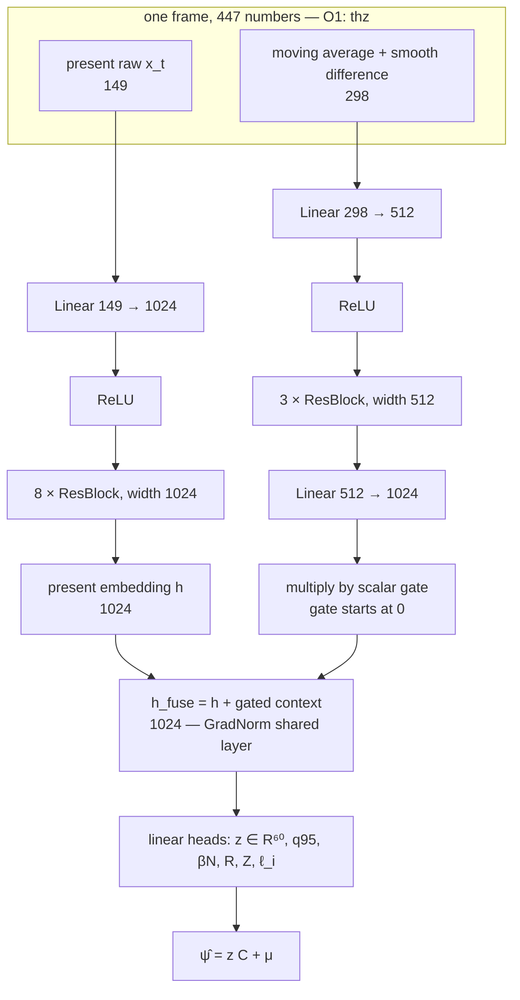

### 7.3 O2 — new `CoeffDualShot` (F8-class init, not F9)

20,418,627 parameters. `--arch dualshot`. Channel Thomson (`th1`). Init from an **F8-class** checkpoint, **not** `F9_unfreeze_edge`.

F9 was one **geometry-off** data epoch on F8. Brown B3 then tried to put stack geometry on the *finished* F9 zip and walked off in one Adam step. The unspent variable is geometry **on** a dualshot that is still allowed to move. That is O2. It waits on O1.

The map branch is the same dualctx tower as O1. A bidirectional GRU reads the raw 149-d frames of the whole shot and writes a per-frame residual into the embedding, multiplied by `gate_seq` (also init 0).

---

## 8. The loss

### 8.1 Flux terms (always on)

These four terms are B8’s data loss. They run from epoch 1.

- **\(L_{\mathrm{data}}\)** — ordinary mean squared error on the 65×65 \(\psi\) grid.
- **\(L_{\mathrm{coeff}}\)** — mean squared error on the 60 raw coefficients. Coefficient 1 still dominates.
- **\(L_{\mathrm{coeff,white}}\)** — **whitened** coefficients. Let \(\sigma_k\) be the training-set standard deviation of coefficient \(k\). Let \(k_\star = 12\). The per-mode divisor is \(s_k = \max(\sigma_k, \sigma_{k_\star})\). Then \(L_{\mathrm{coeff,white}}\) is MSE of \((\hat z - z)/s\). \(\lambda_w = 1.35\). This is the purple C7 term that bought Consistency without a new decoder.
- **\(L_{q\beta}\)** — MSE on \(q_{95}\) and \(\beta_N\). \(\lambda_{q\beta} = 1\).

Write \(L_{\mathrm{data+coeff}}\) for the sum of those four (with their usual coefficients). In GradNorm below, \(L_{\mathrm{data}}\) means this bundle — the flux / scalar-head side — not the pixel term alone.

### 8.2 \(L_{\mathrm{stack}}\) — SoftDerive after warmup 8

The official Consistency score is the mean of seven \(R^2\) values the scorer *derives* from \(\psi\). A biased surrogate of those numbers is worse than none (teal drove \(R^2_\kappa\) to \(-0.60\)).

Olive uses [`soft_derive.py`](soft_derive.py) — a batched, differentiable replica of `fusion_scoring.derive.derive_frame`. Discrete decisions (which cell is the O-point, which critical value is the boundary flux) use detached integer indices; every *value* read at those indices stays in the graph.

| scalar | how SoftDerive computes it | why it is in the stack |
|---|---|---|
| \(\kappa\) | softmax over the co-area line measure \(\lvert\nabla H\rvert\) of the LCFS; height / width | shared hole of B8 and F9 (~0.945) |
| \(Z_{\mathrm{axis}}\) | parabolic sub-pixel fit about the strongest interior local maximum | B8 already owns this; keep it |
| volume | \(2\pi \int R\, H\, dA\), exact as \(\tau\to 0\) | Forest \(s_{\mathrm{iso}}\) |
| \(\ell_i\) | volume average of \(B_p^2\) over \((\mu_0 I_p/\ell_p)^2\) | B8 left this on the floor; F9 owns it *without* geom |

\(\ell_i\) is a **volume** quadratic in \(\nabla\psi\), not an LCFS extent:

\[
\ell_i
\;=\;
\frac{\langle B_p^2\rangle_V}{(\mu_0 I_p/\ell_p)^2},
\qquad
B_p=\frac{\lvert\nabla\psi\rvert}{R},
\qquad
\langle B_p^2\rangle_V
=\frac{\int B_p^2\,H\,dV}{\int H\,dV}.
\]

PCA \(L^2\) and even SoftDerive-\(\kappa\) (a boundary softmax) can match pixels and elongation while smearing \(\lvert\nabla\psi\rvert\) in the core. Do **not** add \(\lVert\nabla\hat\psi-\nabla\psi\rVert_2^2\) as a third loss. SoftDerive \(\ell_i\) *is* that integral.

Let \(g(\psi)\in\mathbb{R}^7\) be SoftDerive on a frame, in the order
`R_axis, Z_axis, kappa, tri_top, tri_bot, volume, li`.
Let \(\sigma_j\) be the training-set standard deviation of reference scalar \(j\). The per-scalar residual is Huberised at 3 \(\sigma\):

\[
r_{t,j} = \frac{g_j(\hat\psi_t) - g_j(\psi_t)}{\sigma_j},
\qquad
\rho(r) =
\begin{cases}
r^2 & \lvert r\rvert \le 3 \\
3\,(2\lvert r\rvert - 3) & \lvert r\rvert > 3
\end{cases}
\]

**Do not** turn SoftDerive on at epoch 1 from random weights (Brown B1 shattered \(\psi\); \(R^2_\psi\) still \(-48\) at epoch 30). Warmup is **8** epochs of \(L_{\mathrm{data+coeff}}\) only — shorter than B8’s 25 because we already know this trunk forms a map, and we want the stack on while the map is still plastic. Kill if epoch-8 val \(R^2_\psi < 0.999\) or val Cons \(< 0.96\). Epoch 8 is the last data-only epoch: the kill is a health check, not a post-shock reading.

Do **not** step \(L_{\mathrm{stack}}\) on at full \(\lambda_{\mathrm{geom}}\) on epoch 9. That shocks AdamW’s momentum buffers and can crash \(R^2_\psi\) just as the kill window closes. The multiplier on \(\lambda_{\mathrm{geom}}\) is

| epoch | \(\le 8\) | 9 | 10 | 11 | 12 | \(\ge 13\) |
|---|---:|---:|---:|---:|---:|---:|
| multiplier | 0 | 0.25 | 0.50 | 0.75 | 1.0 | 1.0 |

This is separate from the **learning-rate** warmup (5 epochs, §9). Do not conflate them.

\(\ell_i\)’s denominator uses the poloidal perimeter \(\ell_p\). SoftDerive today clamps \(\ell_p\) at `eps = 1e-12`. A vanishing contour during early geom-on frames spikes \(\nabla\ell_i\). Olive’s trainer must use \(\ell_p\leftarrow\max(\ell_p,10^{-3})\) in that denominator only (a flag; do not silently change charcoal / Brown). The Huber \(3\sigma\) threshold stays strictly on.

### 8.3 Promoted \(\ell_i\) stack

B8’s stack (`STACK_GEOM_FOCUS = {kappa: 1.5, Z_axis: 1.0, volume: 1.0}`, floor 0.15) puts \(\ell_i\) on the floor. After normalising to mean 1:

| | \(R_{\mathrm{axis}}\) | \(Z_{\mathrm{axis}}\) | \(\kappa\) | \(\delta_{\mathrm{top}}\) | \(\delta_{\mathrm{bot}}\) | volume | \(\ell_i\) |
|---|---:|---:|---:|---:|---:|---:|---:|
| B8 (today) | 0.256 | 1.707 | 2.561 | 0.256 | 0.256 | 1.707 | **0.256** |
| Olive | 0.193 | 1.284 | 1.927 | 0.193 | 0.193 | 1.284 | **1.284** |

Olive sets `STACK_GEOM_FOCUS` to \(\{\kappa: 1.5,\, Z: 1.0,\, V: 1.0,\, \ell_i: 1.0\}\), same floor 0.15. \(\kappa\) stays the heaviest term. \(\ell_i\) is promoted to the same mass as \(Z\) and volume. Huber and the scorer’s plausibility mask stay.

\[
L_{\mathrm{stack}}
\;=\;
\frac{\sum_{t,j} \mathbf{1}_{t,j}\, w_j\, \rho(r_{t,j})}{\sum_{t,j} \mathbf{1}_{t,j}\, w_j}
\]

The geometry term is already dimensionless. The *emphasis* that puts it on the same scale as \(L_{\mathrm{data}}\) is still

\[
\lambda_{\mathrm{geom}}
\;=\;
\varepsilon \cdot \frac{0.20}{0.55} \cdot \mathrm{Var}(\psi)
\]

with \(\varepsilon = 1.0\). That scalar is **not** the adaptive weight. GradNorm is.

### 8.4 GradNorm

After warmup, two losses fight for the same weights. Once \(R^2_\psi\) is 0.9996, \(\nabla L_{\mathrm{data}}\) is small in *score* units and still large in *parameter* units; it drowns \(\nabla\kappa\) and \(\nabla\ell_i\). Raising \(\varepsilon\) on a finished map (F19) spends \(\psi\). GradNorm (Chen, Zhao, Xu, Koltun, ICML 2018) trains a **scalar** \(w_g(t)\) so the two gradient norms stay in a chosen ratio. \(w_\psi = 1\) is fixed.

The shared layer \(\theta\) is the **fused embedding** \(h_{\mathrm{fuse}}\in\mathbb{R}^{1024}\) immediately before the linear heads (`fuse` in §7.2; for O2, after the `gate_seq` residual is added). Do **not** take \(\nabla_\theta\) through the PCA head \(z\in\mathbb{R}^{60}\). That would let GradNorm see only the last linear layer and miss the trunk.

Let \(G_\psi=\lVert\nabla_{h_{\mathrm{fuse}}} L_{\mathrm{data+coeff}}\rVert_2\) and \(G_g=\lVert\nabla_{h_{\mathrm{fuse}}} (w_g L_{\mathrm{stack}})\rVert_2\). Let \(\bar G\) be their mean. The relative inverse training rate of the stack is

\[
r_g(t)
\;=\;
\frac{L_{\mathrm{stack}}(t)/L_{\mathrm{stack}}(0)}{L_{\mathrm{data+coeff}}(t)/L_{\mathrm{data+coeff}}(0)}.
\]

GradNorm’s target is \(G_g \to \bar G\cdot(r_g)^\alpha\) with \(\alpha = 0.5\). \(w_g\) is updated by a small Adam step on \(\lvert G_g - \mathrm{stopgrad}(\bar G\cdot r_g^\alpha)\rvert\), then renormalised so the two task weights still sum to 2. The network weights see

\[
L
\;=\;
L_{\mathrm{data+coeff}} + w_g\,\lambda_{\mathrm{geom}}\, L_{\mathrm{stack}}.
\]

Initialise \(w_\psi=1,\,w_g=1\) at the first geom epoch. Do **not** Adam-update \(w_g\) until **epoch 10** (the second ramp epoch). Epochs 9–10 run the stack at unit GradNorm weights so the gradient ratio is measurable before the weight starts chasing it.

Navy’s `--loss-ema-norm` (Kendall uncertainty) failed. Use GradNorm first. **PCGrad** (project each gradient off the other when their dot product is negative) is the backup if GradNorm’s \(w_g\) collapses (\(<10^{-3}\)) or explodes (\(>5\)) and Cons is flat; that job is **O1.1**, not O1.

Detached integer O-point / \(\psi_b\) in SoftDerive already keeps \(\nabla\kappa\) and \(\nabla\ell_i\) defined almost everywhere.

### 8.5 Trainer contracts (Phase 0)

These four must be in code before O1 launches. They are the accepted engineering refinements of the Olive thesis, not new hypotheses.

| id | contract |
|---|---|
| P0.a | GradNorm \(\nabla\) is at \(h_{\mathrm{fuse}}\), not at \(z\). |
| P0.b | \(\lambda_{\mathrm{geom}}\) ramp: 0 through epoch 8, then \(0.25/0.50/0.75/1.0\) on epochs 9–12. |
| P0.c | \(w_g\) Adam starts at epoch 10. Unit weights until then. |
| P0.d | \(\ell_i\) denominator uses \(\ell_p\leftarrow\max(\ell_p,10^{-3})\). Huber \(3\sigma\) stays. |

---

## 9. Optimiser and schedule

| name | value |
|---|---|
| Optimiser | AdamW, weight decay \(10^{-4}\) |
| Learning rate | \(3\times 10^{-4}\) (slower than B8’s \(10^{-3}\); SoftDerive is on at epoch 8) |
| Warmup | 5 epochs, linear, then cosine to 0 |
| Epochs | 88 |
| Grad clip | 1.0 |
| L-BFGS | off |
| Train shots | 6,961 |
| Official holdout | 80 shots, `--seed 42` |
| Feature clip | 10 σ |
| SoftDerive warmup | 8 (data-only through epoch 8) |
| \(\lambda_{\mathrm{geom}}\) ramp | epochs 9–12: \(0.25, 0.50, 0.75, 1.0\) |
| GradNorm \(\alpha\) | 0.5; \(\nabla\) at \(h_{\mathrm{fuse}}\); \(w_g\) Adam from epoch 10 |
| \(\ell_p\) floor | \(10^{-3}\) in the \(\ell_i\) denominator |
| Kill | epoch-8 val \(R^2_\psi < 0.999\) or val Cons \(< 0.96\) |

The number we *report* is always the official scorer on the 80-shot holdout, run after training finishes.

---

## 10. Hyperparameters, all in one place

### 10.1 Data

| name | O1 | O2 |
|---|---|---|
| Train shots | 6,961 | 6,961 |
| Official holdout | 80, seed 42 | 80, seed 42 |
| Raw features | 149 (`thz`) | 149 (`th1`) |
| Dual features | 447 | 447 |
| PCA modes | 60, frozen (B8 basis) | 60, frozen |
| Feature clip | 10 | 10 |

### 10.2 Present-frame map (both)

| name | value |
|---|---|
| Stem | Linear 149 → 1024 |
| Trunk width × blocks | 1024 × 8 residual blocks |
| Context stem | Linear 298 → 512 |
| Context width × blocks | 512 × 3 residual blocks |
| Context projection | Linear 512 → 1024 |
| `gate` | 1 scalar, init 0 |
| Activation | ReLU |
| Dropout | 0.05 |
| Map parameters | 19,268,162 |

### 10.3 What differs

| name | O1 | O2 |
|---|---|---|
| Class | `CoeffDualContext` | `CoeffDualShot` |
| Shot GRU | none | bidirectional, hidden 256, 1 layer |
| `gate_seq` | — | 1 scalar, init 0 |
| Total parameters | 19,268,162 | 20,418,627 |
| Thomson | Z-grid `thz` | channel `th1` |
| Init | random AdamW | F8-class checkpoint, **not** F9 |
| \(\varepsilon\), warmup | 1.0, 8 | 1.0, 8 |
| Stack | \(\kappa,Z,V,\ell_i\) | same |
| \(\lambda_{\mathrm{geom}}\) ramp | epochs 9–12 | same |
| GradNorm | \(\alpha=0.5\) on \(h_{\mathrm{fuse}}\); \(w_g\) from ep 10 | same |
| When | first (after P0) | after O1 holdout |

---

## 11. Mixing

A **mix** is: run two finished checkpoints on the same shot, then average \(\hat\psi\), \(\hat q_{95}\), and \(\hat\beta_N\) in 64-bit. No new training.

B8 as a single is 0.99173. F9 as a single is 0.99191. The held product is their mean at 0.99320. Requiring a *new* single to beat 0.99320 before mixing would have rejected both parents of the ship. That gate is **retired**.

| verdict | single \(S\) | then |
|---|---|---|
| KEEP-SINGLE | \(\ge 0.99250\), Cons \(\ge 0.9720\), \(\kappa\ge 0.9480\), \(R^2_\psi\ge 0.9993\) | Mix member. |
| PAPER | \(0.99173 < S < 0.99250\) and Cons or \(\kappa\) beat the matching held parent | Different character. Mix is allowed. |
| MISS | \(\le 0.99173\) and no Cons/\(\kappa\) gain | Not a mix member. |

| id | mix | when |
|---|---|---|
| O3.a | \(0.5\,\mathrm{O1}+0.5\,\mathrm{O2}\) | both at least PAPER |
| O3.b | \(0.5\,\mathrm{O1}+0.5\,\mathrm{F9}\) | O1 at least PAPER |
| O3.c | \(0.5\,\mathrm{B8}+0.5\,\mathrm{O2}\) | O2 at least PAPER |

A mix \(S>0.99320\) replaces the held *local*. Package only at \(\ge 0.99350\). Submit only at \(\ge 0.9945\). Prefer a mix that also moves \(\kappa > 0.9519\) or Cons \(> 0.9754\).

Do not 3-mix B13 or B7. Dualctx cousins share a residual. Do not A2-gate B8+F9 again. Do not add a MISS as a third member.

---

## 12. What we have already measured

All local numbers are the official scorer on the same 80-shot holdout.

| artifact | local \(S\) | Cons | \(R^2_\psi\) | \(\kappa\) | what it is |
|---|---:|---:|---:|---:|---|
| F9 single | 0.99191 | 0.9704 | 0.99945 | 0.9454 | best *single*; `th1` dualshot, geom off |
| B8 single | 0.99173 | 0.9692 | 0.99961 | 0.9445 | `thz` dualctx; owns \(Z_{\mathrm{axis}}\) 0.9855 |
| **B8+F9 (held, public #5)** | **0.99320** | **0.9754** | **0.99966** | **0.9519** | uniform mean |
| A2 oracle \(w\) | 0.99335 | 0.9757 | 0.99980 | 0.9515 | per-frame MSE-optimal mix; GT on holdout |
| A2 scalar gate | 0.99323 | 0.9755 | 0.99970 | 0.9521 | paper keep; do not package |
| C2-feat / C2-tau33 | 0.99109 / 0.99106 | 0.9686 / 0.9683 | 0.99956 | 0.943 / 0.942 | frozen-B8 eddy; closed |
| C2-rl | 0.98971 | 0.9601 | 0.99961 | 0.9318 | worse; closed |
| F66 oracle stack | 0.99436 | 0.9830 | 0.99930 | — | illegal GT warp of F9; ceiling, not a submit |
| R6 GT through \(k=60\) | 0.99900 | 0.9972 | — | 0.9887 | basis is not the ceiling |
| Public #1 dmitryzhevn | 0.99438* | 0.9800* | 0.99979* | — | *public*; MAST \(S\) 0.73 vs our 0.055 |

A1 autopsy (same 80 shots, no re-infer):

- **Disagree** (\(|\Delta|\ge 0.005\)): \(R_{\mathrm{axis}}\) F9 +0.0085, \(Z_{\mathrm{axis}}\) B8 +0.0165, \(\ell_i\) F9 +0.0098.
- **Shared hole:** \(\kappa\) (B8 0.9445 / F9 0.9454). A gate can pick \(Z\) vs \(R\); it cannot invent elongation.

Public board 2026-08-20 07:52 (Codabench 19740), Challenge 1 DIII-D:

| rk | who | \(S\) | Cons | \(R^2_\psi\) |
|---:|---|---:|---:|---:|
| 1 | dmitryzhevn | 0.99438 | 0.98002 | 0.99979 |
| 2 | dgaytanv | 0.99320 | 0.97608 | **0.99986** |
| 3 | mnn31 | 0.99208 | 0.97374 | 0.99977 |
| 4 | mwaller | 0.99196 | 0.97049 | 0.99972 |
| **5** | **catskills** | **0.99185** | **0.97072** | **0.99964** |

Weighted gap #5 vs #1 (0.00253 of \(S\)): Cons 74%, LCFS 13%, \(q\beta\) 10%, \(\psi\) 3%.

### Closed — do not reopen

- Steel S1 / S2 / C1 / C2 / C3 / C4 / K / A2-as-ship.
- F9 post-process (\(s_Z\), \(dR\), \(dZ\), fill).
- Raise \(\varepsilon\) on finished B8 (F19).
- Unfreeze finished F9 / C9a (B3).
- Inference GS (F13, \(S\) 0.861).
- Vacuum-as-\(Y\) (Charcoal 25.1).
- Raise \(k\) / INR / FieldRefiner / X-point basis (R6 / Navy / Charcoal 0a).
- 3-mix of dualctx cousins (B7, B13).
- Stack geometry from random dualshot weights (B1).

---


---

## 12b. What this checkpoint actually scored (O1 dualctx)

Olive’s plan doc (§12 above) was written **before** O1 ran. The receipt below is the official scorer on the same 80-shot holdout after training stopped.

**Kill reason.** SoftDerive warmup was 8 epochs. Epoch-8 health gate required val \(R^2_\psi \ge 0.999\) (and Cons \(\ge 0.96\)). Training selected `best_epoch=7` still in the data-only ramp; SoftDerive / GradNorm **never turned on**. Tag `O1_dualctx`. Arch `dualctx`. Seed / init_seed 42.

| Term | Value |
|------|------:|
| **S** | **0.986209** |
| \(R^2_\psi\) | 0.998504 |
| \(R^2_{q\beta}\) | 0.989851 |
| \(1-D_{\mathrm{LCFS}}\) | 0.983053 |
| Consistency | 0.951246 |

Per-scalar Consistency \(R^2\) (fail frac all 0.0):

| Scalar | \(R^2\) |
|--------|------:|
| \(R_{\mathrm{axis}}\) | 0.950738 |
| \(Z_{\mathrm{axis}}\) | 0.951980 |
| \(\kappa\) | 0.920411 |
| \(\delta_{\mathrm{top}}\) | 0.976302 |
| \(\delta_{\mathrm{bot}}\) | 0.961494 |
| volume | 0.953805 |
| \(\ell_i\) | 0.943993 |

**Verdict at the time:** **KILL** (campaign). Holdout \(S\) was well below B8’s 0.99173; the map was not yet championship-healthy. The checkpoint was kept on disk.

**O1.b (adaptive warmup from O1 epoch 7)** — separate run, not this weight: holdout \(S=0.989887\), Cons 0.962833, \(R^2_\psi=0.999235\), also **KILL**. SoftDerive still never delivered the Olive thesis.

Receipts: lab `results/olive/O1_dualctx.json`, `results/CRC_FEQ_olive_O1_dualctx_score.json` (byte-identical scores).

## 13. How to run (historical) and how this weight is used now

**Historical (Olive campaign, lab `65cfe77`).** Env `CRC_FEQ_MODEL_ID=CRC_FEQ_olive`. Board was `:8771`. Ladder entry:

```
CRC_FEQ_MODEL_ID=CRC_FEQ_olive python -m catskills.scripts.olive_ladder o1
```

That produced `artifacts/CRC_FEQ_olive_O1_dualctx.pt` (SHA-256 above). Do not re-run expecting SoftDerive — the campaign closed with SoftDerive never on.

**Phase 3 / organizer rebuild (this repo).** Place the release weight where `psi_tailfit` expects the O1 parent (`artifacts/` or `CRC_FEQ_WEIGHTS_DIR`), then:

```
python -m catskills.scripts.psi_tailfit --parent O1 --power 0.0 --seed 101 \
  --tag LS_O1_101 --epochs 220 --patience 30
# → CRC_FEQ_brown_TF_LS_O1_101.pt

python -m catskills.scripts.psi_tailfit --parent O1 --power 0.0 --seed 42 \
  --lambda-w 1 --tag LS_O1_W1 --epochs 220 --patience 30
# → CRC_FEQ_brown_TF_LS_O1_W1.pt
```

See [`ORGANIZER_REPLY_REBUILD.md`](../../ORGANIZER_REPLY_REBUILD.md) §1.5 and [`MANIFEST.md`](MANIFEST.md).

---

## 14. Artifacts and code map

| | |
|---|---|
| This weight | `weights/phase3/CRC_FEQ_olive_O1_dualctx.pt` (also lab `archive/artifacts/…`, same SHA-256) |
| This report | `weights/phase3/REPORT_CRC_FEQ_olive_O1_dualctx.md` |
| Model description (source) | [`MODEL_DESCRIPTION_CRC_FEQ_olive.md`](../../catskills/MODEL_DESCRIPTION_CRC_FEQ_olive.md) |
| Score receipt | lab `results/olive/O1_dualctx.json` |
| Tailfit children (Phase 3) | `CRC_FEQ_brown_TF_LS_O1_101.pt`, `CRC_FEQ_brown_TF_LS_O1_W1.pt` |
| Tailfit receipts | lab `results/brown/P30_TAILFIT_LS_O1_{101,W1}.json` |
| Env (train era) | `CRC_FEQ_MODEL_ID=CRC_FEQ_olive` |
| Not this model | `CRC_FEQ_olive_geom_*` / O1G |

| file | what it is |
|---|---|
| `pinn_charcoal.py` | `CoeffDualContext`, stack geom, `predict_row` |
| `soft_derive.py` | differentiable seven scalars (never engaged on this checkpoint) |
| `scripts/psi_tailfit.py` | plain / weighted fine-tune that resurrected O1 |
| `COLOR_LEDGER.md` §30.10 | undertrained-parents finding; O1 → best single |


---

## 15. Afterlife — why this “killed” weight still matters

COLOR_LEDGER §30.10 (*The parents were undertrained*) re-measured holdout \(\psi\) MSE under plain `psi_tailfit` (\(p=0\), coefficient MSE, frozen PCA-60). **O1 was the worst member on the §30.7 board by rank, then the best model in the project after a proper budget:**

| stage | holdout \(\psi\) MSE | note |
|---|---:|---|
| O1 parent (this weight), as left by Olive | \(3.78\times 10^{-3}\) | undertrained; SoftDerive never on |
| Short plain fine-tune (O1/U) | \(5.9115\times 10^{-4}\) | **−84%** vs parent |
| Long plain fine-tune (O1/L, 220 ep) | \(5.9275\times 10^{-4}\) | same class |

Best early mix including O1 children: B8/L + O1/U + O1/L → \(5.2410\times 10^{-4}\) (**+38.40%** cut vs B8+F9 pair MSE). Hybrid with locked B8+F9 \(q\beta\): local \(S=\mathbf{0.994147}\) (public calibration 916155: \(d3d\_S=0.993112\)).

**Phase 3 members descended from this parent** (receipts, not re-scored here):

| child | holdout \(\psi\) MSE | cut vs B8+F9 pair (\(8.508\times 10^{-4}\)) | best_epoch |
|---|---:|---:|---:|
| `LS_O1_101` | \(5.361\times 10^{-4}\) | 37.0% | 90 |
| `LS_O1_W1` (\(\lambda_w=1\)) | \(6.025\times 10^{-4}\) | 29.2% | 142 |

So the Olive *thesis* (early SoftDerive + GradNorm) failed, but the Olive *trunk* (new dualctx, B8 recipe, `thz`, stack geom scheduled) left a plastic parent that later campaigns mined. This report documents that parent.

**Explicitly out of scope:** `CRC_FEQ_olive_geom` overnight master blends, O1G Ip-shift seeds, championship packages under `benchmarks/archive/CRC_FEQ_olive_geom/` — those are a later color with sketchier per-attempt `REPORT.md` stubs. Do not treat them as this weight’s benchmark.


---

## Scores (official composite) — this checkpoint

Official `fusion_scoring` metric **3.1.0**, machine **DIII-D**, 80-shot holdout, seed 42.

| Term | Value |
|------|------:|
| **S** | 0.986209 |
| R²_ψ | 0.998504 |
| R²_qβ | 0.989851 |
| 1−D_LCFS | 0.983053 |
| Consistency | 0.951246 |

Per-scalar Consistency $R^2$ (unclipped; fail frac all 0):

| Scalar | $R^2$ | fail frac |
|--------|------:|----------:|
| R_axis | 0.950738 | 0.000 |
| Z_axis | 0.951980 | 0.000 |
| kappa | 0.920411 | 0.000 |
| tri_top | 0.976302 | 0.000 |
| tri_bot | 0.961494 | 0.000 |
| volume | 0.953805 | 0.000 |
| li | 0.943993 | 0.000 |

## Training Parameters

| Parameter | Value |
|-----------|------:|
| method_name | CRC_FEQ_olive |
| tag | O1_dualctx |
| arch | dualctx |
| model_version | 0.1.0+CRC_FEQ_olive+65cfe77 |
| train shots | 6961 |
| test shots (n_eval) | 80 |
| PCA components | 60 |
| temporal_window | 9 |
| thomson_layout | zgrid (`thz`) |
| optimizer | adamw |
| epochs (scheduled) | 88 |
| best_epoch | 7 |
| best_selection | 0.731276 |
| seed / init_seed | 42 / 42 |
| lambda_geom | 0.014477094466036016 |
| geom_emphasis | 1.0 |
| geom_warmup | 8 |
| geom_weights | stack (Olive promoted \(\ell_i\)) |
| geom_weight_vec | R_axis 0.212, Z_axis 1.414, kappa 2.121, tri_top 0.212, tri_bot 0.212, volume 1.414, li 1.414 |
| lambda_coeff_white | 1.35 |
| coeff_white_clamp | 12 |
| lambda_lcfs | 0 |
| edge_weight | off |
| lr_warmup | 5 |
| grad_clip | 1.0 |
| val_fraction | 0.1 (shot split) |
| val_geom_frames | 20000 |
| SoftDerive engaged? | **no** (killed in data-only warmup) |
| GradNorm engaged? | **no** |
| train_s | 606.5 |
| infer_holdout_s | 17.7 |
| checkpoint | `CRC_FEQ_olive_O1_dualctx.pt` |
| git_commit (train) | 65cfe77 |

## Qualitative summary

### Shot 0 (`d3d_shot_ea67ad907d`)

- Flux MSE is low (2.69e-05) — pixel-level agreement looks strong on this shot.
- Error is fairly balanced between edge and core (ratio 1.40).
- Amplitude scale factor ≈ 1.006 — overall gain looks reasonable.
- Largest |Diff| at mid-time near R=2.54 m, Z=-0.45 m (|err|=0.00932).
- q95: RMSE=0.189 vs EFIT — the side-model that predicts this submitted number (separate from the 65×65 flux path) is missing the target; that hurts the 0.15 weight on $R^2_{q95,βN}$ in $S$.
- betaN: RMSE=0.0456 vs EFIT — the side-model that predicts this submitted number (separate from the 65×65 flux path) is missing the target; that hurts the 0.15 weight on $R^2_{q95,βN}$ in $S$.

### Shot 1 (`d3d_shot_c965ecee3a`)

- Flux MSE is low (4.74e-05) — pixel-level agreement looks strong on this shot.
- Error is fairly balanced between edge and core (ratio 0.87).
- Amplitude scale factor ≈ 0.983 — overall gain looks reasonable.
- Largest |Diff| at mid-time near R=2.54 m, Z=0.50 m (|err|=0.00871).
- q95: RMSE=0.185 vs EFIT — the side-model that predicts this submitted number (separate from the 65×65 flux path) is missing the target; that hurts the 0.15 weight on $R^2_{q95,βN}$ in $S$.
- betaN: RMSE=0.0562 vs EFIT — the side-model that predicts this submitted number (separate from the flux-map path) matches well on this shot.

### Shot 2 (`d3d_shot_bc0f6ecd42`)

- Flux MSE is low (3.10e-04) — pixel-level agreement looks strong on this shot.
- Error is core-weighted (edge/core MAE ratio 0.68) — axis / peaking may be off more than the boundary.
- Amplitude scale factor ≈ 0.992 — overall gain looks reasonable.
- Largest |Diff| at mid-time near R=2.27 m, Z=-0.05 m (|err|=0.0468).
- q95: RMSE=0.264 vs EFIT — the side-model that predicts this submitted number (separate from the 65×65 flux path) is missing the target; that hurts the 0.15 weight on $R^2_{q95,βN}$ in $S$.
- betaN: RMSE=0.0661 vs EFIT — the side-model that predicts this submitted number (separate from the flux-map path) matches well on this shot.

## Figure pack - CRC_FEQ_olive_O1_dualctx_h00 - Shot 00

### Inputs (used at inference / context — not predicted; one panel each)

**Coil currents (inputs).** $I_p(t)$ = plasma current; ECOILA = ohmic solenoid. Part of the non-magnetic drive we use. Not predicted.

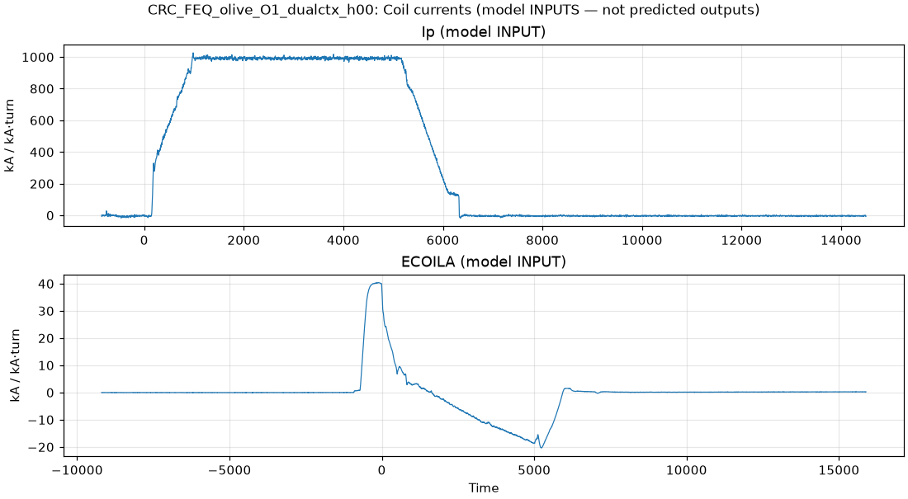

**Thomson core $T_e$ (input).** Electron temperature vs channel × time from the core laser system. Kinetic profile we feed in — not a model output.

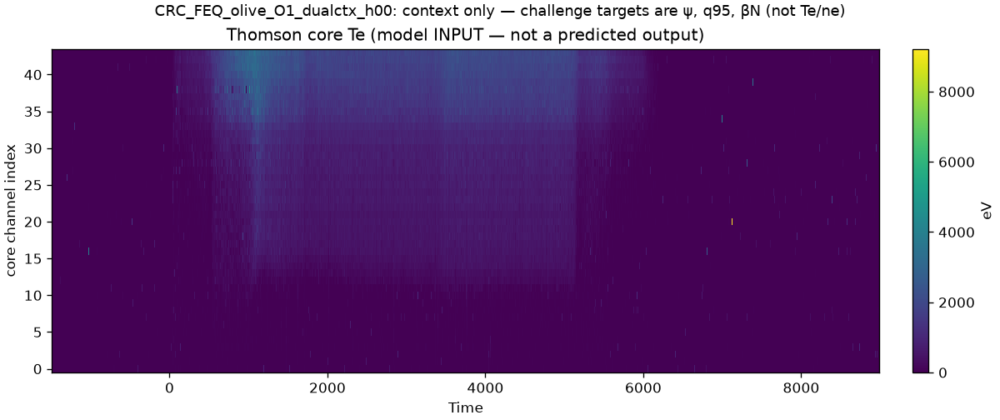

**Thomson edge/tangential $T_e$ (input).** Edge-view electron temperature profile. Kinetic input we feed in — not a model output.

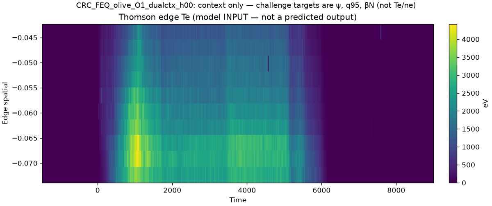

**dsep / X-point gap (EFIT context).** Signed gap (m): $>0$ diverted, $<0$ limited. Label for intuition; we neither submit nor predict this.

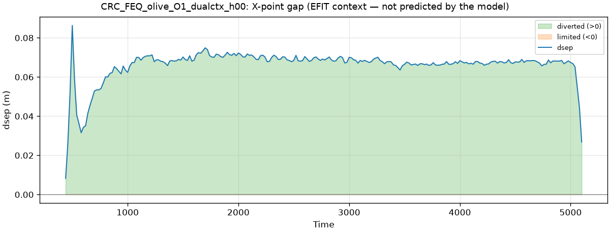

**EFIT geometric context ($\ell_i$, $R_{\mathrm{axis}}$, $Z_{\mathrm{axis}}$).** Present on train labels; Consistency re-derives these from $\psi$. We do not submit or train heads for them here — one trace each, no Pred/Diff.

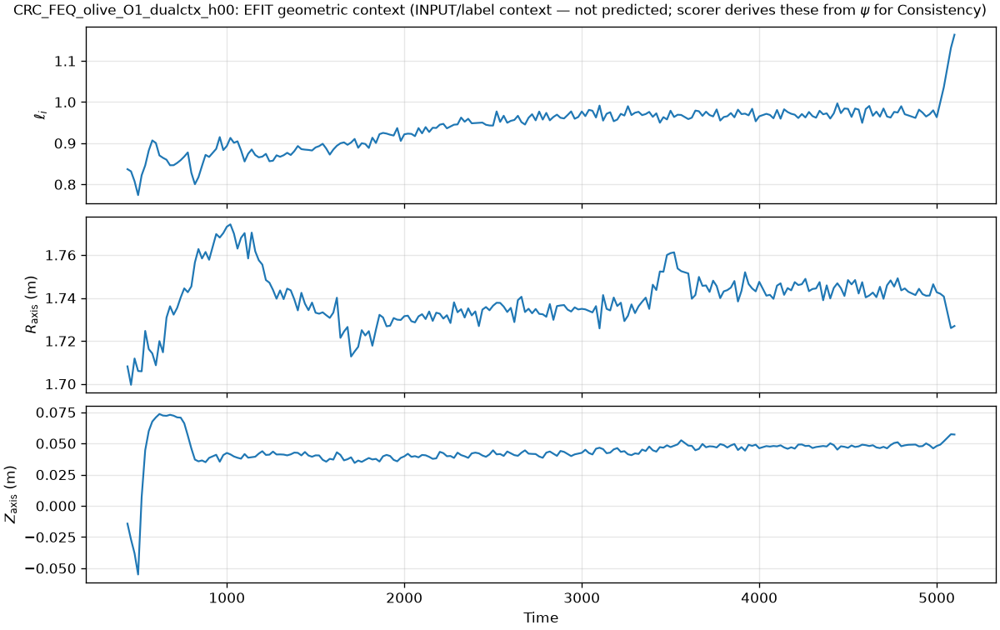

### Outputs (model predictions — GT | Pred | Diff)

**Flux map at mid-shot (2×2: GT, Pred, error map, error distribution).**

This is a vertical slice through the tokamak donut: left–right is distance from the machine centerline (major radius $R$), up–down is height ($Z$). Colors and contour lines show **poloidal magnetic flux** $\psi$ — think of it as a topographic map of the magnetic “terrain” that cages the plasma. Nested closed loops are nested magnetic surfaces; the outer closed loop is roughly the plasma edge.

**Top-left:** EFIT truth. **Top-right:** our prediction. **Bottom-left:** spatial error map (Pred − GT) — where on the cross-section we miss. **Bottom-right:** empirical probability density of *all* error pixels (histogram + KDE): is the error a tight blob around zero (good) or fat-tailed / biased (systematic miss)? Mid-shot = a typical time halfway through the pulse.

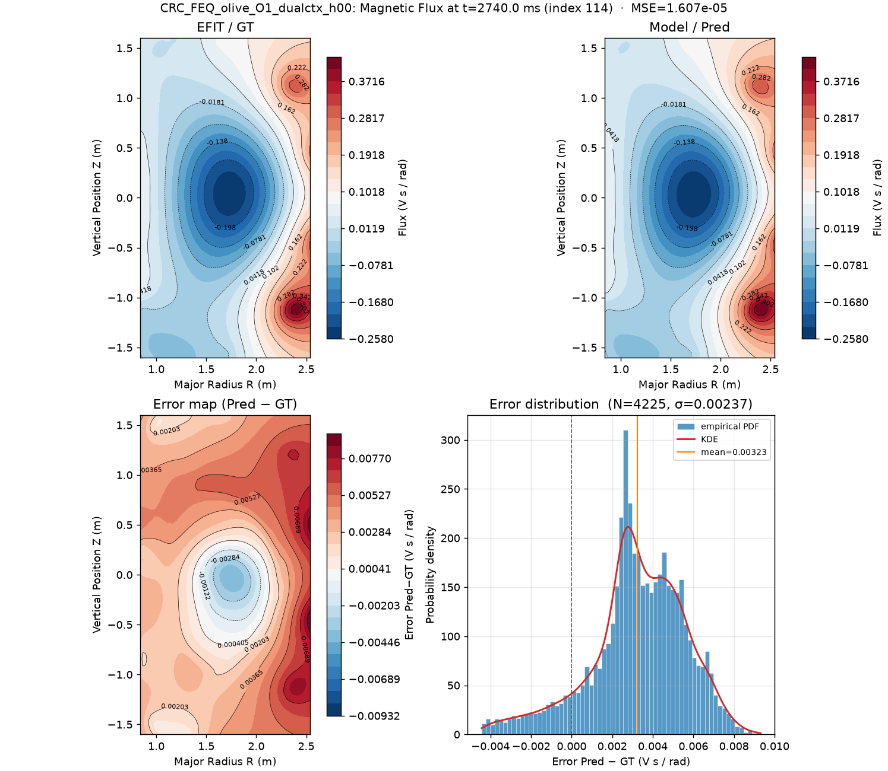

**Flux map at our worst time (2×2: GT, Pred, error map, error distribution).**

Same layout as the mid-shot figure, but at the EFIT time where our pixel MSE is largest. Shows *when* we fail hardest — often near start/end of the pulse or when the shape is changing quickly. The bottom-right distribution shows whether that worst frame’s errors are still centered near zero or skewed.

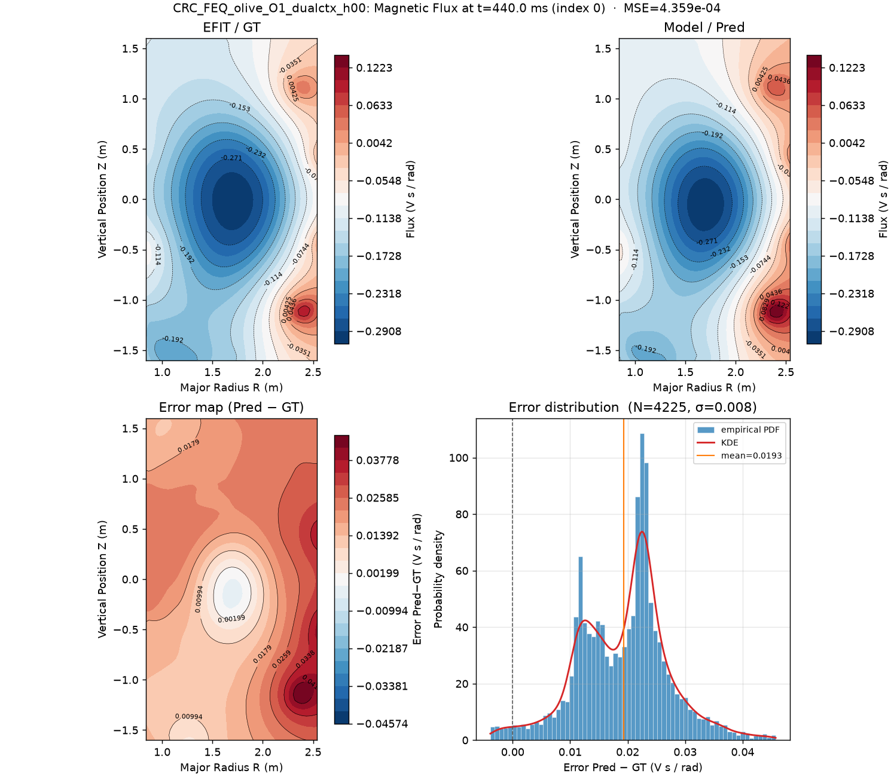

### Predicted q95

Edge safety factor $q_{95}$ over time (GT / Pred / Diff). How twisty the magnetic field is near the plasma edge — a stability-related “safety factor” on the ~95% flux surface. Blue = EFIT truth, orange = our prediction, red = difference. Unlike $\ell_i$ or the axis position, this is **not** derived from our $\psi$ by the scorer — we predict it directly and hand it in.

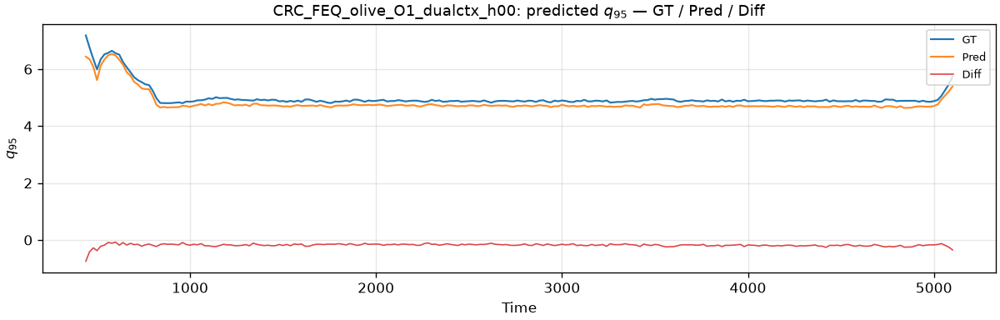

### Predicted betaN

Normalized beta $\beta_N$ over time (GT / Pred / Diff). Plasma pressure relative to the magnetic field strength (normalized). Blue = EFIT truth, orange = our prediction, red = difference. We predict this scalar directly and hand it in with the flux map.

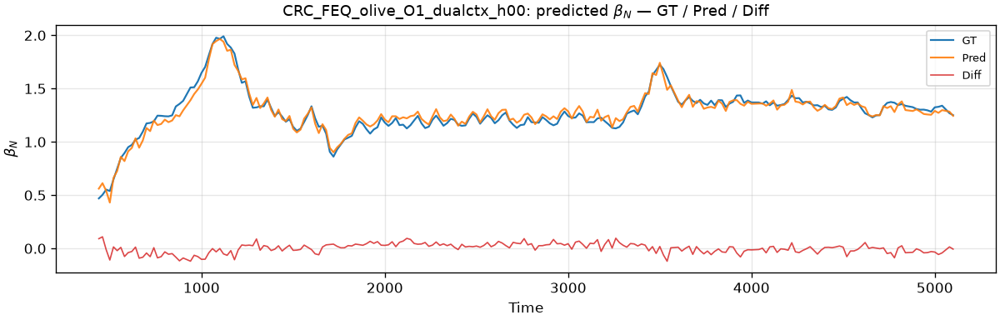

## Figure pack - CRC_FEQ_olive_O1_dualctx_h01 - Shot 01

### Inputs (used at inference / context — not predicted; one panel each)

**Coil currents (inputs).** $I_p(t)$ = plasma current; ECOILA = ohmic solenoid. Part of the non-magnetic drive we use. Not predicted.

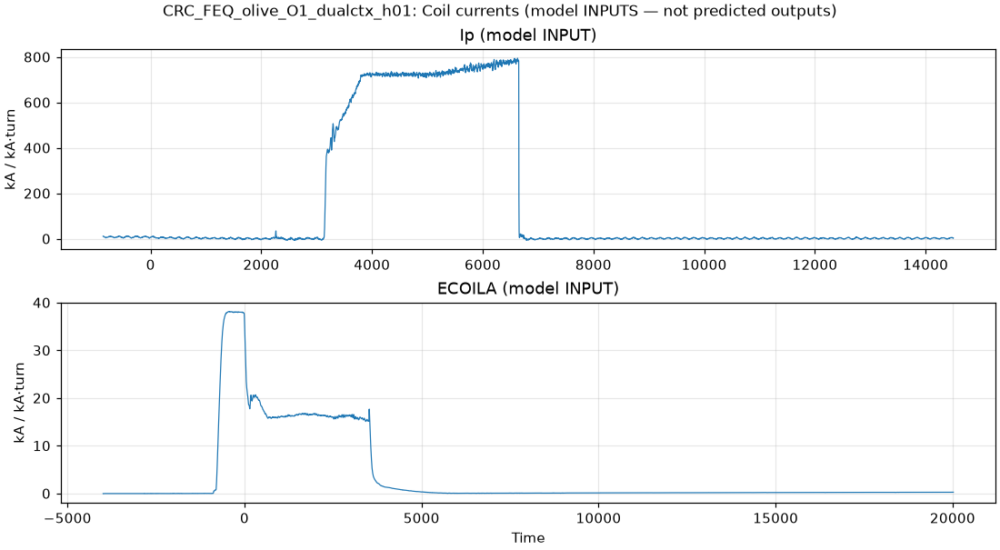

**Thomson core $T_e$ (input).** Electron temperature vs channel × time from the core laser system. Kinetic profile we feed in — not a model output.

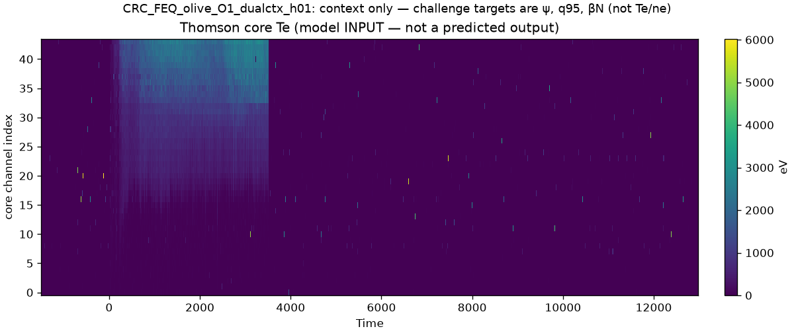

**Thomson edge/tangential $T_e$ (input).** Edge-view electron temperature profile. Kinetic input we feed in — not a model output.

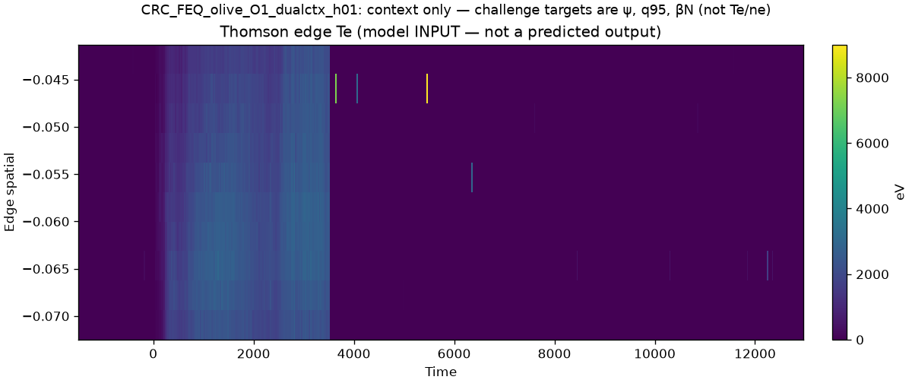

**dsep / X-point gap (EFIT context).** Signed gap (m): $>0$ diverted, $<0$ limited. Label for intuition; we neither submit nor predict this.

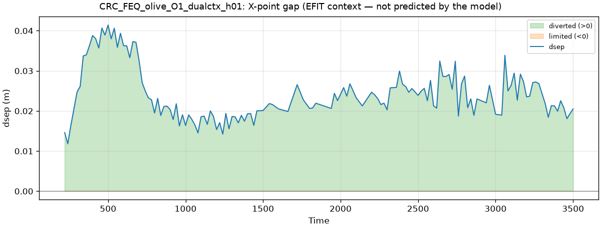

**EFIT geometric context ($\ell_i$, $R_{\mathrm{axis}}$, $Z_{\mathrm{axis}}$).** Present on train labels; Consistency re-derives these from $\psi$. We do not submit or train heads for them here — one trace each, no Pred/Diff.

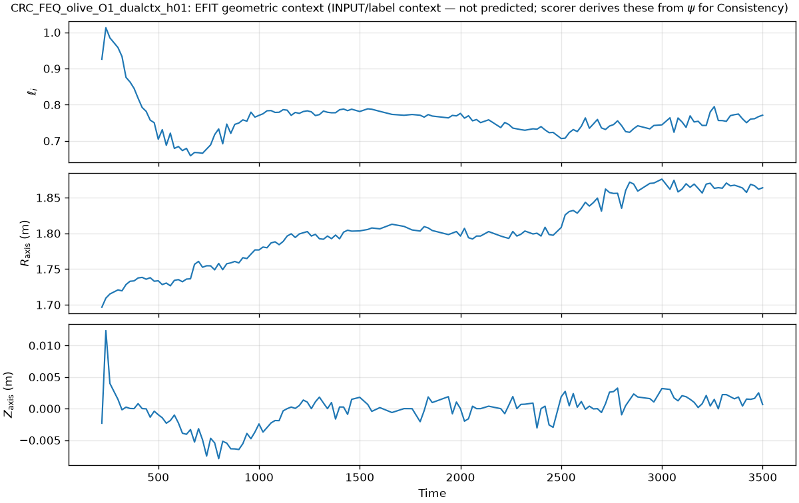

### Outputs (model predictions — GT | Pred | Diff)

**Flux map at mid-shot (2×2: GT, Pred, error map, error distribution).**

This is a vertical slice through the tokamak donut: left–right is distance from the machine centerline (major radius $R$), up–down is height ($Z$). Colors and contour lines show **poloidal magnetic flux** $\psi$ — think of it as a topographic map of the magnetic “terrain” that cages the plasma. Nested closed loops are nested magnetic surfaces; the outer closed loop is roughly the plasma edge.

**Top-left:** EFIT truth. **Top-right:** our prediction. **Bottom-left:** spatial error map (Pred − GT) — where on the cross-section we miss. **Bottom-right:** empirical probability density of *all* error pixels (histogram + KDE): is the error a tight blob around zero (good) or fat-tailed / biased (systematic miss)? Mid-shot = a typical time halfway through the pulse.

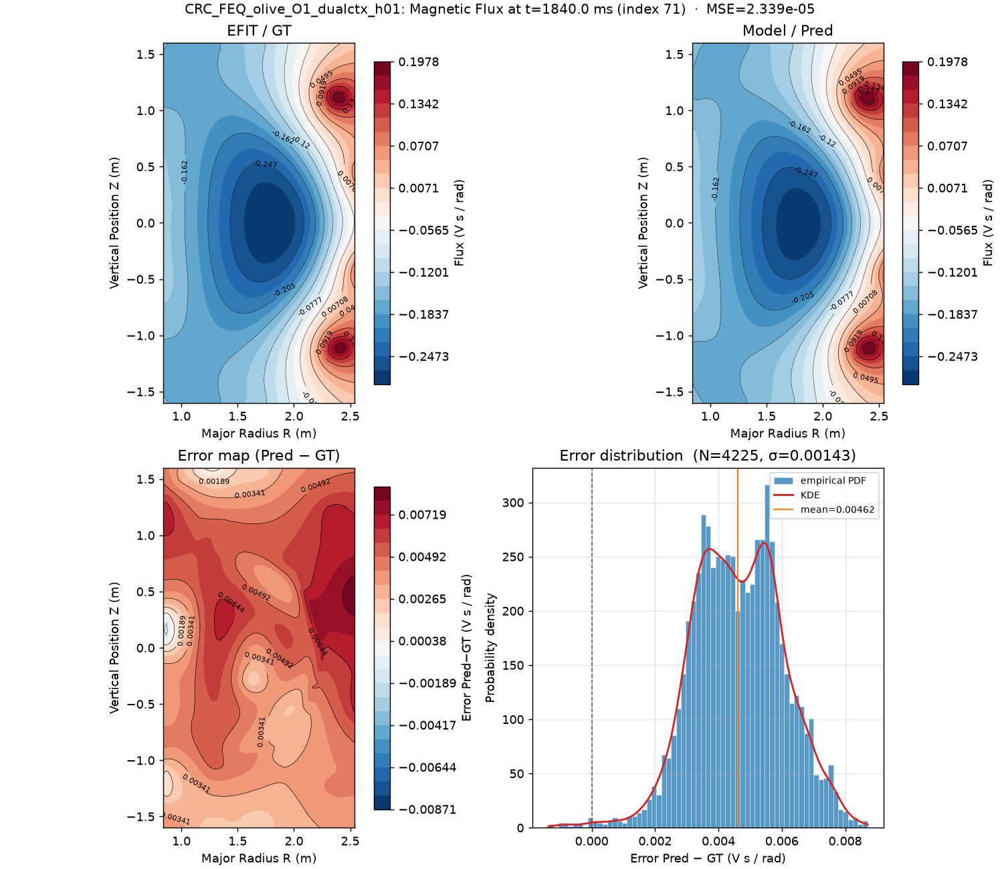

**Flux map at our worst time (2×2: GT, Pred, error map, error distribution).**

Same layout as the mid-shot figure, but at the EFIT time where our pixel MSE is largest. Shows *when* we fail hardest — often near start/end of the pulse or when the shape is changing quickly. The bottom-right distribution shows whether that worst frame’s errors are still centered near zero or skewed.

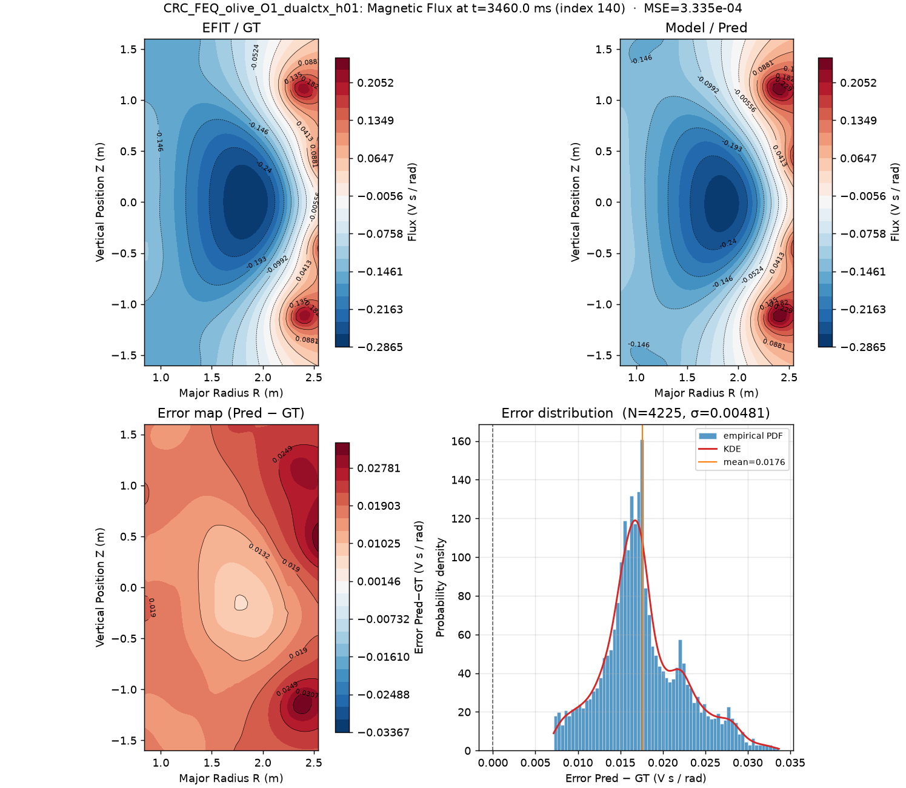

### Predicted q95

Edge safety factor $q_{95}$ over time (GT / Pred / Diff). How twisty the magnetic field is near the plasma edge — a stability-related “safety factor” on the ~95% flux surface. Blue = EFIT truth, orange = our prediction, red = difference. Unlike $\ell_i$ or the axis position, this is **not** derived from our $\psi$ by the scorer — we predict it directly and hand it in.

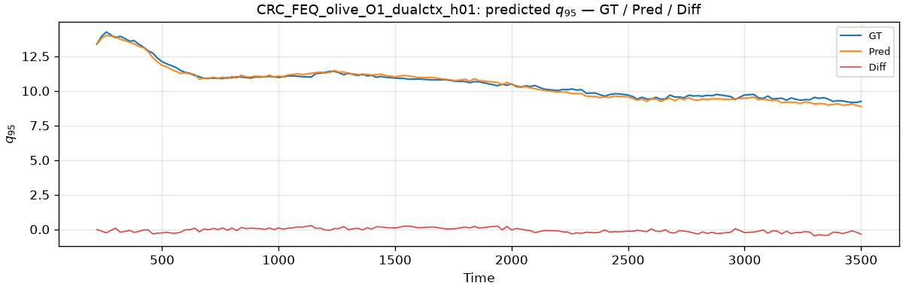

### Predicted betaN

Normalized beta $\beta_N$ over time (GT / Pred / Diff). Plasma pressure relative to the magnetic field strength (normalized). Blue = EFIT truth, orange = our prediction, red = difference. We predict this scalar directly and hand it in with the flux map.

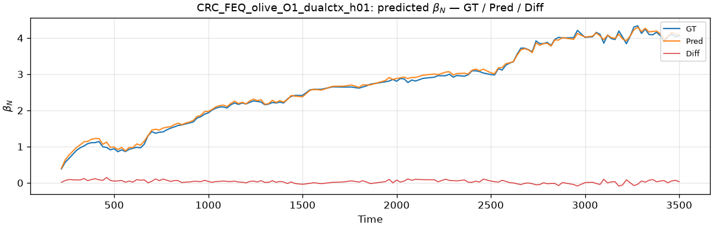

## Figure pack - CRC_FEQ_olive_O1_dualctx_h02 - Shot 02

### Inputs (used at inference / context — not predicted; one panel each)

**Coil currents (inputs).** $I_p(t)$ = plasma current; ECOILA = ohmic solenoid. Part of the non-magnetic drive we use. Not predicted.

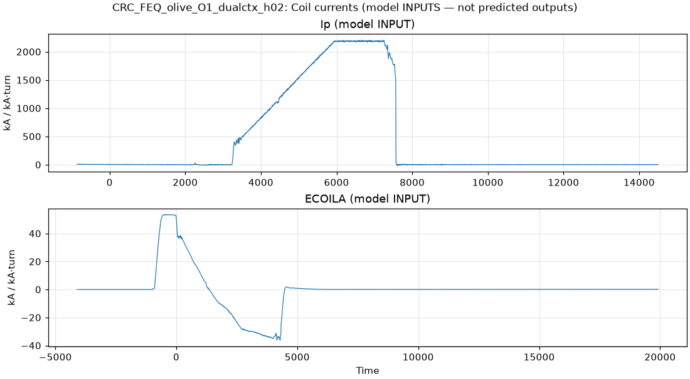

**Thomson core $T_e$ (input).** Electron temperature vs channel × time from the core laser system. Kinetic profile we feed in — not a model output.

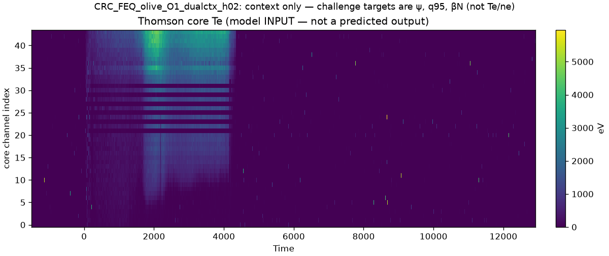

**Thomson edge/tangential $T_e$ (input).** Edge-view electron temperature profile. Kinetic input we feed in — not a model output.

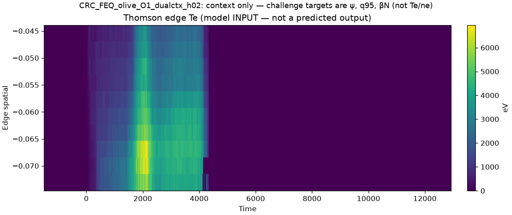

**dsep / X-point gap (EFIT context).** Signed gap (m): $>0$ diverted, $<0$ limited. Label for intuition; we neither submit nor predict this.

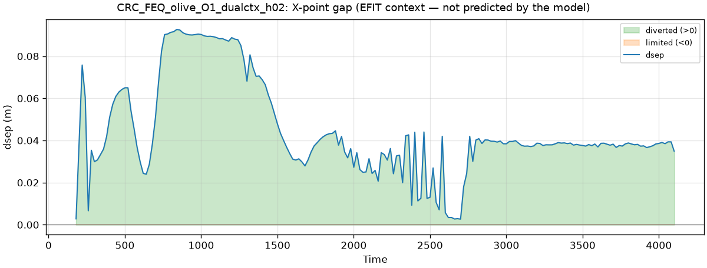

**EFIT geometric context ($\ell_i$, $R_{\mathrm{axis}}$, $Z_{\mathrm{axis}}$).** Present on train labels; Consistency re-derives these from $\psi$. We do not submit or train heads for them here — one trace each, no Pred/Diff.

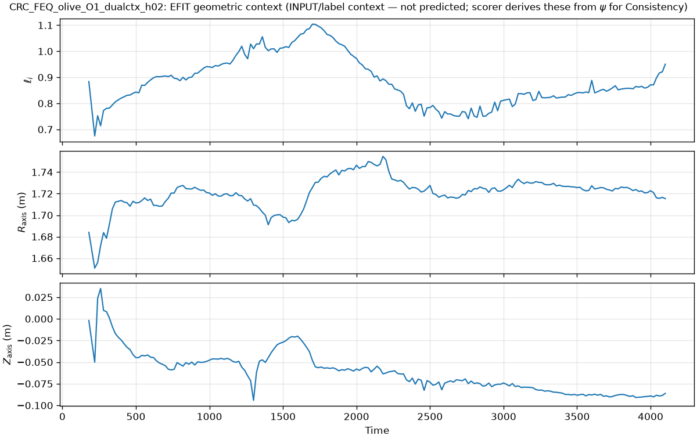

### Outputs (model predictions — GT | Pred | Diff)

**Flux map at mid-shot (2×2: GT, Pred, error map, error distribution).**

This is a vertical slice through the tokamak donut: left–right is distance from the machine centerline (major radius $R$), up–down is height ($Z$). Colors and contour lines show **poloidal magnetic flux** $\psi$ — think of it as a topographic map of the magnetic “terrain” that cages the plasma. Nested closed loops are nested magnetic surfaces; the outer closed loop is roughly the plasma edge.

**Top-left:** EFIT truth. **Top-right:** our prediction. **Bottom-left:** spatial error map (Pred − GT) — where on the cross-section we miss. **Bottom-right:** empirical probability density of *all* error pixels (histogram + KDE): is the error a tight blob around zero (good) or fat-tailed / biased (systematic miss)? Mid-shot = a typical time halfway through the pulse.

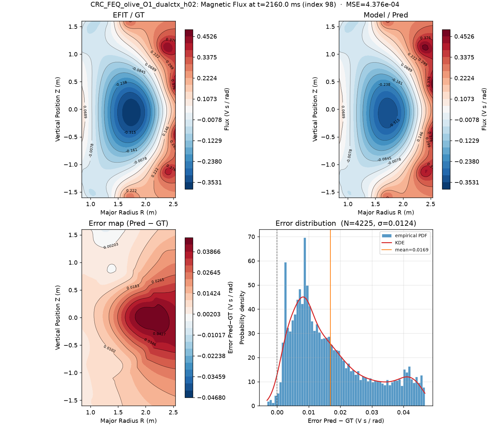

**Flux map at our worst time (2×2: GT, Pred, error map, error distribution).**

Same layout as the mid-shot figure, but at the EFIT time where our pixel MSE is largest. Shows *when* we fail hardest — often near start/end of the pulse or when the shape is changing quickly. The bottom-right distribution shows whether that worst frame’s errors are still centered near zero or skewed.

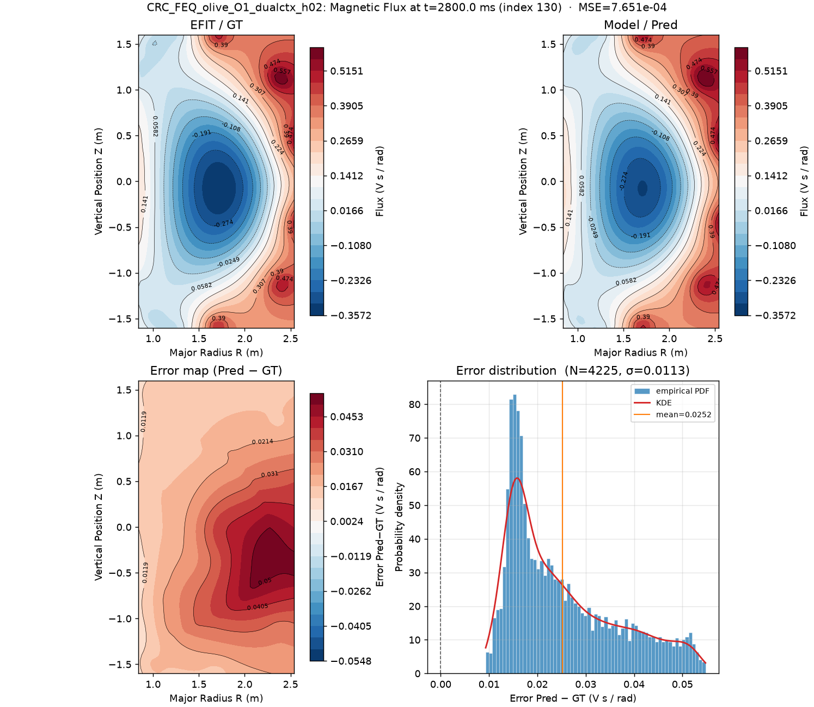

### Predicted q95

Edge safety factor $q_{95}$ over time (GT / Pred / Diff). How twisty the magnetic field is near the plasma edge — a stability-related “safety factor” on the ~95% flux surface. Blue = EFIT truth, orange = our prediction, red = difference. Unlike $\ell_i$ or the axis position, this is **not** derived from our $\psi$ by the scorer — we predict it directly and hand it in.

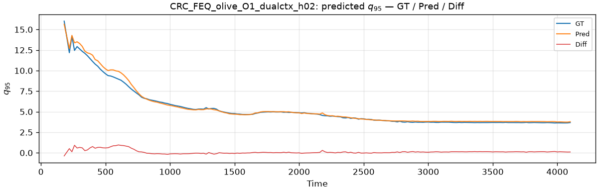

### Predicted betaN

Normalized beta $\beta_N$ over time (GT / Pred / Diff). Plasma pressure relative to the magnetic field strength (normalized). Blue = EFIT truth, orange = our prediction, red = difference. We predict this scalar directly and hand it in with the flux map.

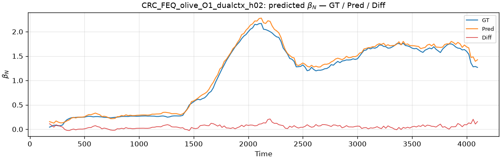

## Notes

- Authoritative train-era model narrative: [`catskills/MODEL_DESCRIPTION_CRC_FEQ_olive.md`](../../catskills/MODEL_DESCRIPTION_CRC_FEQ_olive.md) (status line there still says campaign CLOSED; this REPORT is the checkpoint-centric update).
- Authoritative afterlife / mixes: [`catskills/COLOR_LEDGER.md`](../../catskills/COLOR_LEDGER.md) §30.10–§30.11.
- Organizer rebuild pointer: [`ORGANIZER_REPLY_REBUILD.md`](../../ORGANIZER_REPLY_REBUILD.md).
- Figure pack: `weights/phase3/figures/shot_{00,01,02}/` (first 3 holdout shots, seed 42 / 6961+80 split). Regenerated 2026-11-03.
- No `direct_submission.zip` for this weight (parent checkpoint, not a Codabench attempt).
